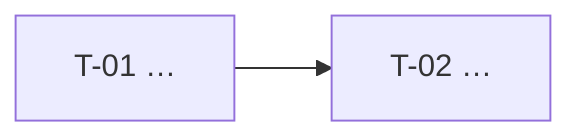

# <NN> · <Titre> — Tâches

> Échelle de points, statuts et définition de terminé commune : `roadmap/README.md`. Points <prévus | estimés a posteriori>.

## Synthèse

| Tâche | Titre | US | Couche | Priorité | Points | Dépend de | Commits |
| --- | --- | --- | --- | --- | --- | --- | --- |
| T-01 | … | US-01 | contracts | MUST | 2 | — | <rétro/clôture : `abc1234`> |

**Total** : <n> points — MUST <n>, SHOULD <n>.

| Lot | Tâches | Points |
| --- | --- | --- |
| 1. <nom> | T-01 → T-0n | <n> |

**Chemin critique** (<n> points) : T-01 → … <Planification seulement : la tâche la plus risquée du chemin, à commencer tôt.>

**Parallélisable** : <tâches sans dépendance commune.>

## Graphe des dépendances

<Planification : obligatoire. Rétro : si plus de 6 tâches.>

---

## Lot <n> — <nom>

### T-01 · <Titre>

- **US** : US-01 · **Priorité** : MUST · **Points** : 2 · **Dépend de** : — · **Commits** : <rétro/clôture>
- **Fichiers** : `<chemins>`

Critères d’acceptation :
- [ ] <Condition vérifiable ; en rétro, ce qui a réellement été livré, coché.>
