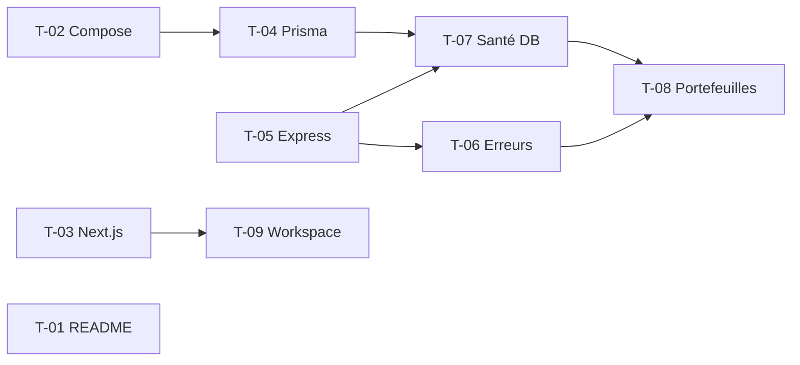

# 01 · Socle technique — Tâches

> Échelle de points, statuts et définition de terminé commune : [`roadmap/README.md`](../README.md). Points estimés a posteriori.

## Synthèse

| Tâche | Titre | US | Couche | Priorité | Points | Dépend de | Commits |
| --- | --- | --- | --- | --- | --- | --- | --- |
| T-01 | README : vision et Portfolio Lab | US-01 | README | MUST | 2 | — | `4e2934b`, `a470a50` |
| T-02 | Infrastructure Docker Compose | US-02 | infra | MUST | 3 | — | `525a325` |
| T-03 | Initialisation de Next.js | US-06 | web | MUST | 1 | — | `d381fcb` |
| T-04 | Prisma et schéma initial | US-04 | core-backend | MUST | 2 | T-02 | `2a736ba` |
| T-05 | Serveur Express et CORS | US-03 | core-backend | MUST | 1 | — | `117650d` |
| T-06 | Erreurs, middleware et builder de routes | US-03 | core-backend | MUST | 3 | T-05 | `71262d3`, `91b6ada` |
| T-07 | Adaptateur PostgreSQL et contrôle de santé | US-04 | core-backend | MUST | 2 | T-04, T-05 | `43eded8` |
| T-08 | CRUD des portefeuilles | US-05 | core-backend | SHOULD | 3 | T-06, T-07 | `f755727` |
| T-09 | Workspace Bun racine | US-06 | racine | MUST | 1 | T-03 | `85ea872` |

**Total** : 18 points — MUST 15, SHOULD 3.

| Lot | Tâches | Points |
| --- | --- | --- |
| 1. Cadrage et infrastructure | T-01, T-02 | 5 |
| 2. API et base | T-04 → T-08 | 11 |
| 3. Applications | T-03, T-09 | 2 |

## Graphe des dépendances

---

## Lot 1 — Cadrage et infrastructure

### T-01 · README : vision et Portfolio Lab

- **US** : US-01 · **Priorité** : MUST · **Points** : 2 · **Dépend de** : — · **Commits** : `4e2934b`, `a470a50`
- **Fichiers** : `README.md`

Critères d’acceptation :
- [x] Vision, périmètre, stack, services, événements Kafka, roadmap annuelle.
- [x] Section « Portfolio Management Lab » (+317 lignes).

### T-02 · Infrastructure Docker Compose

- **US** : US-02 · **Priorité** : MUST · **Points** : 3 · **Dépend de** : — · **Commits** : `525a325`
- **Fichiers** : `docker-compose.yml`

Critères d’acceptation :
- [x] Services `kafka`, `trading-postgres`, `conduktor`, `conduktor-postgres`.

## Lot 2 — API et base

### T-04 · Prisma et schéma initial

- **US** : US-04 · **Priorité** : MUST · **Points** : 2 · **Dépend de** : T-02 · **Commits** : `2a736ba`
- **Fichiers** : `apps/core-backend/prisma/schema.prisma`, `prisma.config.ts`, `prisma/migrations/20261006114259_init/`

Critères d’acceptation :
- [x] Modèles `User`, `Portfolio`, `Account` et migration initiale.

### T-05 · Serveur Express et CORS

- **US** : US-03 · **Priorité** : MUST · **Points** : 1 · **Dépend de** : — · **Commits** : `117650d`
- **Fichiers** : `apps/core-backend/index.ts`

Critères d’acceptation :
- [x] Express 5 écoute sur le port de l’API, CORS activé.

### T-06 · Erreurs, middleware et builder de routes

- **US** : US-03 · **Priorité** : MUST · **Points** : 3 · **Dépend de** : T-05 · **Commits** : `71262d3`, `91b6ada`
- **Fichiers** : `models/error.model.ts`, `errors/*.error.ts`, `middleware/error.middleware.ts`, `builder/route.ts`, `models/route.model.ts`, `utils/logger.ts`

Critères d’acceptation :
- [x] `AppError` et une sous-classe par statut (400, 401, 403, 404, 500).
- [x] Seul `error.middleware` formate la réponse d’erreur.
- [x] Descripteurs de routes enregistrés par le builder.

### T-07 · Adaptateur PostgreSQL et contrôle de santé

- **US** : US-04 · **Priorité** : MUST · **Points** : 2 · **Dépend de** : T-04, T-05 · **Commits** : `43eded8`
- **Fichiers** : `apps/core-backend/prisma.ts`, `utils/db.ts`

Critères d’acceptation :
- [x] Client Prisma unique avec l’adaptateur PostgreSQL.
- [x] Connexion vérifiée au démarrage.

### T-08 · CRUD des portefeuilles

- **US** : US-05 · **Priorité** : SHOULD · **Points** : 3 · **Dépend de** : T-06, T-07 · **Commits** : `f755727`
- **Fichiers** : `routes/portfolio/`, `controller/portfolio.controller.ts`, `services/portfolio.service.ts`, `repositories/portfolio.repository.ts`, `interfaces/portfolio.interface.ts`, `utils/handler.ts`

Critères d’acceptation :
- [x] Création, lecture, mise à jour, suppression d’un portefeuille.
- [x] Erreurs asynchrones propagées au middleware.

## Lot 3 — Applications

### T-03 · Initialisation de Next.js

- **US** : US-06 · **Priorité** : MUST · **Points** : 1 · **Dépend de** : — · **Commits** : `d381fcb`
- **Fichiers** : `apps/web/`

Critères d’acceptation :
- [x] Next.js (App Router), Tailwind, ESLint.

### T-09 · Workspace Bun racine

- **US** : US-06 · **Priorité** : MUST · **Points** : 1 · **Dépend de** : T-03 · **Commits** : `85ea872`
- **Fichiers** : `package.json`, `.gitignore`

Critères d’acceptation :
- [x] `package.json` racine : `bun run dev` lance l’API et le web avec `concurrently`.
- [x] `node_modules` ignorés.
