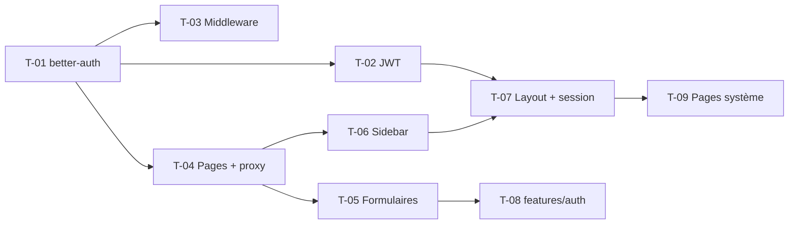

# 02 · Authentification et layout — Tâches

> Échelle de points, statuts et définition de terminé commune : [`roadmap/README.md`](../README.md). Points estimés a posteriori.

## Synthèse

| Tâche | Titre | US | Couche | Priorité | Points | Dépend de | Commits |
| --- | --- | --- | --- | --- | --- | --- | --- |
| T-01 | better-auth et tables d’auth | US-01 | core-backend | MUST | 5 | — | `1ec0cb2` |
| T-02 | Sessions JWT et JWKS | US-01 | core-backend | MUST | 2 | T-01 | `b8c6606` |
| T-03 | Middleware d’auth et `req.userId` | US-02 | core-backend | MUST | 2 | T-01 | `63fb198` |
| T-04 | Pages de connexion et proxy Next | US-01, US-02 | web | MUST | 3 | T-01 | `ec7de4e`, `9cb663b` |
| T-05 | Formulaires react-hook-form et inscription | US-01 | web | MUST | 3 | T-04 | `5d7f297`, `1cf3467`, `8849741`, `918d715`, `65c4159`, `5fab84d`, `0d8a954` |
| T-06 | Sidebar et navigation par onglets | US-03 | web | MUST | 5 | T-04 | `3322557`, `08ae138`, `cae1e04`, `dbe29f3` |
| T-07 | Layout, en-tête et session serveur | US-02, US-03 | web | MUST | 3 | T-02, T-06 | `ecace5d`, `31599bf`, `5925b0b`, `e8c57e8` |
| T-08 | Réécriture en `features/auth` | US-01 | web | MUST | 3 | T-05 | `09454d3`, `1de4101` |
| T-09 | Pages 404, paramètres et accueil | US-04 | web | SHOULD | 2 | T-07 | `1c3544b`, `336b764` |

**Total** : 28 points — MUST 26, SHOULD 2.

| Lot | Tâches | Points |
| --- | --- | --- |
| 1. Authentification | T-01 → T-05, T-08 | 18 |
| 2. Navigation | T-06, T-07, T-09 | 10 |

## Graphe des dépendances

---

## Lot 1 — Authentification

### T-01 · better-auth et tables d’auth

- **US** : US-01 · **Priorité** : MUST · **Points** : 5 · **Dépend de** : — · **Commits** : `1ec0cb2`
- **Fichiers** : `apps/core-backend/auth.ts` (puis `lib/auth.ts`), `controller/auth.controller.ts`, `routes/auth/`, `prisma/schema.prisma`, migrations `add_auth`

Critères d’acceptation :
- [x] better-auth avec l’adaptateur Prisma, e-mail et mot de passe.
- [x] Tables `Session`, `Account`, `Verification` migrées ; `User` aligné sur better-auth.
- [x] Handler better-auth monté sous `/api/auth`.

### T-02 · Sessions JWT et JWKS

- **US** : US-01 · **Priorité** : MUST · **Points** : 2 · **Dépend de** : T-01 · **Commits** : `b8c6606`
- **Fichiers** : `lib/auth.ts`, migration `jwt_session`

Critères d’acceptation :
- [x] Plugin `jwt` et modèle `Jwks` ; configuration déplacée dans `lib/`.

### T-03 · Middleware d’auth et `req.userId`

- **US** : US-02 · **Priorité** : MUST · **Points** : 2 · **Dépend de** : T-01 · **Commits** : `63fb198`
- **Fichiers** : `middleware/auth.middleware.ts`, `types/express.d.ts`

Critères d’acceptation :
- [x] Requête sans session ⇒ `UnauthorizedError`.
- [x] `req.userId` typé et disponible dans les controllers.

### T-04 · Pages de connexion et proxy Next

- **US** : US-01, US-02 · **Priorité** : MUST · **Points** : 3 · **Dépend de** : T-01 · **Commits** : `ec7de4e`, `9cb663b`
- **Fichiers** : `apps/web/proxy.ts`, `src/app/login/page.tsx`, `src/app/dashboard/page.tsx`, `src/lib/auth.ts`

Critères d’acceptation :
- [x] Client better-auth côté web.
- [x] `proxy.ts` redirige selon le cookie de session.

### T-05 · Formulaires react-hook-form et inscription

- **US** : US-01 · **Priorité** : MUST · **Points** : 3 · **Dépend de** : T-04 · **Commits** : `5d7f297`, `1cf3467`, `8849741`, `918d715`, `65c4159`, `5fab84d`, `0d8a954`
- **Fichiers** : `src/app/login/page.tsx`, `src/app/register/page.tsx`, `src/components/Form.tsx`

Critères d’acceptation :
- [x] Connexion avec gestion d’erreur et lien vers l’inscription.
- [x] Page d’inscription ; redirection vers `/app` après succès.
- [x] Focus visible accessible sur les libellés.

### T-08 · Réécriture en `features/auth`

- **US** : US-01 · **Priorité** : MUST · **Points** : 3 · **Dépend de** : T-05 · **Commits** : `09454d3`, `1de4101`
- **Fichiers** : `src/features/auth/{api,hook,schema}.ts`, `login-form.tsx`, `register-form.tsx`, `COMPONENTS.md`, `apps/core-backend/API.md`

Critères d’acceptation :
- [x] Formulaires construits sur les champs partagés (`components/form`).
- [x] Ancien composant de formulaire retiré ; catalogues à jour.

## Lot 2 — Navigation

### T-06 · Sidebar et navigation par onglets

- **US** : US-03 · **Priorité** : MUST · **Points** : 5 · **Dépend de** : T-04 · **Commits** : `3322557`, `08ae138`, `cae1e04`, `dbe29f3`
- **Fichiers** : `components/ui/*`, `components/app-sidebar.tsx`, `components/SidebarNav.tsx`, `components/nav-user.tsx`, `constants/sidebar.tsx`, `lib/path.ts`

Critères d’acceptation :
- [x] Composants shadcn : sidebar, dropdown, sheet, collapsible, skeleton, tooltip, avatar, breadcrumb.
- [x] Onglets de navigation décrits dans `constants/sidebar.tsx` ; chemins centralisés dans `lib/path.ts`.
- [x] Écran connecté déplacé de `/dashboard` vers `/app`.

### T-07 · Layout, en-tête et session serveur

- **US** : US-02, US-03 · **Priorité** : MUST · **Points** : 3 · **Dépend de** : T-02, T-06 · **Commits** : `ecace5d`, `31599bf`, `5925b0b`, `e8c57e8`
- **Fichiers** : `src/app/app/layout.tsx`, `components/Header.tsx`, `components/PageLayout.tsx`, `lib/session.ts`, groupes `(auth)` et `(base)`

Critères d’acceptation :
- [x] `SidebarInset` + `Header` dans le layout `/app`.
- [x] Session lue côté serveur et passée à la sidebar (nom, e-mail).

### T-09 · Pages 404, paramètres et accueil

- **US** : US-04 · **Priorité** : SHOULD · **Points** : 2 · **Dépend de** : T-07 · **Commits** : `1c3544b`, `336b764`
- **Fichiers** : `src/app/not-found.tsx`, `src/app/app/settings/page.tsx`, `src/app/(base)/page.tsx`

Critères d’acceptation :
- [x] 404 avec navigation de retour.
- [x] Squelette de la page Paramètres ; page d’accueil présentant les fonctionnalités.
