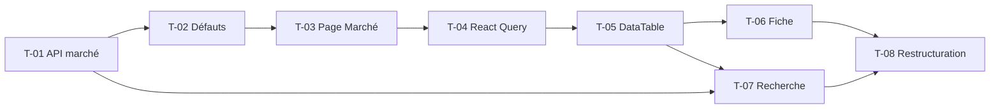

# 03 · Marché — Tâches

> Échelle de points, statuts et définition de terminé commune : [`roadmap/README.md`](../README.md). Points estimés a posteriori.

## Synthèse

| Tâche | Titre | US | Couche | Priorité | Points | Dépend de | Commits |
| --- | --- | --- | --- | --- | --- | --- | --- |
| T-01 | API marché (yahoo-finance2) | US-01, US-02 | core-backend | MUST | 3 | — | `9bda25e` |
| T-02 | Actifs par défaut et journalisation | US-01 | core-backend | MUST | 2 | T-01 | `d8caf98`, `c7656b3` |
| T-03 | Page Marché : tableau et sparklines | US-01 | web | MUST | 3 | T-02 | `643a05a`, `1059be2` |
| T-04 | React Query et client API | US-01 | web | MUST | 2 | T-03 | `3294e86` |
| T-05 | `DataTable` générique et `features/market` | US-01 | web | MUST | 3 | T-04 | `9f2e3e2`, `d00e679` |
| T-06 | Fiche symbole et graphique de prix | US-03 | web | MUST | 5 | T-05 | `e6a0873`, `a345ba9`, `93a6b77`, `c4651f9` |
| T-07 | Recherche de symboles | US-02 | web | MUST | 3 | T-01, T-05 | `aaee3fa`, `05ba8b4` |
| T-08 | Restructuration de la feature | US-03 | web | MUST | 2 | T-06, T-07 | `09454d3` |

**Total** : 23 points — MUST 23, SHOULD 0.

| Lot | Tâches | Points |
| --- | --- | --- |
| 1. Données | T-01 → T-05, T-07 | 16 |
| 2. Fiche | T-06, T-08 | 7 |

## Graphe des dépendances

---

## Lot 1 — Données

### T-01 · API marché (yahoo-finance2)

- **US** : US-01, US-02 · **Priorité** : MUST · **Points** : 3 · **Dépend de** : — · **Commits** : `9bda25e`
- **Fichiers** : `apps/core-backend/routes/market/`, `controller/market.controller.ts`, `services/market.service.ts`, `repositories/market.repository.ts`, `interfaces/market.interface.ts`, `env.ts`

Critères d’acceptation :
- [x] Routes de recherche et de détail d’un symbole, protégées par l’auth.
- [x] Variables d’environnement validées par zod (`env.ts`).

### T-02 · Actifs par défaut et journalisation

- **US** : US-01 · **Priorité** : MUST · **Points** : 2 · **Dépend de** : T-01 · **Commits** : `d8caf98`, `c7656b3`
- **Fichiers** : `constants/market.constants.ts`, `repositories/market.repository.ts`, `controller/market.controller.ts`

Critères d’acceptation :
- [x] Liste d’actifs par défaut en constante, avec cours et historique court pour la sparkline.
- [x] Requêtes journalisées.

### T-03 · Page Marché : tableau et sparklines

- **US** : US-01 · **Priorité** : MUST · **Points** : 3 · **Dépend de** : T-02 · **Commits** : `643a05a`, `1059be2`
- **Fichiers** : `src/app/app/market/page.tsx`, `components/sparkline.tsx`, `components/ui/{chart,table,tabs}.tsx`

Critères d’acceptation :
- [x] Tableau d’actifs avec sparkline par ligne, onglets.

### T-04 · React Query et client API

- **US** : US-01 · **Priorité** : MUST · **Points** : 2 · **Dépend de** : T-03 · **Commits** : `3294e86`
- **Fichiers** : `src/lib/api.ts`, `src/provider/query.tsx`, `src/app/layout.tsx`

Critères d’acceptation :
- [x] `QueryProvider` à la racine ; client API avec cookies de session.

### T-05 · `DataTable` générique et `features/market`

- **US** : US-01 · **Priorité** : MUST · **Points** : 3 · **Dépend de** : T-04 · **Commits** : `9f2e3e2`, `d00e679`
- **Fichiers** : `components/data-table/`, `features/market/{api,hook,column,types}.ts`, `lib/format.ts`

Critères d’acceptation :
- [x] `DataTable` réutilisable avec colonnes typées et `onRowClick`.
- [x] Formatage des prix et variations dans `lib/format.ts`.

### T-07 · Recherche de symboles

- **US** : US-02 · **Priorité** : MUST · **Points** : 3 · **Dépend de** : T-01, T-05 · **Commits** : `aaee3fa`, `05ba8b4`
- **Fichiers** : `components/symbol-search.tsx`, `components/ui/{command,dialog,input-group,badge}.tsx`, `features/market/`

Critères d’acceptation :
- [x] Dialog de recherche avec résultats de l’API, navigation vers la fiche.
- [x] Curseur pointeur sur les boutons.

## Lot 2 — Fiche

### T-06 · Fiche symbole et graphique de prix

- **US** : US-03 · **Priorité** : MUST · **Points** : 5 · **Dépend de** : T-05 · **Commits** : `e6a0873`, `a345ba9`, `93a6b77`, `c4651f9`
- **Fichiers** : `src/app/app/market/[symbol]/page.tsx`, `components/page-layout/`, `components/chart.tsx`, `components/app-sheet/`, `components/Header.tsx`

Critères d’acceptation :
- [x] Page symbole avec `PageHeader` et fil d’Ariane.
- [x] Graphique de prix historique.
- [x] `AppSheet` réutilisable.

### T-08 · Restructuration de la feature

- **US** : US-03 · **Priorité** : MUST · **Points** : 2 · **Dépend de** : T-06, T-07 · **Commits** : `09454d3`
- **Fichiers** : `features/market/{market-list,price-chart,symbol-detail,symbol-search,symbol-sheet}.tsx`, `features/market/constants.ts`

Critères d’acceptation :
- [x] Pages réduites à la composition ; composants dans la feature.
