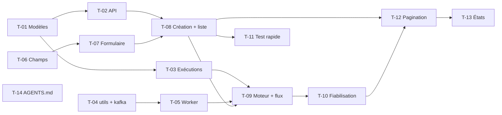

# 05 · Strategy Lab MVP — Tâches

> Échelle de points, statuts et définition de terminé commune : [`roadmap/README.md`](../README.md). Points estimés a posteriori.

## Synthèse

| Tâche | Titre | US | Couche | Priorité | Points | Dépend de | Commits |
| --- | --- | --- | --- | --- | --- | --- | --- |
| T-01 | Modèles `Backtest` et `BacktestResult` | US-01 | core-backend | MUST | 3 | — | `30a42a7` |
| T-02 | API backtest en couches | US-01 | core-backend | MUST | 3 | T-01 | `b52df88` |
| T-03 | Historique d’exécutions | US-02, US-04 | core-backend | MUST | 3 | T-01 | `9a14a01` |
| T-04 | Packages `utils` et `kafka` | US-02 | packages | MUST | 3 | — | `f584a4e`, `b9cfc63` |
| T-05 | Worker `backtest-engine` et intégration Kafka | US-02 | engine | MUST | 3 | T-04 | `abcbb28`, `ae83d37` |
| T-06 | Champs de formulaire partagés | US-01 | web | MUST | 3 | — | `109e9a9`, `c87e8db`, `96987e0` |
| T-07 | Formulaire « Nouveau backtest » et `SymbolsField` | US-01 | web | MUST | 5 | T-06 | `efc5c7c`, `e9a5325`, `fc75b4b`, `3037a67`, `e50b86a`, `60c3b39`, `5f0347a` |
| T-08 | Création, liste et statistiques | US-01, US-05 | core-backend, web | MUST | 5 | T-02, T-07 | `be2329a`, `69f2c27`, `1ab13cc` |
| T-09 | Moteur, contrats, consumers et transitions gardées | US-02, US-03 | contracts, engine, core-backend, web | MUST | 8 | T-03, T-05, T-08 | `aa9ca3d` |
| T-10 | Fiabilisation : total investi, tentative unique, conflit | US-03, US-04 | engine, core-backend, web | MUST | 3 | T-09 | `2331505` |
| T-11 | Test rapide depuis la fiche symbole | US-06 | web | SHOULD | 2 | T-08 | `3b8c385` |
| T-12 | Pagination et `latestExecution` | US-05 | contracts, core-backend, web | MUST | 5 | T-08, T-10 | `540900e` |
| T-13 | États de chargement et d’erreur | US-05 | web | MUST | 1 | T-12 | `bbaf67d` |
| T-14 | Conventions `AGENTS.md` | US-07 | docs | SHOULD | 3 | — | `a0e982d`, `21d16b3` |

**Total** : 50 points — MUST 45, SHOULD 5.

| Lot | Tâches | Points |
| --- | --- | --- |
| 1. Configuration | T-01, T-02, T-06, T-07, T-11 | 16 |
| 2. Exécution asynchrone | T-03, T-04, T-05, T-09, T-10 | 20 |
| 3. Liste | T-08, T-12, T-13, T-14 | 14 |

## Graphe des dépendances

---

## Lot 1 — Configuration

### T-01 · Modèles `Backtest` et `BacktestResult`

- **US** : US-01 · **Priorité** : MUST · **Points** : 3 · **Dépend de** : — · **Commits** : `30a42a7`
- **Fichiers** : `apps/core-backend/prisma/schema.prisma`, migration `add_backtest_table`

Critères d’acceptation :
- [x] Modèles `Backtest`, `BacktestAsset` (poids par actif, retiré ensuite par T-03), `BacktestResult`, enums de statut.

### T-02 · API backtest en couches

- **US** : US-01 · **Priorité** : MUST · **Points** : 3 · **Dépend de** : T-01 · **Commits** : `b52df88`
- **Fichiers** : `routes/backtest/`, `controller/backtest.controller.ts`, `services/backtest.service.ts`, `repositories/backtest.repository.ts`, `interfaces/backtest.interface.ts`

Critères d’acceptation :
- [x] Routes protégées par l’auth, en couches routes → controller → service → repository.

### T-06 · Champs de formulaire partagés

- **US** : US-01 · **Priorité** : MUST · **Points** : 3 · **Dépend de** : — · **Commits** : `109e9a9`, `c87e8db`, `96987e0`
- **Fichiers** : `apps/web/src/components/form/`, `components/ui/{calendar,checkbox,popover,switch}.tsx`

Critères d’acceptation :
- [x] `TextField`, `NumberField`, `SelectField` (valeur `null` gérée), `DateField`, `CheckboxField`, `SwitchField` sur react-hook-form.

### T-07 · Formulaire « Nouveau backtest » et `SymbolsField`

- **US** : US-01 · **Priorité** : MUST · **Points** : 5 · **Dépend de** : T-06 · **Commits** : `efc5c7c`, `e9a5325`, `fc75b4b`, `3037a67`, `e50b86a`, `60c3b39`, `5f0347a`
- **Fichiers** : `src/app/app/backtest/new/page.tsx`, `features/backtest/{new-backtest-form,sections,schema}.tsx`, `components/form/symbols-field.tsx`, `components/symbol-picker.tsx`

Critères d’acceptation :
- [x] Sections Général et Marché ; stratégies DCA / investissement unique.
- [x] Sélection multiple de symboles avec badges.
- [x] Champs des moyennes mobiles (stratégie abandonnée) retirés.

### T-11 · Test rapide depuis la fiche symbole

- **US** : US-06 · **Priorité** : SHOULD · **Points** : 2 · **Dépend de** : T-08 · **Commits** : `3b8c385`
- **Fichiers** : `features/backtest/quick-backtest-form.tsx`, `features/market/symbol-sheet.tsx`

Critères d’acceptation :
- [x] Formulaire réduit dans le panneau de la fiche, symbole prérempli.

## Lot 2 — Exécution asynchrone

### T-03 · Historique d’exécutions

- **US** : US-02, US-04 · **Priorité** : MUST · **Points** : 3 · **Dépend de** : T-01 · **Commits** : `9a14a01`
- **Fichiers** : `prisma/schema.prisma`, migrations `add_backtest_execution_history`

Critères d’acceptation :
- [x] `BacktestExecution` (statut, tentative, dates, erreur) séparé de la configuration ; résultat rattaché à l’exécution.
- [x] Plan d’implémentation écrit (`docs/superpowers/plans/2026-10-25-backtest-mvp.md`).

### T-04 · Packages `utils` et `kafka`

- **US** : US-02 · **Priorité** : MUST · **Points** : 3 · **Dépend de** : — · **Commits** : `f584a4e`, `b9cfc63`
- **Fichiers** : `packages/utils/`, `packages/kafka/`

Critères d’acceptation :
- [x] `Logger` partagé, utilisé par `core-backend`.
- [x] `KafkaClient`, `KafkaProducer`, `KafkaConsumer`, configuration validée par zod.

### T-05 · Worker `backtest-engine` et intégration Kafka

- **US** : US-02 · **Priorité** : MUST · **Points** : 3 · **Dépend de** : T-04 · **Commits** : `abcbb28`, `ae83d37`
- **Fichiers** : `apps/backtest-engine/` (ex-`apps/matching-engine`), `package.json` racine (workspaces), `packages/kafka/src/kafka.types.ts`

Critères d’acceptation :
- [x] Worker Bun sans HTTP ni base, abonné à `backtest.requested`.
- [x] Workspaces `apps/*` et `packages/*`.

### T-09 · Moteur, contrats, consumers et transitions gardées

- **US** : US-02, US-03 · **Priorité** : MUST · **Points** : 8 · **Dépend de** : T-03, T-05, T-08 · **Commits** : `aa9ca3d`
- **Fichiers** : `packages/contracts/src/{backtest,event}.ts`, `apps/backtest-engine/{engine,consumers,publishers,services,repositories}/`, `apps/core-backend/consumers/backtest.consumer.ts`, `features/backtest/{backtest-detail,equity-chart,execution-history}.tsx`

Critères d’acceptation :
- [x] Enveloppe `KafkaEvent<T>` et schémas des quatre événements.
- [x] `runBacktest` pur : équipondéré, versements planifiés, achat à la clôture, frais, cours reporté ; tests unitaires.
- [x] Clôtures journalières lues chez Yahoo par le repository de l’engine.
- [x] Consumer `core-backend` : transitions gardées, résultat écrit dans la même transaction que `COMPLETED`.
- [x] Détail web : courbe de valeur, transactions, historique d’exécutions.

### T-10 · Fiabilisation : total investi, tentative unique, conflit

- **US** : US-03, US-04 · **Priorité** : MUST · **Points** : 3 · **Dépend de** : T-09 · **Commits** : `2331505`
- **Fichiers** : `constants/backtest.constants.ts`, `errors/conflict.error.ts`, migration `add_backtest_invested_unique_attempt`, `repositories/`, `features/backtest/`

Critères d’acceptation :
- [x] `totalInvested` stocké ; index unique `(backtestId, attempt)`.
- [x] `ACTIVE_STATUSES` en constante ; relance pendant une exécution active ⇒ `ConflictError`.
- [x] Lecture légère (`getById`) pour décider, complète (`getDetailsById`) pour répondre.

## Lot 3 — Liste

### T-08 · Création, liste et statistiques

- **US** : US-01, US-05 · **Priorité** : MUST · **Points** : 5 · **Dépend de** : T-02, T-07 · **Commits** : `be2329a`, `69f2c27`, `1ab13cc`
- **Fichiers** : `interfaces/backtest.interface.ts`, migration `add_backtest_feature`, `features/backtest/{backtest-list,column,constants,stats}.tsx`, `components/{filter-tabs,stat-card}.tsx`, `components/custom/Dash.tsx`

Critères d’acceptation :
- [x] Création validée par zod ; `Backtest.symbols` en tableau.
- [x] Liste avec cartes de stats, filtres par statut, `<Dash />` pour une valeur absente.

### T-12 · Pagination et `latestExecution`

- **US** : US-05 · **Priorité** : MUST · **Points** : 5 · **Dépend de** : T-08, T-10 · **Commits** : `540900e`
- **Fichiers** : `packages/contracts/src/pagination.ts`, migration `add_backtest_latest_execution`, `repositories/backtest.repository.ts`, `components/data-table/`, `API.md`

Critères d’acceptation :
- [x] Schéma de pagination partagé, réponses paginées (backtests, actifs par défaut).
- [x] `latestExecution` mis à jour dans la même transaction que toute création d’exécution ; filtres et stats calculés par Prisma.
- [x] `TablePagination` dans le `DataTable`.

### T-13 · États de chargement et d’erreur

- **US** : US-05 · **Priorité** : MUST · **Points** : 1 · **Dépend de** : T-12 · **Commits** : `bbaf67d`
- **Fichiers** : `components/query-status.tsx`, `components/data-table/data-table.tsx`, `COMPONENTS.md`

Critères d’acceptation :
- [x] `LoadingState` et `ErrorState` partagés, utilisés par le tableau, le détail et le graphique de prix.

### T-14 · Conventions `AGENTS.md`

- **US** : US-07 · **Priorité** : SHOULD · **Points** : 3 · **Dépend de** : — · **Commits** : `a0e982d`, `21d16b3`
- **Fichiers** : `AGENTS.md`, `apps/*/AGENTS.md`, `packages/*/AGENTS.md`, `CLAUDE.md`

Critères d’acceptation :
- [x] Règles par couche ; `core-backend` désigné architecture de référence.
