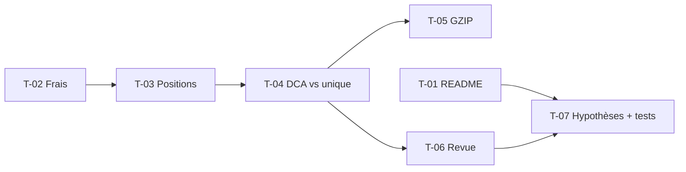

# 07 · Clôture du Strategy Lab — Tâches

> Échelle de points, statuts et définition de terminé commune : [`roadmap/README.md`](../README.md). Points estimés a posteriori.

## Synthèse

| Tâche | Titre | US | Couche | Priorité | Points | Dépend de | Commits |
| --- | --- | --- | --- | --- | --- | --- | --- |
| T-01 | Recadrage du README (pivot, règle d’exécution) | US-04 | README, AGENTS | MUST | 3 | — | `472715b`, `6bdf667`, `5f0890c`, `9ef07f5`, `9c8571e` |
| T-02 | Total des frais | US-01 | contracts, engine, core-backend, web | MUST | 2 | — | `9819b57` |
| T-03 | Quantités et positions finales | US-02 | contracts, engine, core-backend, web | MUST | 3 | T-02 | `61de5af` |
| T-04 | Comparaison DCA / investissement unique | US-03 | contracts, engine, core-backend, web | MUST | 5 | T-03 | `f1f640d` |
| T-05 | Compression GZIP des messages Kafka | US-03 | kafka | MUST | 1 | T-04 | `e87fdcc` |
| T-06 | Revue : utils de l’engine, profit, types dérivés | US-05 | engine, contracts, core-backend, web | MUST | 5 | T-04 | `1a6c412`, `1987a7b` |
| T-07 | Règle d’exécution, provenance et tests de reproductibilité | US-04, US-05 | contracts, engine, core-backend, web | MUST | 5 | T-01, T-06 | `01fcb91` |

**Total** : 24 points — MUST 24, SHOULD 0.

| Lot | Tâches | Points |
| --- | --- | --- |
| 1. Résultat complet | T-02 → T-05 | 11 |
| 2. Explicabilité et reproductibilité | T-01, T-06, T-07 | 13 |

## Graphe des dépendances

---

## Lot 1 — Résultat complet

### T-02 · Total des frais

- **US** : US-01 · **Priorité** : MUST · **Points** : 2 · **Dépend de** : — · **Commits** : `9819b57`
- **Fichiers** : `packages/contracts/src/backtest.ts`, `backtest-engine/engine/`, `core-backend/prisma/`, `features/backtest/stats.tsx`

Critères d’acceptation :
- [x] `totalFees` dans `backtest.completed` (devise saisie, inclus dans `totalInvested`), colonne nullable, carte « Frais payés ».

### T-03 · Quantités et positions finales

- **US** : US-02 · **Priorité** : MUST · **Points** : 3 · **Dépend de** : T-02 · **Commits** : `61de5af`
- **Fichiers** : contrat (`tradeSchema`, `holdingSchema`), engine, `BacktestResult.holdings`, `features/backtest/`

Critères d’acceptation :
- [x] Achats avec quantité fractionnaire, montant et frais arrondis au centime.
- [x] `holdings` valorisés au dernier cours ; tableaux Ordres et Positions finales.

### T-04 · Comparaison DCA / investissement unique

- **US** : US-03 · **Priorité** : MUST · **Points** : 5 · **Dépend de** : T-03 · **Commits** : `f1f640d`
- **Fichiers** : contrat (`lumpSumComparisonSchema`), `engine/backtest.engine.ts`, `BacktestResult.lumpSumComparison`, `features/backtest/{stats,equity-chart}.tsx`

Critères d’acceptation :
- [x] Rejeu du total versé en un achat au premier jour, mêmes frais et cours.
- [x] `dcaAdvantage` > 0 si le DCA fait mieux ; `null` hors DCA.
- [x] Cartes de comparaison et courbe en pointillés.

### T-05 · Compression GZIP des messages Kafka

- **US** : US-03 · **Priorité** : MUST · **Points** : 1 · **Dépend de** : T-04 · **Commits** : `e87fdcc`
- **Fichiers** : `packages/kafka/src/kafka.producer.ts`

Critères d’acceptation :
- [x] Messages produits en GZIP ; un DCA quotidien de 46 ans passe de ~1,1 Mo à ~190 Ko.

## Lot 2 — Explicabilité et reproductibilité

### T-01 · Recadrage du README (pivot, règle d’exécution)

- **US** : US-04 · **Priorité** : MUST · **Points** : 3 · **Dépend de** : — · **Commits** : `472715b`, `6bdf667`, `5f0890c`, `9ef07f5`, `9c8571e`
- **Fichiers** : `README.md`, `AGENTS.md`

Critères d’acceptation :
- [x] Vision « laboratoire de portefeuille », bourse simulée en bonus, roadmap réécrite.
- [x] Explorateur d’allocations, extensions d’analyse et notifications décrits.
- [x] Règle d’exécution : clôture du jour de l’échéance pour une décision planifiée, T+1 pour une décision fondée sur un cours.

### T-06 · Revue : utils de l’engine, profit, types dérivés

- **US** : US-05 · **Priorité** : MUST · **Points** : 5 · **Dépend de** : T-04 · **Commits** : `1a6c412`, `1987a7b`
- **Fichiers** : `engine/backtest.utils.ts` (+ tests), `engine/backtest.engine.ts`, contrat, `core-backend/repositories/`, `features/backtest/`, `lib/format.ts`, `AGENTS.md`

Critères d’acceptation :
- [x] `round`, `periodKey`, tracker de drawdown extraits et testés ; `simulate` réduit à la boucle.
- [x] Profit calculé par l’engine (colonne `profit`) ; `lumpSumValue` sur chaque point (~15 % de message en moins).
- [x] Types web dérivés du contrat (`import type`) ; helper `fromDecimal`.
- [x] Règles documentées : JSDoc, résultats qui évoluent, arrondis, taille des messages, types web.

### T-07 · Règle d’exécution, provenance et tests de reproductibilité

- **US** : US-04, US-05 · **Priorité** : MUST · **Points** : 5 · **Dépend de** : T-01, T-06 · **Commits** : `01fcb91`
- **Fichiers** : contrat (`EXECUTION_RULES`, `dataSourceSchema`), `engine/backtest.utils.ts` (`fingerprintPrices`), `engine/backtest.fixture.ts`, `repositories/market.repository.ts`, migration `ExecutionRule`, `features/backtest/assumptions.tsx`

Critères d’acceptation :
- [x] `executionRule` et `dataSource` publiés avec chaque résultat, colonnes nullables.
- [x] Le repository de marché déclare sa source ; le service horodate la récupération.
- [x] Carte « Hypothèses » avec avertissement.
- [x] Jeu de référence à séries entières seedées : métriques figées, déterminisme, immutabilité des entrées, stabilité de l’empreinte.
