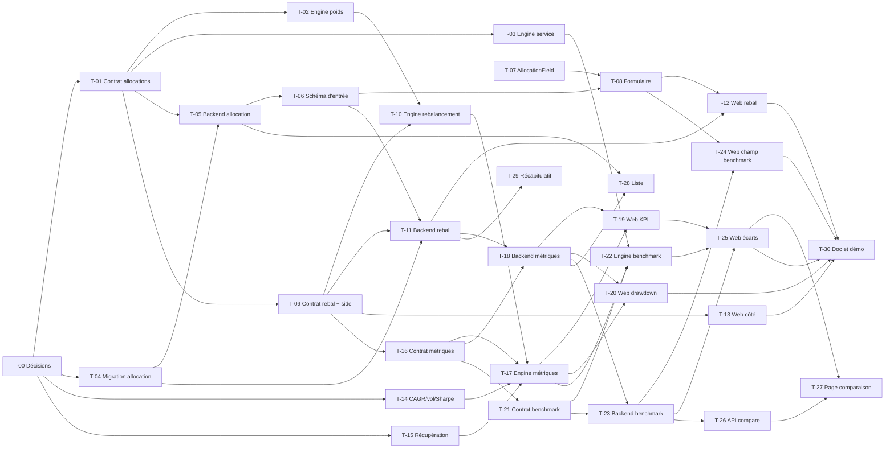

# 08 · Portfolio Management V1 — Tâches

> Découpage technique des user stories de `US.md`. Les décisions D1 à D10 sont définies dans `US.md`, section « Décisions à valider avant de coder ».
> Échelle de points, statuts et définition de terminé commune : [`roadmap/README.md`](../README.md). Points prévus.

## Synthèse

| Tâche | Titre | US | Couche | Priorité | Points | Dépend de |
| --- | --- | --- | --- | --- | --- | --- |
| T-00 | Valider les décisions D1–D10 | toutes | — | MUST | 1 | — |
| T-01 | Contrat : `allocations` dans `backtest.requested` | US-01 | contracts | MUST | 2 | T-00 |
| T-02 | Engine : simulation avec poids cibles | US-01 | engine | MUST | 3 | T-01 |
| T-03 | Engine : service et cours lus depuis `allocations` | US-01 | engine | MUST | 1 | T-01 |
| T-04 | Base : table `BacktestAllocation` et migration | US-01 | core-backend | MUST | 5 | T-00 |
| T-05 | core-backend : allocation dans repository et service | US-01 | core-backend | MUST | 3 | T-01, T-04 |
| T-06 | core-backend : nouveau schéma d’entrée `POST /api/backtests` | US-02 | core-backend | MUST | 3 | T-05 |
| T-07 | Web : composant `AllocationField` | US-02 | web | MUST | 5 | — |
| T-08 | Web : formulaire « Nouveau backtest » (maquette 12.1) | US-02 | web | MUST | 3 | T-06, T-07 |
| T-09 | Contrat : `rebalanceFrequency` et `trade.side` | US-03, US-04 | contracts | MUST | 2 | T-01 |
| T-10 | Engine : ventes, frais sur ventes et rebalancement | US-03 | engine | MUST | 8 | T-02, T-09 |
| T-11 | core-backend : fréquence de rebalancement | US-03 | core-backend | MUST | 2 | T-04, T-06, T-09 |
| T-12 | Web : champ « Rebalancement » et hypothèse | US-03 | web | MUST | 1 | T-08, T-11 |
| T-13 | Web : colonne « Côté » des ordres | US-04 | web | MUST | 2 | T-09 |
| T-14 | Engine : CAGR, volatilité et Sharpe | US-05 | engine | MUST | 5 | T-00 |
| T-15 | Engine : durée de récupération et drawdown par point | US-06, US-07 | engine | MUST | 3 | T-00 |
| T-16 | Contrat : métriques et `equityPoint.drawdown` | US-05, US-06, US-07 | contracts | MUST | 2 | T-09 |
| T-17 | Engine : publier les métriques | US-05, US-06, US-07 | engine | MUST | 2 | T-10, T-14, T-15, T-16 |
| T-18 | core-backend : colonnes de métriques | US-05, US-06 | core-backend | MUST | 3 | T-11, T-16 |
| T-19 | Web : cartes KPI et hypothèses | US-05, US-06, US-07 | web | MUST | 3 | T-17, T-18 |
| T-20 | Web : courbe de drawdown | US-07 | web | MUST | 3 | T-17, T-18 |
| T-21 | Contrat : `benchmark` et `benchmarkValue` | US-08, US-09 | contracts | MUST | 2 | T-16 |
| T-22 | Engine : rejeu du benchmark et écarts | US-08, US-09 | engine | MUST | 5 | T-03, T-17, T-21 |
| T-23 | core-backend : benchmark persisté | US-08 | core-backend | MUST | 3 | T-18, T-21 |
| T-24 | Web : champ « Benchmark » | US-08 | web | MUST | 1 | T-08, T-23 |
| T-25 | Web : écarts, série et tableau « Métriques comparées » | US-09 | web | MUST | 5 | T-19, T-22, T-23 |
| T-26 | core-backend : `GET /api/backtests/compare` | US-10 | core-backend | SHOULD | 5 | T-23 |
| T-27 | Web : page « Comparaison » | US-10 | web | SHOULD | 5 | T-25, T-26 |
| T-28 | Liste : colonnes « Allocation » et « CAGR » | US-11 | core-backend, web | SHOULD | 3 | T-05, T-18 |
| T-29 | Récapitulatif prévisionnel du formulaire | US-02 | core-backend, web | SHOULD | 5 | T-11 |
| T-30 | Documentation, limites et démo | US-12 | README | MUST | 2 | T-12, T-13, T-20, T-24, T-25 |

**Total** : 98 points — MUST 80, SHOULD 18.

| Lot | Tâches | Points |
| --- | --- | --- |
| 0. Décisions | T-00 | 1 |
| 1. Allocation | T-01 → T-08 | 25 |
| 2. Rebalancement | T-09 → T-13 | 15 |
| 3. Métriques | T-14 → T-20 | 21 |
| 4. Benchmark | T-21 → T-25 | 16 |
| 5. Comparaison et finitions | T-26 → T-30 | 20 (dont 18 SHOULD) |

**Chemin critique MUST** (28 points) : T-00 → T-01 → T-02 → T-10 → T-17 → T-22 → T-25 → T-30. Un retard sur T-10 (rebalancement, 8 points) décale tout le mois : c’est la tâche à commencer au plus tôt.

**Parallélisable** : T-04 (migration) en parallèle de T-01 → T-03 ; T-07 (composant web) dès le début ; T-14 et T-15 (calculs purs) en parallèle du lot 2.

## Graphe des dépendances

---

## Lot 0 — Décisions

### T-00 · Valider les décisions D1–D10

- **US** : toutes · **Priorité** : MUST · **Points** : 1 · **Dépend de** : —
- **Objet** : relire la section « Décisions » de `US.md`, trancher chaque point et corriger `US.md` si une décision change.

Critères d’acceptation :
- [x] D1 à D10 sont validées ou amendées par écrit dans `US.md` (D2 amendée : poids au pourcent entier).
- [x] La maquette 12.1 est alignée sur D8 (« Frais par ordre » au lieu de « Frais par achat ») ou l’écart est noté : écart noté, la maquette garde « Frais par achat », le libellé du web suit D8 (T-08).

---

## Lot 1 — Allocation

### T-01 · Contrat : `allocations` dans `backtest.requested`

- **US** : US-01 · **Priorité** : MUST · **Points** : 2 · **Dépend de** : T-00
- **Fichiers** : `packages/contracts/src/backtest.ts`

Critères d’acceptation :
- [x] `symbols` est remplacé par `allocations: z.array(allocationSchema).min(1)`, avec `allocationSchema = { symbol, weight }` ; `weight` commenté « Ratio : 0.6 = 60 % du portefeuille ».
- [x] `refine` : symboles uniques, chaque poids dans `]0, 1]` et au pourcent près (D2), somme égale à 1 à `1e-6` près (tolérance en constante nommée du contrat).
- [x] Type `Allocation` exporté par `z.infer`.
- [x] Producteur (core-backend) et consommateur (engine) compilent : adaptés dans le même diff, au minimum en équipondéré si T-02/T-05 ne sont pas encore livrés.

### T-02 · Engine : simulation avec poids cibles

- **US** : US-01 · **Priorité** : MUST · **Points** : 3 · **Dépend de** : T-01
- **Fichiers** : `apps/backtest-engine/engine/backtest.engine.ts`, `interfaces/backtest.interface.ts`, `engine/backtest.engine.test.ts`, `engine/backtest.fixture.ts`

Critères d’acceptation :
- [x] Chaque versement est réparti selon `weight` (au lieu de `1 / symbols.length`), frais déduits de chaque ordre.
- [x] JSDoc de `simulate` mis à jour (« portefeuille équipondéré » remplacé par la règle des poids).
- [x] Test : versement de 10 000 € en 60/40 ⇒ montants d’ordre 6 000 / 4 000, frais compris.
- [x] Test de non-régression : poids égaux ⇒ résultat identique à la fixture actuelle.
- [x] Test de reproductibilité : mêmes entrées ⇒ même résultat et même empreinte (empreinte non testée : elle ne hache que les cours, les poids ne la changent pas).

### T-03 · Engine : service et cours lus depuis `allocations`

- **US** : US-01 · **Priorité** : MUST · **Points** : 1 · **Dépend de** : T-01
- **Fichiers** : `apps/backtest-engine/services/backtest.service.ts`, `consumers/backtest.consumer.ts`

Critères d’acceptation :
- [x] Les cours sont récupérés pour les symboles de `allocations`.
- [x] Un message aux poids invalides est loggué (`logger.warn`) et ignoré par le consumer, sans exception.

### T-04 · Base : table `BacktestAllocation` et migration

- **US** : US-01 · **Priorité** : MUST · **Points** : 5 · **Dépend de** : T-00
- **Fichiers** : `apps/core-backend/prisma/schema.prisma`, `prisma/migrations/<timestamp>_backtest_allocation/migration.sql`

Critères d’acceptation :
- [x] Modèle `BacktestAllocation` : `id`, `backtestId`, `symbol`, `weight Decimal @db.Decimal(3, 2)` (commentaire : ratio au pourcent près, D2), `@@unique([backtestId, symbol])`, `onDelete: Cascade`.
- [x] Migration en trois étapes dans un seul fichier : création de la table, backfill équipondéré au pourcent entier depuis `Backtest.symbols` (`floor(100 / n)`, le reste réparti +1 % sur les premiers symboles : somme exactement 1), suppression de `symbols`.
- [x] Testée sur une copie de la base locale contenant des backtests : nombre de lignes d’allocation = somme des longueurs de `symbols`, somme des poids = 1 par backtest.
- [x] `bunx prisma migrate diff --from-schema-datasource prisma/schema.prisma --to-schema-datamodel prisma/schema.prisma --script` renvoie une migration vide.
- [x] `bun run db:generate` exécuté.

> Suppression de colonne irréversible : faire un `pg_dump` de la base locale avant d’appliquer.

### T-05 · core-backend : allocation dans repository et service

- **US** : US-01 · **Priorité** : MUST · **Points** : 3 · **Dépend de** : T-01, T-04
- **Fichiers** : `repositories/backtest.repository.ts`, `services/backtest.service.ts`, `interfaces/backtest.interface.ts`

Critères d’acceptation :
- [ ] `create` écrit le backtest et ses allocations dans la même transaction (création imbriquée Prisma), avec `latestExecution` comme aujourd’hui.
- [ ] `include` de l’allocation en constante `satisfies Prisma.BacktestInclude` en tête du repository.
- [ ] Le service construit `allocations` du payload Kafka (`Decimal` → `number` uniquement à ce moment).
- [ ] « Relancer » republie l’allocation persistée.
- [ ] `GET /api/backtests/:id` renvoie `allocations` ; entrée `API.md` mise à jour.

### T-06 · core-backend : nouveau schéma d’entrée `POST /api/backtests`

- **US** : US-02 · **Priorité** : MUST · **Points** : 3 · **Dépend de** : T-05
- **Fichiers** : `interfaces/backtest.interface.ts`, `services/backtest.service.ts`, `API.md`

Critères d’acceptation :
- [ ] `createBacktestSchema` : `name`, `investmentMode` (`LUMP_SUM` / `RECURRING`), `allocations: [{ symbol, weight }]` avec `weight` en pourcent entier (`z.number().int()`, 1 à 100, converti en ratio par le schéma), `start`, `end`, `initialAmount`, `recurringAmount` (requis si `RECURRING`, interdit sinon), `fee` (%).
- [ ] Somme des poids ≠ 100 % ⇒ 400 avec `path: ["allocations"]`.
- [ ] Les anciens champs `strategy` et `amount` disparaissent ; le web est adapté dans T-08 (signaler la rupture d’API si T-08 n’est pas dans le même diff).
- [ ] Entrée `API.md` : body, réponses, erreurs.

### T-07 · Web : composant `AllocationField`

- **US** : US-02 · **Priorité** : MUST · **Points** : 5 · **Dépend de** : —
- **Fichiers** : `apps/web/src/components/` (champ de formulaire, à côté des champs existants) ou `features/backtest/` selon `COMPONENTS.md`, `COMPONENTS.md`

Critères d’acceptation :
- [x] Une ligne par actif : symbole, nom, barre proportionnelle au poids, champ `%` entier (pas de 1, D2), bouton de suppression (maquette 12.1).
- [x] « + Ajouter un actif » ouvre la recherche de symboles existante (`symbol-search.tsx`) ; un symbole déjà présent n’est pas ajouté deux fois.
- [x] Badge « Total » : vert à 100 %, rouge sinon (la somme affichée est un affichage de saisie, la validation fait foi côté schéma).
- [x] Accessible au clavier, labels associés aux champs.
- [x] Entrée `COMPONENTS.md` (props, usage).

### T-08 · Web : formulaire « Nouveau backtest » (maquette 12.1)

- **US** : US-02 · **Priorité** : MUST · **Points** : 3 · **Dépend de** : T-06, T-07
- **Fichiers** : `features/backtest/new-backtest-form.tsx`, `sections.tsx`, `schema.ts`, `api.ts`, `constants.ts`

Critères d’acceptation :
- [ ] Section « Général » : nom, « Mode d’investissement », « Versement mensuel (€) » visible seulement en `RECURRING`.
- [ ] Section « Allocation et période » : `AllocationField`, Début, Fin, « Capital initial (€) », « Frais par ordre (%) ».
- [ ] « Lancer le backtest » désactivé tant que le total ≠ 100 % ; erreurs 400 affichées sous le champ concerné.
- [ ] Le formulaire de test rapide (`quick-backtest-form.tsx`) envoie une allocation à 100 % sur son symbole.
- [ ] Parcours vérifié dans le navigateur : création d’un 60/40, redirection vers le résultat.

---

## Lot 2 — Rebalancement

### T-09 · Contrat : `rebalanceFrequency` et `trade.side`

- **US** : US-03, US-04 · **Priorité** : MUST · **Points** : 2 · **Dépend de** : T-01
- **Fichiers** : `packages/contracts/src/backtest.ts`

Critères d’acceptation :
- [x] `REBALANCE_FREQUENCIES = ["NONE", "MONTHLY", "QUARTERLY", "YEARLY"] as const` et `rebalanceFrequency` dans `backtest.requested`.
- [x] `tradeSchema.side: z.enum(["BUY", "SELL"])` ; commentaire : quantité et montant toujours positifs, le sens porte le signe.
- [x] Commentaire de `feeRate` : « par ordre, achat ou vente » (D8).

### T-10 · Engine : ventes, frais sur ventes et rebalancement

- **US** : US-03 · **Priorité** : MUST · **Points** : 8 · **Dépend de** : T-02, T-09
- **Fichiers** : `engine/backtest.engine.ts`, `engine/backtest.utils.ts`, tests

Critères d’acceptation :
- [ ] Au premier jour de cotation de chaque période de rebalancement (hors premier jour de simulation), après le versement du jour : vente des actifs surpondérés, puis achat des sous-pondérés avec le produit net des ventes.
- [ ] Après rebalancement, chaque poids est égal à sa cible, à la perte de frais près (test avec tolérance explicite).
- [ ] Frais prélevés sur chaque vente et chaque achat, inclus dans `totalFees` ; `totalInvested` inchangé par un rebalancement.
- [ ] Ordres de rebalancement inclus dans `trades` avec `side` ; `totalTrades` les compte.
- [ ] `QUARTERLY` ajouté à `periodKey` (ou helper équivalent dans `backtest.utils.ts`), testé.
- [ ] `NONE` ⇒ aucune vente, résultat identique à T-02 (non-régression).
- [ ] Test sur fixture à deux actifs aux trajectoires opposées : poids dérivés avant la date, ramenés à la cible après.
- [ ] Drawdown toujours mesuré hors versements : un rebalancement ne crée pas de rendement artificiel (test).

### T-11 · core-backend : fréquence de rebalancement

- **US** : US-03 · **Priorité** : MUST · **Points** : 2 · **Dépend de** : T-04, T-06, T-09
- **Fichiers** : `prisma/schema.prisma`, migration, `interfaces/`, `services/`, `API.md`

Critères d’acceptation :
- [ ] `enum RebalanceFrequency` et `Backtest.rebalanceFrequency @default(NONE)` (lignes existantes : `NONE`).
- [ ] Champ `rebalanceFrequency` dans `createBacktestSchema`, publié dans `backtest.requested`.
- [ ] Entrée `API.md` mise à jour.

### T-12 · Web : champ « Rebalancement » et hypothèse

- **US** : US-03 · **Priorité** : MUST · **Points** : 1 · **Dépend de** : T-08, T-11
- **Fichiers** : `features/backtest/sections.tsx`, `constants.ts`, `assumptions.tsx`

Critères d’acceptation :
- [ ] Select « Rebalancement » (Aucun / Mensuel / Trimestriel / Annuel), aide « Ramène les poids à la cible ».
- [ ] Ligne « Rebalancement » dans les hypothèses du résultat ; libellés en constantes de `features/backtest/constants.ts`.

### T-13 · Web : colonne « Côté » des ordres

- **US** : US-04 · **Priorité** : MUST · **Points** : 2 · **Dépend de** : T-09
- **Fichiers** : `features/backtest/column.tsx`, `types.ts`

Critères d’acceptation :
- [ ] Colonne « Côté » : badge « Achat » (contour vert) / « Vente » (plein rouge), comme la maquette 13.
- [ ] Type web dérivé du contrat avec `side` optionnel ; absence de `side` ⇒ « Achat » (D10).

---

## Lot 3 — Métriques

### T-14 · Engine : CAGR, volatilité et Sharpe

- **US** : US-05 · **Priorité** : MUST · **Points** : 5 · **Dépend de** : T-00
- **Fichiers** : `engine/backtest.utils.ts`, `engine/backtest.utils.test.ts`

Critères d’acceptation :
- [ ] Fonctions pures sur la série des rendements journaliers TWR (hors versements) : `annualizedReturn` (D3), `annualizedVolatility` (D4), `sharpeRatio` (D5).
- [ ] Constantes nommées : `TRADING_DAYS_PER_YEAR = 252`, `RISK_FREE_RATE = 0` (commentaire : ratio annuel, hypothèse affichée).
- [ ] CAGR annualisé sur la durée calendaire réelle (jours / 365,25).
- [ ] Sharpe `null` si volatilité nulle ; métriques `null` si moins de deux points.
- [ ] Tests contre des valeurs calculées à la main : série constante, rendement journalier fixe, période inférieure à un an, série d’un seul point.
- [ ] JSDoc : formule, unité, cas `null`.

### T-15 · Engine : durée de récupération et drawdown par point

- **US** : US-06, US-07 · **Priorité** : MUST · **Points** : 3 · **Dépend de** : T-00
- **Fichiers** : `engine/backtest.utils.ts` (`createDrawdownTracker`), tests

Critères d’acceptation :
- [ ] Le tracker expose `maxDrawdownPeakDate`, `maxDrawdownRecoveryDate` (`null` si non récupéré) et `recoveryDays` (jours calendaires, `null` si non récupéré), selon D6.
- [ ] Le tracker renvoie le drawdown courant (ratio ≤ 0) à chaque `record`, pour alimenter la courbe.
- [ ] Tests : baisse récupérée, baisse jamais récupérée, aucune baisse, deux baisses dont la seconde est la plus profonde.

### T-16 · Contrat : métriques et `equityPoint.drawdown`

- **US** : US-05, US-06, US-07 · **Priorité** : MUST · **Points** : 2 · **Dépend de** : T-09
- **Fichiers** : `packages/contracts/src/backtest.ts`

Critères d’acceptation :
- [ ] `backtest.completed` : `cagr`, `volatility`, `sharpeRatio` (nullables), `maxDrawdownPeakDate`, `maxDrawdownRecoveryDate`, `recoveryDays` (nullables), chacun avec son unité commentée.
- [ ] `equityPointSchema.drawdown: z.number().max(0)` (ratio, TWR).

### T-17 · Engine : publier les métriques

- **US** : US-05, US-06, US-07 · **Priorité** : MUST · **Points** : 2 · **Dépend de** : T-10, T-14, T-15, T-16
- **Fichiers** : `engine/backtest.engine.ts`, `interfaces/backtest.interface.ts`, `publishers/backtest.publisher.ts`

Critères d’acceptation :
- [ ] `runBacktest` renvoie les nouvelles métriques et `drawdown` sur chaque point.
- [ ] Taille du message `backtest.completed` mesurée sur 20 ans à 3 actifs, compressé : sous la limite du broker (valeur notée dans la PR).
- [ ] Test de bout en bout de l’engine sur la fixture : métriques présentes et cohérentes (`maxDrawdown` = minimum des `drawdown`).

### T-18 · core-backend : colonnes de métriques

- **US** : US-05, US-06 · **Priorité** : MUST · **Points** : 3 · **Dépend de** : T-11, T-16
- **Fichiers** : `prisma/schema.prisma`, migration, `interfaces/backtest.interface.ts`, `repositories/`, `consumers/`

Critères d’acceptation :
- [ ] `BacktestResult` : `cagr`, `volatility`, `sharpeRatio` (`Decimal(12, 6)?`), `maxDrawdownPeakDate`, `maxDrawdownRecoveryDate` (`DateTime?`), `recoveryDays` (`Int?`), commentaires « null pour les résultats antérieurs » (D10).
- [ ] `CompleteExecutionDTO` dérivé du payload, dates converties ; écriture dans la transaction de complétion existante.
- [ ] Un événement `backtest.completed` rejoué ne modifie rien (transition gardée inchangée).
- [ ] `GET /api/backtests/:id` renvoie les champs ; entrée `API.md` mise à jour.

### T-19 · Web : cartes KPI et hypothèses

- **US** : US-05, US-06, US-07 · **Priorité** : MUST · **Points** : 3 · **Dépend de** : T-17, T-18
- **Fichiers** : `features/backtest/stats.tsx`, `assumptions.tsx`, `lib/format.ts`, `COMPONENTS.md`

Critères d’acceptation :
- [ ] Cartes (style maquette 19) : CAGR, Volatilité, Max drawdown (légende : date et récupération), Sharpe ; « Valeur finale » et « Frais payés » restent visibles.
- [ ] Formatter de durée (`formatDuration` ou existant à étendre dans `lib/format.ts`) : « 14 mois », « 45 jours » ; « Non récupéré » si `maxDrawdownRecoveryDate` est `null` et `maxDrawdownPeakDate` présent.
- [ ] Résultat antérieur (`cagr === null`) : `<Dash />` dans chaque carte, aucune valeur recalculée.
- [ ] Hypothèse « Taux sans risque : 0 % » ajoutée.
- [ ] `COMPONENTS.md` mis à jour pour tout formatter ajouté.

### T-20 · Web : courbe de drawdown

- **US** : US-07 · **Priorité** : MUST · **Points** : 3 · **Dépend de** : T-17, T-18
- **Fichiers** : `features/backtest/` (nouveau graphique à côté de `equity-chart.tsx`), `backtest-detail.tsx`

Critères d’acceptation :
- [ ] Aire sous zéro du `drawdown` par date, axe en pourcentage, même axe temporel que la courbe de valeur.
- [ ] Graphique masqué si les points n’ont pas de `drawdown` (résultat antérieur).
- [ ] Lisible en mode clair et sombre.

---

## Lot 4 — Benchmark

### T-21 · Contrat : `benchmark` et `benchmarkValue`

- **US** : US-08, US-09 · **Priorité** : MUST · **Points** : 2 · **Dépend de** : T-16
- **Fichiers** : `packages/contracts/src/backtest.ts`

Critères d’acceptation :
- [ ] `backtest.requested.benchmarkSymbol: string | null`.
- [ ] `benchmarkSchema` : `symbol`, `finalValue`, `totalReturn`, `cagr`, `volatility`, `sharpeRatio`, `maxDrawdown`, `recoveryDays`, et écarts stratégie − benchmark `excessCagr`, `excessVolatility`, `excessMaxDrawdown`, `excessSharpe` (unités commentées : points de ratio).
- [ ] `backtest.completed.benchmark: benchmarkSchema.nullable()` ; `equityPointSchema.benchmarkValue` optionnel.

### T-22 · Engine : rejeu du benchmark et écarts

- **US** : US-08, US-09 · **Priorité** : MUST · **Points** : 5 · **Dépend de** : T-03, T-17, T-21
- **Fichiers** : `engine/backtest.engine.ts`, `services/backtest.service.ts`, tests

Critères d’acceptation :
- [ ] Benchmark simulé par `simulate` avec une allocation 100 % `benchmarkSymbol`, mêmes versements, dates et frais (D9), sans rebalancement.
- [ ] Courbe alignée par date avec la stratégie (même règle de départ : premier jour où tous les symboles, benchmark compris, ont un cours).
- [ ] Cours du benchmark inclus dans `dataSource.fingerprint`.
- [ ] Benchmark sans données ⇒ `BacktestError` « No market data for <symbol> », exécution `FAILED`.
- [ ] Tests : benchmark identique à l’unique actif du portefeuille ⇒ écarts nuls ; `benchmarkSymbol: null` ⇒ `benchmark: null` et pas de `benchmarkValue`.

### T-23 · core-backend : benchmark persisté

- **US** : US-08 · **Priorité** : MUST · **Points** : 3 · **Dépend de** : T-18, T-21
- **Fichiers** : `prisma/schema.prisma`, migration, `interfaces/`, `repositories/`, `services/`, `API.md`

Critères d’acceptation :
- [ ] `Backtest.benchmarkSymbol String?` et `BacktestResult.benchmark Json?` (commentaire de forme, null pour les résultats antérieurs).
- [ ] `benchmark` ajouté aux colonnes omises des exécutions dans `BacktestWithExecutions` (comme `lumpSumComparison`).
- [ ] `benchmarkSymbol` dans `createBacktestSchema` (optionnel), publié et relancé.
- [ ] Entrée `API.md` mise à jour.

### T-24 · Web : champ « Benchmark »

- **US** : US-08 · **Priorité** : MUST · **Points** : 1 · **Dépend de** : T-08, T-23
- **Fichiers** : `features/backtest/sections.tsx`, `constants.ts`

Critères d’acceptation :
- [ ] Champ « Benchmark » (recherche de symboles), valeur proposée `URTH` en constante, effaçable.
- [ ] Hypothèse « Benchmark » affichée sur le résultat.

### T-25 · Web : écarts, série et tableau « Métriques comparées »

- **US** : US-09 · **Priorité** : MUST · **Points** : 5 · **Dépend de** : T-19, T-22, T-23
- **Fichiers** : `features/backtest/stats.tsx`, `equity-chart.tsx`, nouveau tableau dans `features/backtest/`

Critères d’acceptation :
- [ ] Badges d’écart sur les cartes KPI (« +1,3 pt »), lus dans `benchmark.excess*`, et légende « B : 16,1 % ».
- [ ] Série « Benchmark » superposée sur la courbe de valeur, avec légende.
- [ ] Tableau « Métriques comparées » : Rendement annualisé, Volatilité, Max drawdown, Durée de récupération, Sharpe ; colonnes Portefeuille / Benchmark.
- [ ] Sans benchmark : badges, série et colonne masqués.
- [ ] Aucun écart calculé côté web.

---

## Lot 5 — Comparaison et finitions

### T-26 · core-backend : `GET /api/backtests/compare`

- **US** : US-10 · **Priorité** : SHOULD · **Points** : 5 · **Dépend de** : T-23
- **Fichiers** : `interfaces/`, `repositories/`, `services/`, `controller/`, `routes/backtest/`, `API.md`

Critères d’acceptation :
- [ ] `?ids=a,b` validé par zod (exactement deux identifiants distincts).
- [ ] Réponse : pour chaque backtest, paramètres, allocation, métriques et courbe du dernier résultat terminé ; écarts A − B calculés par le service ; drapeau `homogeneous` (même période, mêmes frais, même benchmark) et liste des différences.
- [ ] Backtest d’un autre utilisateur ⇒ `NotFoundError` (helper `assertOwner`) ; sans résultat terminé ⇒ `BadRequestError`.
- [ ] Lecture des colonnes lourdes uniquement pour la réponse, pas pour l’autorisation.
- [ ] Entrée `API.md` (appelant web : page Comparaison).

### T-27 · Web : page « Comparaison »

- **US** : US-10 · **Priorité** : SHOULD · **Points** : 5 · **Dépend de** : T-25, T-26
- **Fichiers** : `app/(base)/.../comparaison/page.tsx`, `features/backtest/` (ou `features/comparison/` si le domaine grossit), sidebar

Critères d’acceptation :
- [ ] Sélection de deux backtests terminés ; URL partageable (`?ids=`).
- [ ] Blocs du haut de la maquette 19 : cartes KPI de A avec écart à B, « Valeur des portefeuilles » (A, B, benchmark), « Métriques comparées » (A, B, benchmark). Réutilise les composants de T-19 et T-25.
- [ ] Bandeau d’avertissement si `homogeneous === false`, avec les différences.
- [ ] Blocs « Selon la date de départ », « Rendements glissants », « Effet devise » absents (mois 5).

### T-28 · Liste : colonnes « Allocation » et « CAGR »

- **US** : US-11 · **Priorité** : SHOULD · **Points** : 3 · **Dépend de** : T-05, T-18
- **Fichiers** : `repositories/backtest.repository.ts`, `features/backtest/column.tsx`, `API.md`

Critères d’acceptation :
- [ ] `GET /api/backtests` inclut l’allocation et le `cagr` du dernier résultat, sans `equityCurve`, `trades`, `holdings`, `benchmark`.
- [ ] Colonne « Allocation » : `AAPL 30 % · MSFT 30 % · IEF 40 %`, tronquée avec infobulle.
- [ ] Colonne « CAGR » : `<Dash />` si non terminé ou résultat antérieur.

### T-29 · Récapitulatif prévisionnel du formulaire

- **US** : US-02 · **Priorité** : SHOULD · **Points** : 5 · **Dépend de** : T-11
- **Fichiers** : core-backend (service + route de prévisualisation), `features/backtest/` (panneau), `API.md`

Critères d’acceptation :
- [ ] Route de prévisualisation (ex. `POST /api/backtests/preview`, sans écriture) : nombre de versements et de rebalancements prévus, calculés par le service à partir du calendrier, sans appel à l’engine.
- [ ] Panneau « Récapitulatif » de la maquette 12.1 : étapes Données / Simulation / Métriques, « Rebalancements prévus », « Versements prévus », « Source des données ».
- [ ] Appel débouncé, panneau en `<Dash />` tant que le formulaire est invalide.
- [ ] Les nombres prévus sont des estimations calendaires (jours fériés non connus avant les cours) : libellé explicite.

### T-30 · Documentation, limites et démo

- **US** : US-12 · **Priorité** : MUST · **Points** : 2 · **Dépend de** : T-12, T-13, T-20, T-24, T-25
- **Fichiers** : `README.md`, `roadmap/08-portfolio-v1/` (US, tâches, bilan), `roadmap/README.md`

Critères d’acceptation :
- [ ] README, « Définition de terminé » : case portefeuille multi-actifs cochée.
- [ ] Limites documentées : taux sans risque à 0, dividendes non inclus, actifs en USD affichés sans conversion (mois 5), rebalancement à la clôture du premier jour de la période.
- [ ] Scénario de démo exécuté de bout en bout : 60 % `AAPL` / 40 % `MSFT`, rebalancement annuel, frais 0,1 %, benchmark `URTH`, `PENDING` → `RUNNING` → `COMPLETED`, métriques face au benchmark.
- [ ] Rejeu d’un `backtest.requested` : ni double exécution ni double résultat.
- [ ] Feature clôturée avec le skill `feature-roadmap` (mode clôture) : cases cochées, commits et points réalisés, bilan, statut `Livrée` dans l’index.
