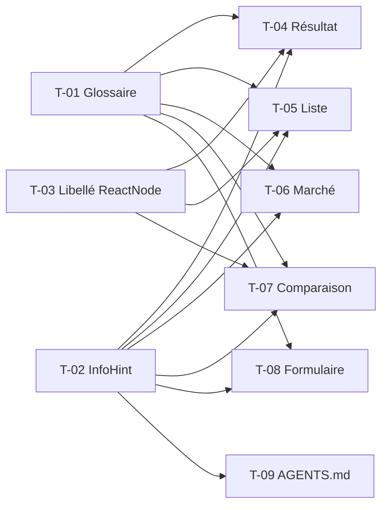

# 09 · Aide contextuelle sur les données — Tâches

> Décisions D1 à D7 : `US.md`. Échelle de points, statuts et définition de terminé commune : [`roadmap/README.md`](../README.md). Points prévus.

## Synthèse

| Tâche | Titre | US | Couche | Priorité | Points | Dépend de |
| --- | --- | --- | --- | --- | --- | --- |
| T-01 | Catalogue `glossary.ts` | US-01, US-03 | web | MUST | 5 | — |
| T-02 | Composant `InfoHint` | US-01 | web | MUST | 3 | — |
| T-03 | Libellé `ReactNode` dans `MetricBlock` et `StatCard` | US-01 | web | MUST | 2 | — |
| T-04 | Aide sur le résultat d’un backtest | US-01 | web | MUST | 3 | T-01, T-02, T-03 |
| T-05 | Aide sur la liste des backtests | US-01 | web | MUST | 2 | T-01, T-02, T-03 |
| T-06 | Aide sur le marché | US-01 | web | MUST | 2 | T-01, T-02 |
| T-07 | Aide sur la comparaison | US-01 | web | MUST | 2 | T-01, T-02, T-03 |
| T-08 | Aide sur le formulaire « Nouveau backtest » | US-02 | web | SHOULD | 2 | T-01, T-02 |
| T-09 | Règle de maintenance dans `AGENTS.md` | US-03 | docs | MUST | 1 | T-02 |

**Total** : 22 points — MUST 20, SHOULD 2.

| Lot | Tâches | Points |
| --- | --- | --- |
| 1. Socle et écrans | T-01 → T-07 | 19 |
| 2. Formulaire | T-08 | 2 |
| 3. Suivi | T-09 | 1 |

**Chemin critique** (8 points) : T-01 → T-04. T-01 est la tâche la plus longue : chaque texte se relit contre le code de l’engine ou du service.

**Parallélisable** : T-01, T-02 et T-03 dès le début ; T-04 à T-07 entre elles.

## Graphe des dépendances

---

## Lot 1 — Socle et écrans

### T-01 · Catalogue `glossary.ts`

- **US** : US-01, US-03 · **Priorité** : MUST · **Points** : 5 · **Dépend de** : —
- **Fichiers** : `apps/web/src/constants/glossary.ts`, `apps/web/COMPONENTS.md`

Critères d’acceptation :
- [ ] Type `GlossaryEntry` (`title`, `purpose`, `computation`, `formula?`, `unit`, `readingTip?`, `source`) et objet `GLOSSARY` `satisfies Record<string, GlossaryEntry>`, `GlossaryKey` dérivé de ses clés (D1, D3).
- [ ] Entrées du résultat : valeur finale, plus-value, montant investi, rendement total, CAGR, volatilité, ratio de Sharpe, taux sans risque, max drawdown (date), durée de récupération, courbe de valeur, courbe de drawdown, benchmark, frais payés, ordres, versements, rebalancements, investissement unique et écart du DCA, positions finales (quantité, valeur), ordres (côté, prix, quantité, montant, frais).
- [ ] Entrées des hypothèses : règle d’exécution, source des données, empreinte des données.
- [ ] Entrées de la liste : taux de réussite, taux d’échec, durée d’exécution.
- [ ] Entrée de la comparaison : écart A − B.
- [ ] Entrées du marché : prix, variation 24 h, volume 24 h, tendance.
- [ ] Chaque `source` cite un fichier et un symbole réels ; chaque texte est relu contre ce code (`annualizedReturn`, `annualizedVolatility`, `sharpeRatio`, `createDrawdownTracker`, frais inclus dans le montant investi, signe de l’écart du DCA…).
- [ ] Entrée `COMPONENTS.md` : usage du glossaire.

### T-02 · Composant `InfoHint`

- **US** : US-01 · **Priorité** : MUST · **Points** : 3 · **Dépend de** : —
- **Fichiers** : `apps/web/src/components/info-hint.tsx`, `apps/web/COMPONENTS.md`

Critères d’acceptation :
- [ ] Props : `entry: GlossaryKey`, `value?: ReactNode` (valeur déjà formatée, D4), `children` (le libellé affiché).
- [ ] Rend le libellé dans un `<button type="button">` souligné en pointillés, `cursor-pointer` (retouche du 01/11/2026, au lieu de `cursor-help`), sans changer la typographie du parent (D7, maquette 15.1).
- [ ] Ouvre `AppSheet` : titre, « À quoi ça sert », « Comment c’est calculé », formule en `font-mono` (D5), « Unité », « Comment le lire », « Valeur affichée », source (maquette 15).
- [ ] Clavier : focusable, `Entrée` ouvre, `Échap` ferme, focus rendu au libellé ; `aria-haspopup="dialog"`.
- [ ] Le clic ne déclenche pas l’action du parent (ligne de tableau cliquable, soumission de formulaire).
- [ ] Entrée `COMPONENTS.md` (props, usage).

### T-03 · Libellé `ReactNode` dans `MetricBlock` et `StatCard`

- **US** : US-01 · **Priorité** : MUST · **Points** : 2 · **Dépend de** : —
- **Fichiers** : `apps/web/src/features/backtest/metric-block.tsx`, `apps/web/src/components/stat-card.tsx`, `apps/web/COMPONENTS.md`

Critères d’acceptation :
- [ ] `MetricRow` reçoit `hint` (et `details`) et `MetricBlock` rend lui-même l’`InfoHint` du libellé, panneau rempli avec la valeur de chaque colonne ; `columnHints` pour un en-tête (« Écart »). `StatCard` inchangé : l’aide des taux va sur `caption`, déjà `ReactNode` (écart du 01/11/2026, voir `README.md`).
- [ ] Rendu inchangé pour les appelants actuels.
- [ ] Entrées `COMPONENTS.md` mises à jour.

### T-04 · Aide sur le résultat d’un backtest

- **US** : US-01 · **Priorité** : MUST · **Points** : 3 · **Dépend de** : T-01, T-02, T-03
- **Fichiers** : `features/backtest/result-overview.tsx`, `stats.tsx`, `assumptions.tsx`, `column.tsx`

Critères d’acceptation :
- [ ] « Valeur finale » et légendes « Drawdown », « Benchmark » de `ResultOverview`.
- [ ] Lignes de `BacktestResultBlocks` (Performance, Risque, Coûts et activité), avec la valeur affichée.
- [ ] « Taux sans risque », « Règle d’exécution », « Source des données » et « Empreinte des données » de `BacktestAssumptions`.
- [ ] En-têtes des colonnes calculées de `tradeColumns` et `holdingColumns`.
- [ ] Aucun libellé souligné sur les champs bruts (D6).
- [ ] Comparé aux maquettes 15 et 15.1 (skill `verify`, étape 5).

### T-05 · Aide sur la liste des backtests

- **US** : US-01 · **Priorité** : MUST · **Points** : 2 · **Dépend de** : T-01, T-02, T-03
- **Fichiers** : `features/backtest/stats.tsx`, `features/backtest/column.tsx`

Critères d’acceptation :
- [ ] Cartes « Terminés » et « Échoués » (taux) de `BacktestStats`.
- [ ] En-têtes « Rendement », « CAGR » et « Durée » de `backtestColumns` ; le clic ne navigue pas vers le détail.

### T-06 · Aide sur le marché

- **US** : US-01 · **Priorité** : MUST · **Points** : 2 · **Dépend de** : T-01, T-02
- **Fichiers** : `features/market/column.tsx`, `features/market/price-chart.tsx`

Critères d’acceptation :
- [ ] En-têtes « Prix », « Variation 24 h », « Volume 24 h », « Tendance ».
- [ ] Titre du graphique de prix (source, intervalle des points).

### T-07 · Aide sur la comparaison

- **US** : US-01 · **Priorité** : MUST · **Points** : 2 · **Dépend de** : T-01, T-02, T-03
- **Fichiers** : `features/backtest/comparison-blocks.tsx`

Critères d’acceptation :
- [ ] Lignes de « Métriques comparées », en réutilisant les entrées du résultat, et en-tête « Écart ».
- [ ] « Frais », « Rebalancement » et « Benchmark » de « Paramètres ».

## Lot 2 — Formulaire

### T-08 · Aide sur le formulaire « Nouveau backtest »

- **US** : US-02 · **Priorité** : SHOULD · **Points** : 2 · **Dépend de** : T-01, T-02
- **Fichiers** : `features/backtest/new-backtest-form.tsx`, `components/form/fields` (libellé `ReactNode` si absent), `constants/glossary.ts`

Critères d’acceptation :
- [ ] Entrées et libellés cliquables : « Mode d’investissement », « Actifs et poids », « Frais par ordre (%) », « Rebalancement », « Benchmark ».
- [ ] Le clic sur un libellé ne soumet pas le formulaire et ne donne pas le focus au champ.

## Lot 3 — Suivi

### T-09 · Règle de maintenance dans `AGENTS.md`

- **US** : US-03 · **Priorité** : MUST · **Points** : 1 · **Dépend de** : T-02
- **Fichiers** : `apps/web/AGENTS.md`

Critères d’acceptation :
- [ ] Règle : « une donnée calculée affichée a son entrée dans `constants/glossary.ts` et son `InfoHint` dans le même diff ».
