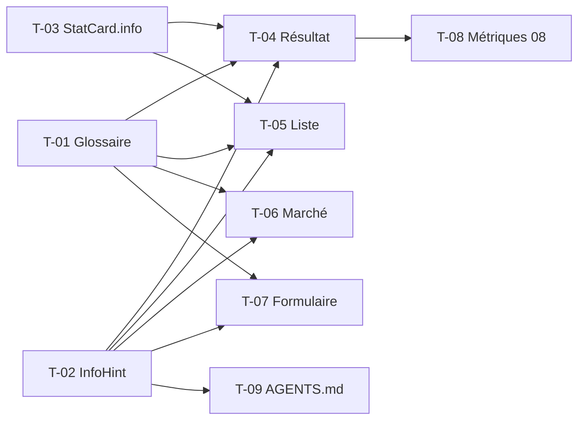

# 09 · Aide contextuelle sur les données — Tâches

> Décisions D1 à D7 : `US.md`. Échelle de points, statuts et définition de terminé commune : [`roadmap/README.md`](../README.md). Points prévus.

## Synthèse

| Tâche | Titre | US | Couche | Priorité | Points | Dépend de |
| --- | --- | --- | --- | --- | --- | --- |
| T-01 | Catalogue `glossary.ts` des données existantes | US-01 | web | MUST | 5 | — |
| T-02 | Composant `InfoHint` | US-01 | web | MUST | 3 | — |
| T-03 | Emplacement `info` dans `StatCard` | US-01 | web | MUST | 1 | — |
| T-04 | Aide sur le résultat d’un backtest | US-01 | web | MUST | 3 | T-01, T-02, T-03 |
| T-05 | Aide sur la liste des backtests | US-01 | web | MUST | 2 | T-01, T-02, T-03 |
| T-06 | Aide sur le marché | US-01 | web | MUST | 2 | T-01, T-02 |
| T-07 | Aide sur le formulaire « Nouveau backtest » | US-02 | web | SHOULD | 2 | T-01, T-02 |
| T-08 | Entrées des métriques de la feature 08 | US-03 | web | MUST | 2 | T-04 |
| T-09 | Règle de maintenance dans `AGENTS.md` | US-03 | docs | MUST | 1 | T-02 |

**Total** : 21 points — MUST 19, SHOULD 2.

| Lot | Tâches | Points |
| --- | --- | --- |
| 1. Socle | T-01 → T-06 | 16 |
| 2. Formulaire | T-07 | 2 |
| 3. Suivi | T-08 → T-09 | 3 |

**Chemin critique** (10 points) : T-01 → T-04 → T-08. T-01 est la tâche la plus longue : chaque texte se relit contre le code de l’engine ou du service.

**Parallélisable** : T-01, T-02 et T-03 dès le début ; T-04, T-05 et T-06 entre elles. T-08 attend aussi les tâches T-19, T-20 et T-25 de la feature 08 (métriques affichées).

## Graphe des dépendances

---

## Lot 1 — Socle

### T-01 · Catalogue `glossary.ts` des données existantes

- **US** : US-01 · **Priorité** : MUST · **Points** : 5 · **Dépend de** : —
- **Fichiers** : `apps/web/src/constants/glossary.ts`, `apps/web/COMPONENTS.md`

Critères d’acceptation :
- [ ] Type `GlossaryEntry` (`title`, `purpose`, `computation`, `formula?`, `unit`, `readingTip?`, `source`) et objet `GLOSSARY` typé `satisfies Record<GlossaryKey, GlossaryEntry>` (D1, D3).
- [ ] Entrées du résultat : rendement total, plus-value, drawdown max (date), valeur finale, montant investi, frais payés, nombre d’ordres, investissement unique, écart du DCA, courbe de valeur, positions finales (quantité, valeur), ordres (côté, prix, quantité, montant, frais).
- [ ] Entrées des hypothèses : règle d’exécution, source des données, empreinte des données.
- [ ] Entrées de la liste : taux de réussite, taux d’échec, durée d’exécution.
- [ ] Entrées du marché : prix, variation 24 h, volume 24 h, tendance.
- [ ] Chaque `source` cite un fichier et un symbole réels ; chaque texte est relu contre ce code (drawdown hors versements, frais inclus dans le montant investi, `dcaAdvantage` > 0 si le DCA fait mieux…).
- [ ] Entrée `COMPONENTS.md` : usage du glossaire.

### T-02 · Composant `InfoHint`

- **US** : US-01 · **Priorité** : MUST · **Points** : 3 · **Dépend de** : —
- **Fichiers** : `apps/web/src/components/info-hint.tsx`, `apps/web/COMPONENTS.md`

Critères d’acceptation :
- [ ] Props : `entry: GlossaryKey`, `value?: ReactNode` (valeur déjà formatée, D4).
- [ ] Bouton icône `Info` (D7) qui ouvre `AppSheet` : titre, sections « À quoi ça sert », « Comment c’est calculé », formule en `font-mono` (D5), « Unité », « Comment le lire », « Valeur affichée ».
- [ ] Clavier : focusable, `Entrée` ouvre, `Échap` ferme, focus rendu au bouton ; `aria-label` « À propos de <titre> ».
- [ ] Le clic sur l’icône ne déclenche pas l’action de son parent (ligne de tableau cliquable).
- [ ] Rendu conforme à la maquette `26 · Aide sur une donnée (sheet)`.
- [ ] Entrée `COMPONENTS.md` (props, usage).

### T-03 · Emplacement `info` dans `StatCard`

- **US** : US-01 · **Priorité** : MUST · **Points** : 1 · **Dépend de** : —
- **Fichiers** : `apps/web/src/components/stat-card.tsx`, `apps/web/COMPONENTS.md`

Critères d’acceptation :
- [ ] Prop optionnelle `info?: ReactNode` rendue à droite du libellé ; sans elle, le rendu est inchangé.
- [ ] Entrée `COMPONENTS.md` mise à jour.

### T-04 · Aide sur le résultat d’un backtest

- **US** : US-01 · **Priorité** : MUST · **Points** : 3 · **Dépend de** : T-01, T-02, T-03
- **Fichiers** : `features/backtest/stats.tsx`, `assumptions.tsx`, `equity-chart.tsx`, `column.tsx`, `sections.tsx`

Critères d’acceptation :
- [ ] Icône sur les cartes de `BacktestResultStats` et `LumpSumComparisonStats`, avec la valeur affichée.
- [ ] Icône sur « Règle d’exécution », « Source des données » et « Empreinte des données » de `BacktestAssumptions`.
- [ ] Icône sur le titre « Courbe d’equity » et sur les en-têtes des colonnes calculées des ordres et des positions.
- [ ] Aucune icône sur les champs bruts (D6).
- [ ] Comparé à la maquette 26 (skill `verify`, étape 5).

### T-05 · Aide sur la liste des backtests

- **US** : US-01 · **Priorité** : MUST · **Points** : 2 · **Dépend de** : T-01, T-02, T-03
- **Fichiers** : `features/backtest/stats.tsx`, `features/backtest/column.tsx`

Critères d’acceptation :
- [ ] Icône sur les cartes « Terminés » et « Échoués » (taux) de `BacktestStats`.
- [ ] Icône sur les en-têtes « Rendement » et « Durée » de `backtestColumns`.

### T-06 · Aide sur le marché

- **US** : US-01 · **Priorité** : MUST · **Points** : 2 · **Dépend de** : T-01, T-02
- **Fichiers** : `features/market/column.tsx`, `features/market/price-chart.tsx`

Critères d’acceptation :
- [ ] Icône sur les en-têtes « Prix », « Variation 24 h », « Volume 24 h », « Tendance ».
- [ ] Icône sur le titre du graphique de prix (source, intervalle des points).

## Lot 2 — Formulaire

### T-07 · Aide sur le formulaire « Nouveau backtest »

- **US** : US-02 · **Priorité** : SHOULD · **Points** : 2 · **Dépend de** : T-01, T-02
- **Fichiers** : `features/backtest/new-backtest-form.tsx`, `components/form/fields` (slot de libellé si absent), `constants/glossary.ts`

Critères d’acceptation :
- [ ] Entrées et icônes : « Mode d’investissement », « Actifs et poids », « Frais par ordre (%) », « Rebalancement » (si 08 T-12 est livré).
- [ ] Le clic sur l’icône ne soumet pas le formulaire (`type="button"`).

## Lot 3 — Suivi

### T-08 · Entrées des métriques de la feature 08

- **US** : US-03 · **Priorité** : MUST · **Points** : 2 · **Dépend de** : T-04 (et 08 T-19, T-20, T-25)
- **Fichiers** : `constants/glossary.ts`, `features/backtest/stats.tsx`

Critères d’acceptation :
- [ ] Entrées : CAGR (D3 de 08), volatilité (D4), ratio de Sharpe avec taux sans risque à 0 (D5), durée de récupération (D6), courbe de drawdown, benchmark et écarts, rebalancement.
- [ ] Formules relues contre `annualizedReturn`, `annualizedVolatility`, `sharpeRatio`, `createDrawdownTracker`.

### T-09 · Règle de maintenance dans `AGENTS.md`

- **US** : US-03 · **Priorité** : MUST · **Points** : 1 · **Dépend de** : T-02
- **Fichiers** : `apps/web/AGENTS.md`

Critères d’acceptation :
- [ ] Règle : « une donnée calculée affichée a son entrée dans `constants/glossary.ts` et son `InfoHint` dans le même diff ».
