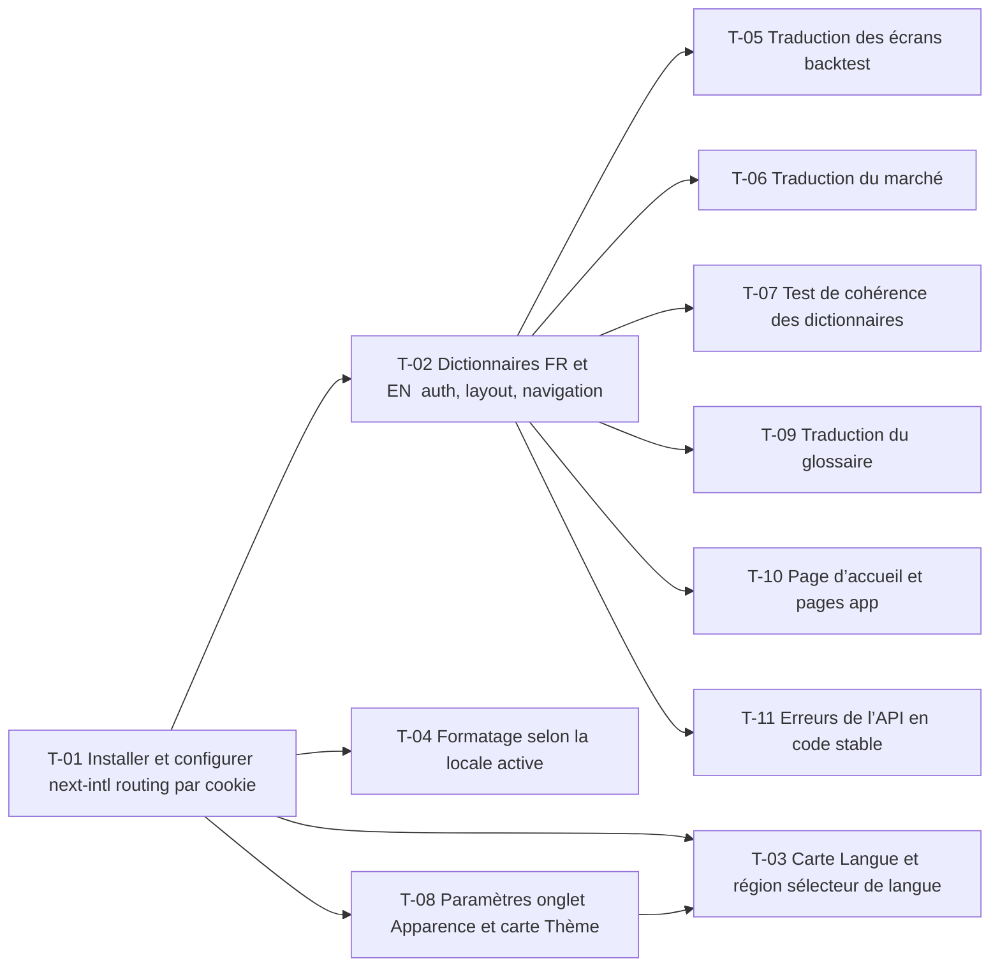

# 10 · Internationalisation et apparence du web (FR / EN, thème) — Tâches

> Décisions : `US.md`. Échelle de points, statuts et définition de terminé commune : [`roadmap/README.md`](../README.md). Points prévus ; tâches T-06, T-09, T-10 et T-11 ajoutées le 2026-11-11 au découpage des écrans restants.

## Synthèse

| Tâche | Titre | US | Couche | Priorité | Points | Dépend de | Réalisé | Commits |
| --- | --- | --- | --- | --- | --- | --- | --- | --- |
| T-01 | Installer et configurer next-intl (routing par cookie) | US-01 | web | MUST | 3 | — | 3 | `9999fd5` |
| T-02 | Dictionnaires FR et EN : auth, layout, navigation | US-01 | web | MUST | 5 | T-01 | 5 | `9999fd5` |
| T-03 | Carte « Langue et région » (sélecteur de langue) | US-01 | web | MUST | 2 | T-01, T-08 | 3 | `810b276` |
| T-04 | Formatage selon la locale active | US-02 | web | MUST | 3 | T-01 | 5 | `e1b85ae` |
| T-05 | Traduction des écrans backtest | US-01 | web | MUST | 8 | T-02 | 13 | `e2e1742`, `de57c33`, `d2d98eb`, `7c8cfcf` |
| T-06 | Traduction du marché | US-01 | web | SHOULD | 3 | T-02 | 3 | `09fe659`, `6f95fad` |
| T-07 | Test de cohérence des dictionnaires | US-03 | web | MUST | 2 | T-02 | 2 | `c308167`, `06b48cb` |
| T-08 | Paramètres : onglet Apparence et carte « Thème » | US-04 | web | MUST | 3 | T-01 | 5 | `810b276` |
| T-09 | Traduction du glossaire (aide contextuelle) | US-01 | web | SHOULD | 8 | T-02 | 8 | `1362977`, `30540f7`, `215a7ea` |
| T-10 | Traduction de la page d’accueil et des pages `/app/*` à venir | US-01 | web | MUST | 3 | T-02 | 3 | `f346219` |
| T-11 | Erreurs de l’API en code stable, traduites par le web | US-05 | backend, web | SHOULD | 5 | T-02 | 5 | `a61cbfb`, `cd9cb0e`, `e71566e`, `fb0bd25` |

**Total** : 45 points prévus — MUST 29, SHOULD 16 ; 55 réalisés sur T-01 à T-11 (45 prévus).

Écarts réalisés : T-04 3 → 5, 20 fichiers adaptés (colonnes devenues des hooks, helpers qui reçoivent les formatters) ; T-05 8 → 13, traduction de 50 composants et helpers, schémas zod en fabriques, découpe de `result-metrics.tsx` et `allocation-field.tsx` sous les seuils ; T-08 3 → 5, cartes ajustées à la maquette 06.2 et correction de l’hydratation du thème ; T-03 2 → 3, Server Action `setLocale`. T-06 5 → 3 : le glossaire, qui en faisait partie, devient T-09. T-06 et T-09 réalisés par deux sous-agents en parallèle (un worktree chacun), fusionnés le 2026-11-11 (`fefb857`) ; `GLOSSARY` ne porte plus que la `source` de chaque entrée, les textes sont dans `messages/*.json`.

| Lot | Tâches | Points |
| --- | --- | --- |
| 1. Socle | T-01 → T-04, T-08 | 16 |
| 2. Écrans | T-05 → T-07 | 13 |
| 3. Écrans restants | T-09 → T-11 | 16 |

**Chemin critique** (16 points) : T-01 → T-02 → T-05 (livré). Toutes les tâches sont livrées.

**Parallélisable** : T-06, T-09, T-10 et T-11 après T-02, sans dépendance entre elles.

## Graphe des dépendances

---

## Lot 1 — Socle

### T-01 · Installer et configurer next-intl (routing par cookie)

- **US** : US-01 · **Priorité** : MUST · **Points** : 3 · **Dépend de** : — · **Commits** : —
- **Fichiers** : `apps/web/package.json`, `apps/web/src/i18n/*`, `apps/web/src/app/layout.tsx`

Critères d’acceptation :
- [x] Une langue active lue depuis le cookie `locale`, FR par défaut.
- [x] Aucune route préfixée par la langue (D2).

### T-02 · Dictionnaires FR et EN : auth, layout, navigation

- **US** : US-01 · **Priorité** : MUST · **Points** : 5 · **Dépend de** : T-01 · **Commits** : —
- **Fichiers** : `apps/web/messages/fr.json`, `apps/web/messages/en.json`

Critères d’acceptation :
- [x] Les écrans auth, layout et menu lisent leurs libellés dans les dictionnaires.
- [x] Aucun libellé FR en dur dans ces écrans.

### T-03 · Carte « Langue et région » (sélecteur de langue)

- **US** : US-01 · **Priorité** : MUST · **Points** : 2 · **Dépend de** : T-01, T-08 · **Commits** : —
- **Fichiers** : `apps/web/src/app/app/settings/page.tsx`, `apps/web/src/features/settings/*`

Critères d’acceptation :
- [x] Carte « Langue et région » (maquette `06.2`) : description « Format d'affichage des textes, dates et nombres » et liste déroulante « Langue » (Français / English).
- [x] Le choix FR / EN change la langue sans recharger la session.
- [x] Le choix est conservé après rechargement (cookie `locale`).

### T-04 · Formatage selon la locale active

- **US** : US-02 · **Priorité** : MUST · **Points** : 3 · **Dépend de** : T-01 · **Commits** : —
- **Fichiers** : `apps/web/src/lib/format.ts`

Critères d’acceptation :
- [x] `LOCALE` n'est plus une constante fixe : devise, date et durée suivent la langue.
- [x] Une valeur de 1234,5 s'affiche `1 234,50 €` en FR et `€1,234.50` en EN.

### T-08 · Paramètres : onglet Apparence et carte « Thème »

- **US** : US-04 · **Priorité** : MUST · **Points** : 3 · **Dépend de** : T-01 · **Commits** : —
- **Fichiers** : `apps/web/src/app/app/settings/page.tsx`, `apps/web/src/features/settings/*`, `apps/web/src/components/theme-toggle.tsx`

Critères d’acceptation :
- [x] Page Paramètres avec barre d'onglets ; seul l'onglet Apparence existe pour l'instant (maquette `06.2`).
- [x] Carte « Thème » : trois aperçus Clair, Sombre, Système ; le thème actif est encadré.
- [x] Le clic applique le thème via `next-themes`, sans rechargement ; `ThemeToggle` de la barre latérale reste synchronisé.
- [x] Libellés lus dans les dictionnaires (FR et EN).
- [x] Composant d'aperçu ajouté à `apps/web/COMPONENTS.md`.

## Lot 2 — Écrans

### T-05 · Traduction des écrans backtest

- **US** : US-01 · **Priorité** : MUST · **Points** : 8 · **Dépend de** : T-02 · **Commits** : —
- **Fichiers** : `apps/web/src/features/backtest/*`

Critères d’acceptation :
- [x] Liste, formulaire, résultat, comparaison et messages de validation traduits.
- [x] Aucun libellé FR visible en locale EN sur le parcours backtest.

### T-06 · Traduction du marché

- **US** : US-01 · **Priorité** : SHOULD · **Points** : 3 · **Dépend de** : T-02 · **Commits** : `09fe659`, `6f95fad`
- **Fichiers** : `apps/web/src/features/market/*`, `apps/web/src/app/app/market/**`, `apps/web/messages/*.json`

Critères d’acceptation :
- [x] Liste, fiche, graphique de prix (périodes, « Aucune donnée »), en-têtes de colonnes et recherche traduits.
- [x] Le test de cohérence des dictionnaires (T-07) passe.
- [x] Aucun libellé FR visible en locale EN sur le parcours marché, hors textes d’aide (T-09).

### T-07 · Test de cohérence des dictionnaires

- **US** : US-03 · **Priorité** : MUST · **Points** : 2 · **Dépend de** : T-02 · **Commits** : —
- **Fichiers** : `apps/web/messages/*.test.ts`

Critères d’acceptation :
- [x] Le test échoue si une clé existe en FR et pas en EN, ou l'inverse.
- [x] `bun test` le lance.

## Lot 3 — Écrans restants

### T-09 · Traduction du glossaire (aide contextuelle)

- **US** : US-01 · **Priorité** : SHOULD · **Points** : 8 · **Dépend de** : T-02 · **Commits** : `1362977`, `30540f7`, `215a7ea`
- **Fichiers** : `apps/web/src/constants/glossary.ts`, `apps/web/messages/*.json`, `apps/web/src/components/info-hint.tsx`

Critères d’acceptation :
- [x] Chaque entrée du glossaire existe en FR et en EN ; formule, unité et `source` restent identiques.
- [x] `GLOSSARY` ne porte plus de texte : titre, objectif, calcul, lecture et unité sont lus dans les dictionnaires par clé d’entrée.
- [x] Les phrases communes (`MONEY_UNIT`, `TWR_SENTENCE`) restent écrites une seule fois par langue.
- [x] Le test de cohérence des dictionnaires (T-07) passe.
- [x] La règle « Aide sur les données » d’`apps/web/AGENTS.md` dit où écrire le texte d’une nouvelle entrée.

### T-10 · Traduction de la page d’accueil et des pages `/app/*` à venir

- **US** : US-01 · **Priorité** : MUST · **Points** : 3 · **Dépend de** : T-02 · **Commits** : `f346219`
- **Fichiers** : `apps/web/src/app/(base)/page.tsx`, `apps/web/src/app/app/**/page.tsx`, `apps/web/src/features/market/*` (hors périmètre de T-06), `apps/web/messages/*.json`

Critères d’acceptation :
- [x] La page d’accueil (titre, présentation, trois cartes, mention pédagogique) est traduite.
- [x] Les pages `/app/*` qui n’affichent que `PageHeader` (dashboard, notifications, paper trading, risque, projection, optimisation, rapports, monitoring, utilisateurs, données de référence) ont titre, description et `metadata` lus dans les dictionnaires.
- [x] Le test de cohérence des dictionnaires (T-07) passe.

### T-11 · Erreurs de l’API en code stable, traduites par le web

- **US** : US-05 · **Priorité** : SHOULD · **Points** : 5 · **Dépend de** : T-02 · **Commits** : —
- **Fichiers** : `apps/core-backend/errors/*`, `apps/core-backend/middleware/error.middleware.ts`, `apps/core-backend/services/*`, `apps/core-backend/API.md`, `apps/web/src/lib/api.ts`, `apps/web/messages/*.json`

Critères d’acceptation :
- [x] Chaque `AppError` porte un `code` stable (`BACKTEST_NOT_FOUND`, `EXECUTION_IN_PROGRESS`…), renvoyé dans le corps d’erreur à côté de `error`.
- [x] Les messages zod personnalisés du backend portent un code ; les issues gardent `path` et `code`.
- [x] `ApiError` du web expose `code` ; les écrans affichent `errors.<code>` des dictionnaires, avec repli sur un message générique traduit.
- [x] Aucun en-tête de langue ni paramètre de requête : le backend reste sans langue.
- [x] `API.md` documente les codes ; producteur et consommateur changent dans le même diff.
