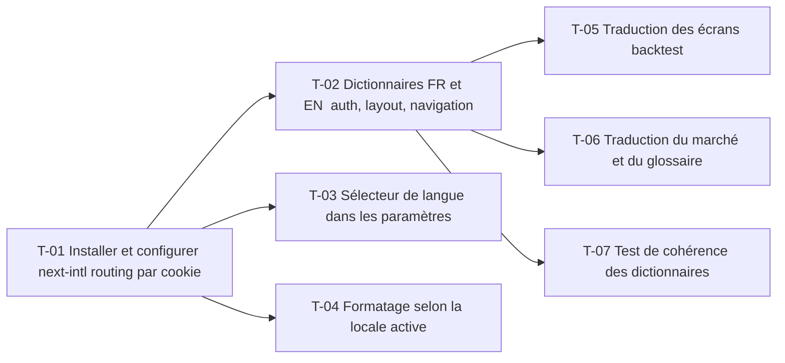

# 10 · Internationalisation du web (FR / EN) — Tâches

> Décisions : `US.md`. Échelle de points, statuts et définition de terminé commune : [`roadmap/README.md`](../README.md). Points prévus.

## Synthèse

| Tâche | Titre | US | Couche | Priorité | Points | Dépend de | Commits |
| --- | --- | --- | --- | --- | --- | --- | --- |
| T-01 | Installer et configurer next-intl (routing par cookie) | US-01 | web | MUST | 3 | — | — |
| T-02 | Dictionnaires FR et EN : auth, layout, navigation | US-01 | web | MUST | 5 | T-01 | — |
| T-03 | Sélecteur de langue dans les paramètres | US-01 | web | MUST | 2 | T-01 | — |
| T-04 | Formatage selon la locale active | US-02 | web | MUST | 3 | T-01 | — |
| T-05 | Traduction des écrans backtest | US-01 | web | MUST | 8 | T-02 | — |
| T-06 | Traduction du marché et du glossaire | US-01 | web | SHOULD | 5 | T-02 | — |
| T-07 | Test de cohérence des dictionnaires | US-03 | web | MUST | 2 | T-02 | — |

**Total** : 28 points — MUST 23, SHOULD 5.

| Lot | Tâches | Points |
| --- | --- | --- |
| 1. Socle | T-01 → T-04 | 13 |
| 2. Écrans | T-05 → T-07 | 15 |

**Chemin critique** (16 points) : T-01 → T-02 → T-05. Le plus long : la traduction des écrans backtest (T-05) doit attendre le socle (T-02).

**Parallélisable** : T-01 dès le début ; T-02, T-04 après T-01 ; T-05 et T-06 après T-02.

## Graphe des dépendances

---

## Lot 1 — Socle

### T-01 · Installer et configurer next-intl (routing par cookie)

- **US** : US-01 · **Priorité** : MUST · **Points** : 3 · **Dépend de** : — · **Commits** : —
- **Fichiers** : `apps/web/package.json`, `apps/web/src/i18n/*`, `apps/web/src/app/layout.tsx`

Critères d’acceptation :
- [ ] Une langue active lue depuis le cookie `locale`, FR par défaut.
- [ ] Aucune route préfixée par la langue (D2).

### T-02 · Dictionnaires FR et EN : auth, layout, navigation

- **US** : US-01 · **Priorité** : MUST · **Points** : 5 · **Dépend de** : T-01 · **Commits** : —
- **Fichiers** : `apps/web/messages/fr.json`, `apps/web/messages/en.json`

Critères d’acceptation :
- [ ] Les écrans auth, layout et menu lisent leurs libellés dans les dictionnaires.
- [ ] Aucun libellé FR en dur dans ces écrans.

### T-03 · Sélecteur de langue dans les paramètres

- **US** : US-01 · **Priorité** : MUST · **Points** : 2 · **Dépend de** : T-01 · **Commits** : —
- **Fichiers** : écran paramètres (`apps/web/src/app/(base)/settings`)

Critères d’acceptation :
- [ ] Le choix FR / EN change la langue sans recharger la session.
- [ ] Le choix est conservé après rechargement.

### T-04 · Formatage selon la locale active

- **US** : US-02 · **Priorité** : MUST · **Points** : 3 · **Dépend de** : T-01 · **Commits** : —
- **Fichiers** : `apps/web/src/lib/format.ts`

Critères d’acceptation :
- [ ] `LOCALE` n'est plus une constante fixe : devise, date et durée suivent la langue.
- [ ] Une valeur de 1234,5 s'affiche `1 234,50 €` en FR et `€1,234.50` en EN.

## Lot 2 — Écrans

### T-05 · Traduction des écrans backtest

- **US** : US-01 · **Priorité** : MUST · **Points** : 8 · **Dépend de** : T-02 · **Commits** : —
- **Fichiers** : `apps/web/src/features/backtest/*`

Critères d’acceptation :
- [ ] Liste, formulaire, résultat, comparaison et messages de validation traduits.
- [ ] Aucun libellé FR visible en locale EN sur le parcours backtest.

### T-06 · Traduction du marché et du glossaire

- **US** : US-01 · **Priorité** : SHOULD · **Points** : 5 · **Dépend de** : T-02 · **Commits** : —
- **Fichiers** : `apps/web/src/features/market/*`, `apps/web/src/constants/glossary.ts`

Critères d’acceptation :
- [ ] Liste, fiche et graphique traduits.
- [ ] Chaque entrée du glossaire existe en FR et en EN (formule et unité restent identiques).

### T-07 · Test de cohérence des dictionnaires

- **US** : US-03 · **Priorité** : MUST · **Points** : 2 · **Dépend de** : T-02 · **Commits** : —
- **Fichiers** : `apps/web/messages/*.test.ts`

Critères d’acceptation :
- [ ] Le test échoue si une clé existe en FR et pas en EN, ou l'inverse.
- [ ] `bun test` le lance.
