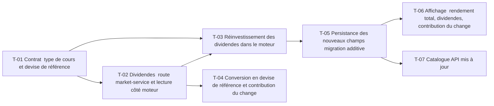

# 11 · Dividendes, splits et effet devise — Tâches

> Décisions : `US.md`. Échelle de points, statuts et définition de terminé commune : [`roadmap/README.md`](../README.md). Points prévus.

## Synthèse

| Tâche | Titre | US | Couche | Priorité | Points | Dépend de | Réalisé | Commits |
| --- | --- | --- | --- | --- | --- | --- | --- | --- |
| T-01 | Contrat : type de cours et devise de référence | US-01, US-03 | contracts | MUST | 2 | — | 3 | `19d4e4b` |
| T-02 | Dividendes : route market-service et lecture côté moteur | US-01 | market-service, backtest-engine | MUST | 5 | T-01 | 6 | `19d4e4b` |
| T-03 | Réinvestissement des dividendes dans le moteur | US-01 | backtest-engine | MUST | 5 | T-01, T-02 | 5 | `19d4e4b` |
| T-04 | Conversion en devise de référence et contribution du change | US-02 | backtest-engine | SHOULD | 5 | T-02 | 8 | `19d4e4b` |
| T-05 | Persistance des nouveaux champs (migration additive) | US-01, US-02 | core-backend | MUST | 3 | T-03 | 4 | `19d4e4b` |
| T-06 | Affichage : rendement total, dividendes, contribution du change | US-01, US-02 | web | MUST | 3 | T-05 | 8 | `360bb9d` |
| T-07 | Catalogue API mis à jour | US-01 | docs | SHOULD | 1 | T-05 | 2 | `19d4e4b` |

**Total** : 24 points prévus — MUST 18, SHOULD 6 ; 36 réalisés sur T-01 à T-07.

Écarts réalisés : T-01 2 → 3, `returnBreakdown`, `dividendEvents` et `priceOnlyValue` ajoutés au contrat pour la page dédiée ; T-02 5 → 6, devise par symbole et normalisation des sous-unités (TD-26) ; T-04 5 → 8, le moteur rejoue la simulation sans dividendes et en devise locale pour la décomposition ; T-05 3 → 4, cinq colonnes dont deux Json ; T-06 3 → 8, page dédiée (route, quatre composants, glossaire, traductions FR/EN) et maquettes 13 et 31 retouchées ; T-07 1 → 2, détail des nouveaux champs.

| Lot | Tâches | Points |
| --- | --- | --- |
| 1. Contrat | T-01 | 2 |
| 2. Données | T-02 → T-05 | 8 |
| 3. Moteur | T-03 → T-04 | 10 |
| 4. Écrans | T-06 → T-07 | 4 |

**Chemin critique** (16 points) : T-02 → T-03 → T-05 → T-06. T-03 : le réinvestissement touche le cœur du calcul et doit rester pur et testé ; c'est la tâche la plus risquée.

**Parallélisable** : T-01 dès le début ; T-04 après T-02 ; T-06 et T-07 après T-05.

## Graphe des dépendances

---

## Lot 1 — Contrat

### T-01 · Contrat : type de cours et devise de référence

- **US** : US-01, US-03 · **Priorité** : MUST · **Points** : 2 · **Dépend de** : — · **Commits** : —
- **Fichiers** : `packages/contracts/src/backtest.ts`

Critères d’acceptation :
- [x] `dataSourceSchema.priceType` accepte `TOTAL_RETURN` en plus de `CLOSE_SPLIT_ADJUSTED` (ajout, pas de rupture).
- [x] Champs nouveaux documentés en unité (ratio, devise EUR).

## Lot 2 — Données

### T-02 · Dividendes : route market-service et lecture côté moteur

- **US** : US-01 · **Priorité** : MUST · **Points** : 5 · **Dépend de** : T-01 · **Commits** : —
- **Fichiers** : `apps/market-service/routes/market/market.routes.ts`, `controller/market.controller.ts`, `services/market.service.ts`, `repositories/market.repository.ts`, `interfaces/market.interface.ts`, `API.md` ; `packages/contracts/src/market.ts` ; `apps/backtest-engine/repositories/market.repository.ts`

Yahoo Finance reste le seul fournisseur, appelé par market-service uniquement (D4).

Critères d’acceptation :
- [x] market-service expose les dividendes par symbole (`chart` avec `events: 'div'`) : date `YYYY-MM-DD` de l'ex-date dans le fuseau de la place, montant par titre dans la devise de cotation ; schéma zod dans `@azimut/contracts`.
- [x] Le repository du moteur lit cette route (clé interne, même politique de nouvel essai que `closes`), sans appeler Yahoo.
- [x] Un test couvre un titre sans dividende (liste vide, pas d'erreur).
- [x] Entrée ajoutée dans `apps/market-service/API.md`.

### T-05 · Persistance des nouveaux champs (migration additive)

- **US** : US-01, US-02 · **Priorité** : MUST · **Points** : 3 · **Dépend de** : T-03 · **Commits** : —
- **Fichiers** : `apps/core-backend/prisma/schema.prisma`, `prisma/migrations/`, `services/backtest.service.ts`

Critères d’acceptation :
- [x] Colonnes `priceReturn`, `dividendTotal`, `dividendGain`, `dividendEvents` et `returnBreakdown` nullables : les résultats anciens restent valides, sans recalcul.
- [x] Le mapping entrée → DTO est dans le service.

## Lot 3 — Moteur

### T-03 · Réinvestissement des dividendes dans le moteur

- **US** : US-01 · **Priorité** : MUST · **Points** : 5 · **Dépend de** : T-01, T-02 · **Commits** : —
- **Fichiers** : `apps/backtest-engine/engine/backtest.engine.ts`, `backtest.engine.test.ts`

Critères d’acceptation :
- [x] Un dividende de 1,595 $ sur 100 titres crédite 159,50 $ réinvestis au cours de l'ex-date, sans frais (D1).
- [x] Test de référence : parité avec un calcul à la main sur 2 ans.
- [x] Le rendement total dépasse le rendement cours seul sur un titre à dividende.

### T-04 · Conversion en devise de référence et contribution du change

- **US** : US-02 · **Priorité** : SHOULD · **Points** : 5 · **Dépend de** : T-02 · **Commits** : —
- **Fichiers** : `apps/backtest-engine/repositories/market.repository.ts` (paire `EURUSD=X` lue via `GET /api/market/closes`, sans nouvelle route), `engine/backtest.engine.ts`

Critères d’acceptation :
- [x] Un actif en USD est converti au cours EUR/USD du jour (D3).
- [x] Le résultat donne `returnBreakdown.fx` = rendement EUR − rendement local (local + contribution = EUR, critère d'US-02).

## Lot 4 — Écrans

### T-06 · Affichage : rendement total, dividendes, contribution du change

- **US** : US-01, US-02 · **Priorité** : MUST · **Points** : 3 · **Dépend de** : T-05 · **Commits** : —
- **Fichiers** : `apps/web/src/app/app/backtest/[id]/dividends/page.tsx`, `features/backtest/backtest-dividends.tsx`, `return-breakdown.tsx`, `dividends-table.tsx`, `backtest-detail.tsx`

Critères d’acceptation :
- [x] Page `/app/backtest/<id>/dividends` (maquette 31) : cartes de rendement, décomposition, courbe avec et sans dividendes, tableau des dividendes ; bouton « Dividendes et change » sur le détail.
- [x] Les résultats antérieurs (champs null) masquent ces lignes ; aucune valeur recalculée côté web.

### T-07 · Catalogue API mis à jour

- **US** : US-01 · **Priorité** : SHOULD · **Points** : 1 · **Dépend de** : T-05 · **Commits** : —
- **Fichiers** : `apps/core-backend/API.md`

Critères d’acceptation :
- [x] La réponse de `GET /api/backtest/:id` documente les champs nullables.
