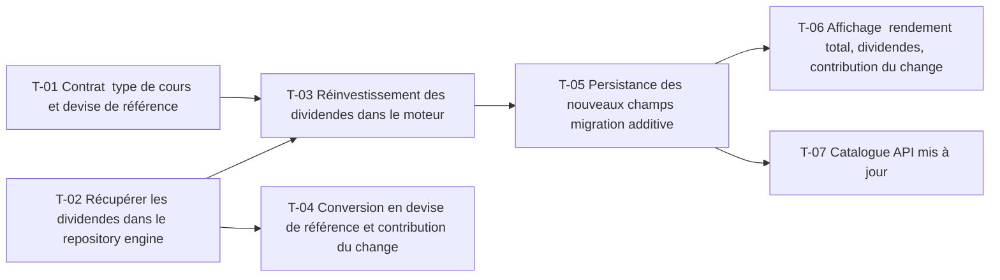

# 11 · Dividendes, splits et effet devise — Tâches

> Décisions : `US.md`. Échelle de points, statuts et définition de terminé commune : [`roadmap/README.md`](../README.md). Points prévus.

## Synthèse

| Tâche | Titre | US | Couche | Priorité | Points | Dépend de | Commits |
| --- | --- | --- | --- | --- | --- | --- | --- |
| T-01 | Contrat : type de cours et devise de référence | US-01, US-03 | contracts | MUST | 2 | — | — |
| T-02 | Récupérer les dividendes dans le repository engine | US-01 | backtest-engine | MUST | 3 | — | — |
| T-03 | Réinvestissement des dividendes dans le moteur | US-01 | backtest-engine | MUST | 5 | T-01, T-02 | — |
| T-04 | Conversion en devise de référence et contribution du change | US-02 | backtest-engine | SHOULD | 5 | T-02 | — |
| T-05 | Persistance des nouveaux champs (migration additive) | US-01, US-02 | core-backend | MUST | 3 | T-03 | — |
| T-06 | Affichage : rendement total, dividendes, contribution du change | US-01, US-02 | web | MUST | 3 | T-05 | — |
| T-07 | Catalogue API mis à jour | US-01 | docs | SHOULD | 1 | T-05 | — |

**Total** : 22 points — MUST 16, SHOULD 6.

| Lot | Tâches | Points |
| --- | --- | --- |
| 1. Contrat | T-01 | 2 |
| 2. Données | T-02 → T-05 | 6 |
| 3. Moteur | T-03 → T-04 | 10 |
| 4. Écrans | T-06 → T-07 | 4 |

**Chemin critique** (14 points) : T-02 → T-03 → T-05 → T-06. T-03 : le réinvestissement touche le cœur du calcul et doit rester pur et testé ; c'est la tâche la plus risquée.

**Parallélisable** : T-01, T-02 dès le début ; T-01 et T-02 ; T-04 après T-02 ; T-06 et T-07 après T-05.

## Graphe des dépendances

---

## Lot 1 — Contrat

### T-01 · Contrat : type de cours et devise de référence

- **US** : US-01, US-03 · **Priorité** : MUST · **Points** : 2 · **Dépend de** : — · **Commits** : —
- **Fichiers** : `packages/contracts/src/backtest.ts`

Critères d’acceptation :
- [ ] `dataSourceSchema.priceType` accepte `TOTAL_RETURN` en plus de `CLOSE_SPLIT_ADJUSTED` (ajout, pas de rupture).
- [ ] Champs nouveaux documentés en unité (ratio, devise EUR).

## Lot 2 — Données

### T-02 · Récupérer les dividendes dans le repository engine

- **US** : US-01 · **Priorité** : MUST · **Points** : 3 · **Dépend de** : — · **Commits** : —
- **Fichiers** : `apps/backtest-engine/repositories/market.repository.ts`

Critères d’acceptation :
- [ ] `chart` appelé avec `events: 'div|split'`.
- [ ] Un test couvre un titre sans dividende (liste vide, pas d'erreur).

### T-05 · Persistance des nouveaux champs (migration additive)

- **US** : US-01, US-02 · **Priorité** : MUST · **Points** : 3 · **Dépend de** : T-03 · **Commits** : —
- **Fichiers** : `apps/core-backend/prisma/schema.prisma`, `prisma/migrations/`, `services/backtest.service.ts`

Critères d’acceptation :
- [ ] Colonnes `dividendTotal` et `fxContribution` nullables : les résultats anciens restent valides, sans recalcul.
- [ ] Le mapping entrée → DTO est dans le service.

## Lot 3 — Moteur

### T-03 · Réinvestissement des dividendes dans le moteur

- **US** : US-01 · **Priorité** : MUST · **Points** : 5 · **Dépend de** : T-01, T-02 · **Commits** : —
- **Fichiers** : `apps/backtest-engine/engine/backtest.engine.ts`, `backtest.engine.test.ts`

Critères d’acceptation :
- [ ] Un dividende de 1,595 $ sur 100 titres crédite 159,50 $ réinvestis au cours de l'ex-date, sans frais (D1).
- [ ] Test de référence : parité avec un calcul à la main sur 2 ans.
- [ ] Le rendement total dépasse le rendement cours seul sur un titre à dividende.

### T-04 · Conversion en devise de référence et contribution du change

- **US** : US-02 · **Priorité** : SHOULD · **Points** : 5 · **Dépend de** : T-02 · **Commits** : —
- **Fichiers** : `apps/backtest-engine/repositories/market.repository.ts` (paire `EURUSD=X`), `engine/backtest.engine.ts`

Critères d’acceptation :
- [ ] Un actif en USD est converti au cours EUR/USD du jour (D3).
- [ ] Le résultat donne `fxContribution` = rendement local − rendement EUR.

## Lot 4 — Écrans

### T-06 · Affichage : rendement total, dividendes, contribution du change

- **US** : US-01, US-02 · **Priorité** : MUST · **Points** : 3 · **Dépend de** : T-05 · **Commits** : —
- **Fichiers** : `apps/web/src/features/backtest/result-metrics.tsx`, `backtest-assumptions.tsx`

Critères d’acceptation :
- [ ] Ligne « Dividendes perçus » et « Rendement total » visibles.
- [ ] Les résultats antérieurs (champs null) masquent ces lignes ; aucune valeur recalculée côté web.

### T-07 · Catalogue API mis à jour

- **US** : US-01 · **Priorité** : SHOULD · **Points** : 1 · **Dépend de** : T-05 · **Commits** : —
- **Fichiers** : `apps/core-backend/API.md`

Critères d’acceptation :
- [ ] La réponse de `GET /api/backtest/:id` documente les champs nullables.
