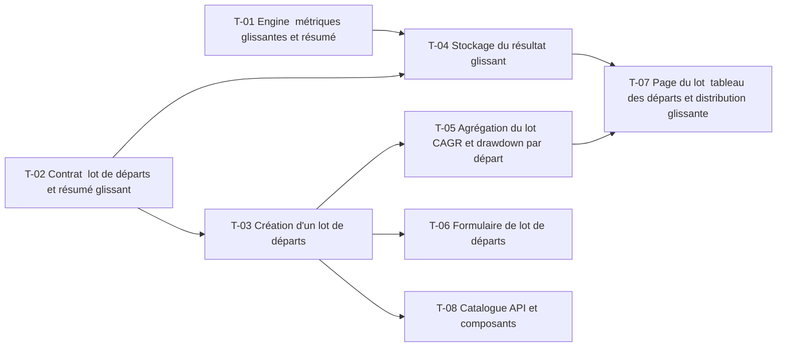

# 12 · Robustesse : dates de départ et métriques glissantes — Tâches

> Décisions : `US.md`. Échelle de points, statuts et définition de terminé commune : [`roadmap/README.md`](../README.md). Points prévus.

## Synthèse

| Tâche | Titre | US | Couche | Priorité | Points | Dépend de | Réalisé | Commits |
| --- | --- | --- | --- | --- | --- | --- | --- | --- |
| T-01 | Engine : métriques glissantes et résumé | US-02 | backtest-engine | MUST | 5 | — | 5 | `d840be9` |
| T-02 | Contrat : lot de départs et résumé glissant | US-01, US-02 | contracts | MUST | 2 | — | 3 | `d840be9` |
| T-03 | Création d'un lot de départs | US-01 | core-backend | MUST | 5 | T-02 | 8 | `d840be9` |
| T-04 | Stockage du résultat glissant | US-02 | core-backend | MUST | 3 | T-01, T-02 | 3 | `d840be9` |
| T-05 | Agrégation du lot : CAGR et drawdown par départ | US-01 | core-backend | MUST | 3 | T-03 | 3 | `d840be9` |
| T-06 | Formulaire de lot de départs | US-01 | web | MUST | 3 | T-03 | 5 | `d840be9` |
| T-07 | Page du lot : tableau des départs et distribution glissante | US-01, US-02 | web | SHOULD | 5 | T-04, T-05 | 8 | `d840be9` |
| T-08 | Catalogue API et composants | US-01 | docs | SHOULD | 1 | T-03 | 1 | `d840be9` |

**Total** : 27 points prévus — MUST 21, SHOULD 6 ; 36 réalisés (estimés a posteriori d'après le diff).

Écarts réalisés : T-02 2 → 3, schémas de lecture du lot, des rangs et des fenêtres ; T-03 5 → 8, relance d'un lot, ajout de départs et nouveau lot en plus de la création ; T-06 3 → 5, sélecteur de date partagé (`date-picker.tsx`) ; T-07 5 → 8, courbe par date d'entrée, rangs et bouton « Robustesse » du détail (maquette 32).

| Lot | Tâches | Points |
| --- | --- | --- |
| 1. Moteur | T-01 | 5 |
| 2. Contrat | T-02 | 2 |
| 3. Service | T-03 → T-05 | 8 |
| 4. Données | T-04 | 3 |
| 5. Écrans | T-06 → T-08 | 9 |

**Chemin critique** (15 points) : T-02 → T-03 → T-05 → T-07. T-03 : le lot crée N exécutions ; le rejeu doit rester idempotent par départ.

**Parallélisable** : T-01, T-02 dès le début ; T-01, T-02 ; T-03 après T-02 ; T-06 après T-03.

## Graphe des dépendances

---

## Lot 1 — Moteur

### T-01 · Engine : métriques glissantes et résumé

- **US** : US-02 · **Priorité** : MUST · **Points** : 5 · **Dépend de** : — · **Commits** : `d840be9`
- **Fichiers** : `apps/backtest-engine/engine/rolling.ts`, `rolling.test.ts`

Critères d’acceptation :
- [x] Fenêtres d'1, 3 et 5 ans, pas d'un jour ouvré (D2).
- [x] Résumé : pire, médiane, meilleure fenêtre, part des fenêtres négatives.
- [x] Fonction pure ; un jeu de test à résultat connu.

## Lot 2 — Contrat

### T-02 · Contrat : lot de départs et résumé glissant

- **US** : US-01, US-02 · **Priorité** : MUST · **Points** : 2 · **Dépend de** : — · **Commits** : `d840be9`
- **Fichiers** : `packages/contracts/src/backtest.ts`

Critères d’acceptation :
- [x] `startDates` (liste de dates, 2 à 10) ajouté à la demande, `batchId` au résultat.
- [x] Schéma zod avec validation des bornes.

## Lot 3 — Service

### T-03 · Création d'un lot de départs

- **US** : US-01 · **Priorité** : MUST · **Points** : 5 · **Dépend de** : T-02 · **Commits** : `d840be9`
- **Fichiers** : `apps/core-backend/services/backtest.service.ts`, `routes/backtest/backtest.routes.ts`

Critères d’acceptation :
- [x] Une requête crée N backtests liés par `batchId`, un `backtest.requested` par départ.
- [x] Rejeu idempotent : l'enregistrement du lot est atomique (rien n'est publié s'il échoue, testé) ; le rejeu d'un événement est sans effet, la transition étant gardée par statut (`backtest.started`, testé). Un second `POST /batch` identique crée un nouveau lot : voulu, pas de clé d'idempotence côté client.
- [x] Un départ trop proche de la fin est refusé (400).

### T-05 · Agrégation du lot : CAGR et drawdown par départ

- **US** : US-01 · **Priorité** : MUST · **Points** : 3 · **Dépend de** : T-03 · **Commits** : `d840be9`
- **Fichiers** : `apps/core-backend/services/backtest.service.ts`

Critères d’acceptation :
- [x] Liste triée par date de départ avec CAGR, volatilité et drawdown.
- [x] Calcul côté service à partir des résultats stockés, sans recalcul moteur.

## Lot 4 — Données

### T-04 · Stockage du résultat glissant

- **US** : US-02 · **Priorité** : MUST · **Points** : 3 · **Dépend de** : T-01, T-02 · **Commits** : `d840be9`
- **Fichiers** : `apps/core-backend/prisma/schema.prisma`, `prisma/migrations/`

Critères d’acceptation :
- [x] Champ JSON nullable `rollingSummary` sur `BacktestResult`.
- [x] Migration additive.

## Lot 5 — Écrans

### T-06 · Formulaire de lot de départs

- **US** : US-01 · **Priorité** : MUST · **Points** : 3 · **Dépend de** : T-03 · **Commits** : `d840be9`
- **Fichiers** : `apps/web/src/features/backtest/new-backtest-form.tsx`

Critères d’acceptation :
- [x] Saisie de 2 à 10 dates de départ.
- [x] Valeurs affichées telles que reçues ; validation de forme seulement.

### T-07 · Page du lot : tableau des départs et distribution glissante

- **US** : US-01, US-02 · **Priorité** : SHOULD · **Points** : 5 · **Dépend de** : T-04, T-05 · **Commits** : `d840be9`
- **Fichiers** : `apps/web/src/features/backtest/` (nouveau composant lot)

Critères d’acceptation :
- [x] Tableau d'un départ par ligne.
- [x] Distribution : pire, médiane, meilleure, part négative, affichées telles que reçues.

### T-08 · Catalogue API et composants

- **US** : US-01 · **Priorité** : SHOULD · **Points** : 1 · **Dépend de** : T-03 · **Commits** : `d840be9`
- **Fichiers** : `apps/core-backend/API.md`, `apps/web/COMPONENTS.md`

Critères d’acceptation :
- [x] Routes et composants du lot documentés.
