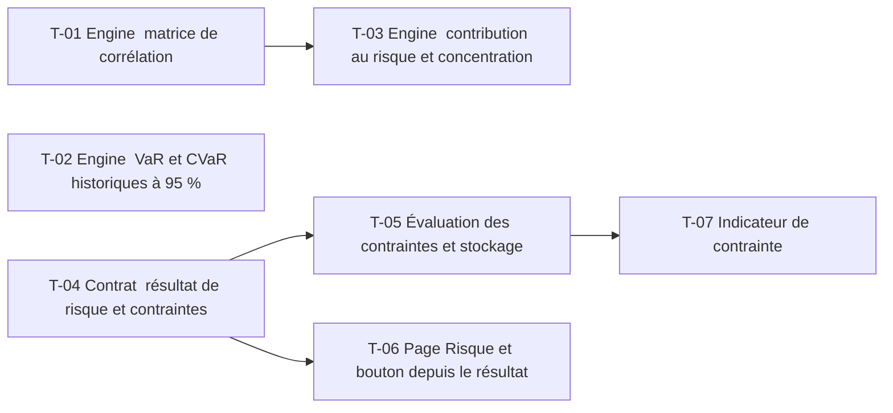

# 13 · Risk Engine — Tâches

> Décisions : `US.md`. Échelle de points, statuts et définition de terminé commune : [`roadmap/README.md`](../README.md). Points prévus.

## Synthèse

| Tâche | Titre | US | Couche | Priorité | Points | Dépend de | Commits |
| --- | --- | --- | --- | --- | --- | --- | --- |
| T-01 | Engine : matrice de corrélation | US-01 | backtest-engine | MUST | 3 | — | — |
| T-02 | Engine : VaR et CVaR historiques à 95 % | US-02 | backtest-engine | MUST | 3 | — | — |
| T-03 | Engine : contribution au risque et concentration | US-01, US-03 | backtest-engine | MUST | 5 | T-01 | — |
| T-04 | Contrat : résultat de risque et contraintes | US-03 | contracts | MUST | 2 | — | — |
| T-05 | Évaluation des contraintes et stockage | US-03 | core-backend | MUST | 5 | T-04 | — |
| T-06 | Page Risque et bouton depuis le résultat | US-01, US-02 | web | SHOULD | 5 | T-04 | — |
| T-07 | Indicateur de contrainte | US-03 | web | SHOULD | 2 | T-05 | — |

**Total** : 25 points — MUST 18, SHOULD 7.

| Lot | Tâches | Points |
| --- | --- | --- |
| 1. Moteur | T-01 → T-03 | 11 |
| 2. Contrat | T-04 | 2 |
| 3. Service | T-05 | 5 |
| 4. Écrans | T-06 → T-07 | 7 |

**Chemin critique** (9 points) : T-04 → T-05 → T-07. T-03 : la formule de contribution au risque est la plus facile à mal écrire ; le test à deux actifs doit être fait avant l'intégration.

**Parallélisable** : T-01, T-02, T-04 dès le début ; T-01, T-02, T-04 dès le début ; T-06 et T-07 après T-04 et T-05.

## Graphe des dépendances

---

## Lot 1 — Moteur

### T-01 · Engine : matrice de corrélation

- **US** : US-01 · **Priorité** : MUST · **Points** : 3 · **Dépend de** : — · **Commits** : —
- **Fichiers** : `apps/backtest-engine/engine/risk.ts`, `risk.test.ts`

Critères d’acceptation :
- [ ] Corrélation de Pearson des rendements journaliers, entre −1 et 1.
- [ ] Diagonale = 1 ; symétrie vérifiée par test.

### T-02 · Engine : VaR et CVaR historiques à 95 %

- **US** : US-02 · **Priorité** : MUST · **Points** : 3 · **Dépend de** : — · **Commits** : —
- **Fichiers** : `apps/backtest-engine/engine/risk.ts`

Critères d’acceptation :
- [ ] VaR = quantile 5 % des rendements journaliers ; CVaR = moyenne des pires 5 %.
- [ ] Ratios ≤ 0, un jour (D1).

### T-03 · Engine : contribution au risque et concentration

- **US** : US-01, US-03 · **Priorité** : MUST · **Points** : 5 · **Dépend de** : T-01 · **Commits** : —
- **Fichiers** : `apps/backtest-engine/engine/risk.ts`

Critères d’acceptation :
- [ ] Contribution de chaque actif à la variance : wᵢ (Σw)ᵢ / σ², somme = 1.
- [ ] Concentration = indice de Herfindahl des poids.
- [ ] Test sur un portefeuille à deux actifs non corrélés.

## Lot 2 — Contrat

### T-04 · Contrat : résultat de risque et contraintes

- **US** : US-03 · **Priorité** : MUST · **Points** : 2 · **Dépend de** : — · **Commits** : —
- **Fichiers** : `packages/contracts/src/risk.ts`

Critères d’acceptation :
- [ ] `riskSchema` et `riskConstraintSchema` (drawdown max, ratio ≤ 0).

## Lot 3 — Service

### T-05 · Évaluation des contraintes et stockage

- **US** : US-03 · **Priorité** : MUST · **Points** : 5 · **Dépend de** : T-04 · **Commits** : —
- **Fichiers** : `apps/core-backend/services/risk.service.ts`, `prisma/schema.prisma`

Critères d’acceptation :
- [ ] Chaque contrainte renvoie respectée / non respectée, avec la valeur mesurée.
- [ ] Migration additive ; pas de recalcul côté web.

## Lot 4 — Écrans

### T-06 · Page Risque et bouton depuis le résultat

- **US** : US-01, US-02 · **Priorité** : SHOULD · **Points** : 5 · **Dépend de** : T-04 · **Commits** : —
- **Fichiers** : `apps/web/src/features/backtest/` (bouton « Risque » du détail), `apps/web/src/features/risk/` (page, maquette 33)

Critères d’acceptation :
- [ ] Matrice de corrélation en carte de chaleur, VaR et CVaR, contributions au risque.
- [ ] Valeurs affichées telles que reçues.

### T-07 · Indicateur de contrainte

- **US** : US-03 · **Priorité** : SHOULD · **Points** : 2 · **Dépend de** : T-05 · **Commits** : —
- **Fichiers** : `apps/web/src/features/backtest/`

Critères d’acceptation :
- [ ] « Contrainte respectée » ou « non respectée » avec la valeur mesurée.
