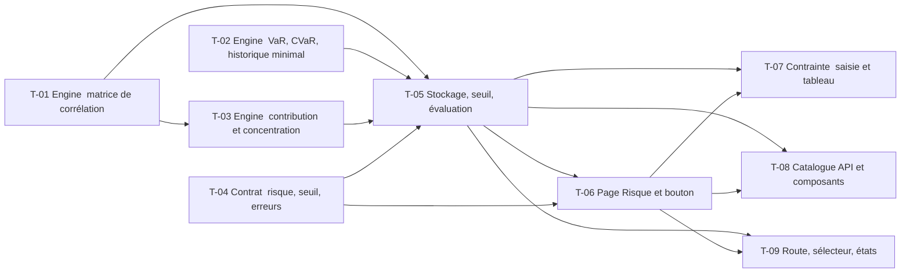

# 13 · Risk Engine — Tâches

> Décisions : `README.md` (D1 à D21) ; calculs et jeux de test : `US.md`. Échelle de points, statuts et définition de terminé commune : [`roadmap/README.md`](../README.md). Points prévus. Écran : [`MAQUETTE.md`](MAQUETTE.md).

## Synthèse

| Tâche | Titre | US | Couche | Priorité | Points | Dépend de | Commits |
| --- | --- | --- | --- | --- | --- | --- | --- |
| T-01 | Engine : matrice de corrélation | US-01 | backtest-engine | MUST | 3 | — | — |
| T-02 | Engine : VaR et CVaR historiques à 95 %, historique minimal | US-02 | backtest-engine | MUST | 5 | — | — |
| T-03 | Engine : contribution au risque et concentration | US-01 | backtest-engine | MUST | 5 | T-01 | — |
| T-04 | Contrat : résultat de risque, seuil et erreurs | US-01, US-02, US-03 | contracts | MUST | 3 | — | — |
| T-05 | Stockage du risque, seuil et évaluation de la contrainte | US-02, US-03 | core-backend | MUST | 8 | T-01, T-02, T-03, T-04 | — |
| T-06 | Page Risque et bouton depuis le résultat | US-01, US-02 | web | SHOULD | 5 | T-04, T-05 | — |
| T-07 | Contrainte de drawdown : saisie et tableau | US-03 | web | SHOULD | 3 | T-05, T-06 | — |
| T-08 | Catalogue API et composants | US-03 | docs | SHOULD | 1 | T-05, T-06 | — |
| T-09 | Page Risque : route, sélecteur et états | US-04 | web | SHOULD | 4 | T-05, T-06 | — |

**Total** : 37 points — MUST 24, SHOULD 13.

| Lot | Tâches | Points |
| --- | --- | --- |
| 1. Moteur | T-01 → T-03 | 13 |
| 2. Contrat et service | T-04 → T-05 | 11 |
| 3. Écrans | T-06 → T-09 | 13 |

**Chemin critique** (19 points) : T-01 → T-03 → T-05 → T-06 → T-07. T-03 : la formule de contribution au risque est la plus facile à mal écrire ; le test à deux actifs non corrélés (`0,2` et `0,8`) se fait avant l'intégration. T-05 : le seuil et le risque s'ajoutent à des résultats déjà en base, donc colonnes nullables.

**Parallélisable** : T-01, T-02, T-04 dès le début ; T-06 après T-05 (ou en parallèle sur des données simulées après T-04).

## Graphe des dépendances

---

## Lot 1 — Moteur

### T-01 · Engine : matrice de corrélation

- **US** : US-01 · **Priorité** : MUST · **Points** : 3 · **Dépend de** : — · **Commits** : —
- **Fichiers** : `apps/backtest-engine/engine/risk.ts`, `apps/backtest-engine/test/risk.test.ts`

Critères d’acceptation :
- [ ] Corrélation de Pearson des rendements journaliers, entre −1 et 1, actifs dans l'ordre de l'allocation.
- [ ] Diagonale = 1 ; symétrie vérifiée par test.
- [ ] Jeux connus de `US.md` (`1`, `−1`, `0`).
- [ ] Fonction pure : rendements en paramètre, aucune I/O ni horloge.

### T-02 · Engine : VaR et CVaR historiques à 95 %, historique minimal

- **US** : US-02 · **Priorité** : MUST · **Points** : 5 · **Dépend de** : — · **Commits** : —
- **Fichiers** : `apps/backtest-engine/engine/risk.ts`, `apps/backtest-engine/test/risk.test.ts`, `apps/backtest-engine/engine/backtest.engine.ts` (série des rendements journaliers en EUR, jours communs)

Critères d’acceptation :
- [ ] VaR = `k`-ième plus petit rendement, CVaR = moyenne des `k` plus petits, `k = ceil(0,05 × n)` ; ratios un jour (D1).
- [ ] Jeu connu de `US.md` : VaR `−0,46`, CVaR `−0,48`.
- [ ] Rendements journaliers en EUR, change inclus (D5), sur les jours de cotation communs à tous les actifs.
- [ ] Moins de 250 jours communs : aucun résultat de risque (`null`), pas d'exception (D6).

### T-03 · Engine : contribution au risque et concentration

- **US** : US-01 · **Priorité** : MUST · **Points** : 5 · **Dépend de** : T-01 · **Commits** : —
- **Fichiers** : `apps/backtest-engine/engine/risk.ts`, `apps/backtest-engine/test/risk.test.ts`

Critères d’acceptation :
- [ ] Contribution de chaque actif à la variance : `wᵢ (Σw)ᵢ / σ²`, somme = 1 ; aucun arrondi appliqué à un cumul.
- [ ] Volatilité annualisée du portefeuille et de chaque actif (colonnes `Volatilité` et carte « Volatilité annualisée »).
- [ ] Concentration : HHI des poids et actifs effectifs `1 / HHI` ; poids maximal (D7).
- [ ] Test sur un portefeuille à deux actifs non corrélés (`0,2` et `0,8`) et sur 30/30/30/10 (HHI `0,28`).

## Lot 2 — Contrat et service

### T-04 · Contrat : résultat de risque, seuil et erreurs

- **US** : US-01, US-02, US-03 · **Priorité** : MUST · **Points** : 3 · **Dépend de** : — · **Commits** : —
- **Fichiers** : `packages/contracts/src/risk.ts`, `packages/contracts/src/backtest.ts` (le risque, optionnel, dans `backtestCompletedPayloadSchema`), `packages/contracts/src/error.ts`

Critères d’acceptation :
- [ ] `riskSchema` : volatilité annualisée, VaR, CVaR, corrélations (actifs et matrice), contributions, expositions par actif (poids, volatilité), HHI, actifs effectifs, poids maximal ; chaque champ numérique commenté avec son unité (ratio, un jour, ordre des actifs).
- [ ] `riskConstraintSchema` : `maxDrawdownLimit` ratio de 0,01 à 0,99, zod ; mesuré, statut, limite renvoyés par l'API.
- [ ] Code d'erreur dédié à un seuil invalide, avec libellés FR et EN.
- [ ] Producteur (engine) et consommateur (core-backend) modifiés dans le même diff ; signaler de redémarrer les services concernés.

### T-05 · Stockage du risque, seuil et évaluation de la contrainte

- **US** : US-02, US-03 · **Priorité** : MUST · **Points** : 8 · **Dépend de** : T-01, T-02, T-03, T-04 · **Commits** : —
- **Fichiers** : `apps/core-backend/services/risk.service.ts`, `apps/core-backend/controller/`, `routes/`, `repositories/backtest.repository.ts`, `prisma/schema.prisma`, `prisma/migrations/`, `test/risk.service.test.ts`, `apps/backtest-engine/` (publication du risque)

Critères d’acceptation :
- [ ] Le consommateur de `backtest.completed` stocke le risque dans une colonne `Json?` du résultat ; message invalide loggué et ignoré.
- [ ] Seuil `maxDrawdownLimit` (entier de 1 à 99 en pourcentage, ratio stocké) et **2 dernières vérifications** (D12) : colonnes nullables sur le backtest ; route de lecture et de modification (propriétaire seulement), validation 1 % à 99 %, erreur 400 traduite.
- [ ] Réponse de la page Risque : risque, statut de la contrainte (respectée / non respectée, valeur mesurée = `maxDrawdown` stocké, limite), sans relancer l'engine. Jeux connus de `US.md`.
- [ ] Anciens backtests : risque `null`, aucune exception ; backtest non terminé ou en échec : état dédié renvoyé (D17).
- [ ] Phrases de lecture : le backend fournit la paire la plus corrélée et l'actif contribuant le plus (D14).
- [ ] Migration additive (colonnes nullables) ; aucun SQL écrit à la main hors migration.
- [ ] Tests : service avec faux repository, route avec `startApp`, repository sur `trading_test`.

## Lot 3 — Écrans

### T-06 · Page Risque et bouton depuis le résultat

- **US** : US-01, US-02 · **Priorité** : SHOULD · **Points** : 5 · **Dépend de** : T-04, T-05 · **Commits** : —
- **Fichiers** : `apps/web/src/features/backtest/` (bouton « Risque » du détail, après « Robustesse »), `apps/web/src/features/risk/` (page, cartes, matrice, contributions), `apps/web/messages/fr.json`, `en.json`

Critères d’acceptation :
- [ ] Les blocs de `MAQUETTE.md` : en-tête (titre, badge `Calculé`, `Choisir un backtest`), quatre cartes, matrice en carte de chaleur, contribution au risque, expositions par actif, avec les libellés exacts.
- [ ] Valeurs affichées telles que reçues (conversion de ratio en pourcentage seulement) ; `<Dash />` pour un risque absent.
- [ ] Message « données insuffisantes » seul, sans carte partielle (D16) ; textes et phrases de lecture dans `messages/` FR / EN (D14).
- [ ] Volatilité annualisée avec pastille « période » (D13) ; pas de pastille « Données au … » (D15).
- [ ] Bouton « Risque » : contour, 3ᵉ position de l'en-tête du résultat, vers la page du backtest.

### T-07 · Contrainte de drawdown : saisie et tableau

- **US** : US-03 · **Priorité** : SHOULD · **Points** : 3 · **Dépend de** : T-05, T-06 · **Commits** : —
- **Fichiers** : `apps/web/src/features/risk/`

Critères d’acceptation :
- [ ] Champ « Drawdown maximal accepté » vide au départ, entier de 1 à 99 %, et bouton « Vérifier » ; erreur de validation affichée.
- [ ] Lignes `Actuelle` et `Précédente` (2 dernières vérifications, D12) ; pas de ligne `Précédente` à la première.
- [ ] Tableau `Vérification`, `Limite`, `Mesuré`, `Statut` ; badges « Respectée » (contour vert) et « Non respectée » (plein rouge) ; valeur mesurée en rouge si non respectée.
- [ ] Mention « Le passé ne garantit pas l’avenir… » sous le tableau.

### T-08 · Catalogue API et composants

- **US** : US-03 · **Priorité** : SHOULD · **Points** : 1 · **Dépend de** : T-05, T-06 · **Commits** : —
- **Fichiers** : `apps/core-backend/API.md`, `apps/web/COMPONENTS.md`, `apps/web/src/features/risk/COMPONENTS.md`

Critères d’acceptation :
- [ ] Routes du risque et du seuil, composants de la page Risque documentés selon les gabarits.

### T-09 · Page Risque : route, sélecteur et états

- **US** : US-04 · **Priorité** : SHOULD · **Points** : 4 · **Dépend de** : T-05, T-06 · **Commits** : —
- **Fichiers** : `apps/web/src/app/(base)/risk/page.tsx`, `apps/web/src/features/risk/`, entrée de la barre latérale, `apps/web/messages/fr.json`, `en.json`

Critères d’acceptation :
- [ ] Route `/app/risk?backtest=<id>` ; entrée « Risque » dans le groupe « Analyse » (D11).
- [ ] Sélecteur « Choisir un backtest » : liste des backtests terminés de l'utilisateur.
- [ ] États : vide (aucun backtest), chargement (squelette), données insuffisantes, sans risque avec bouton « Relancer le backtest » (D17), erreur ; thème sombre et mobile.
- [ ] Badge `Calculé` seulement avec un risque présent.
