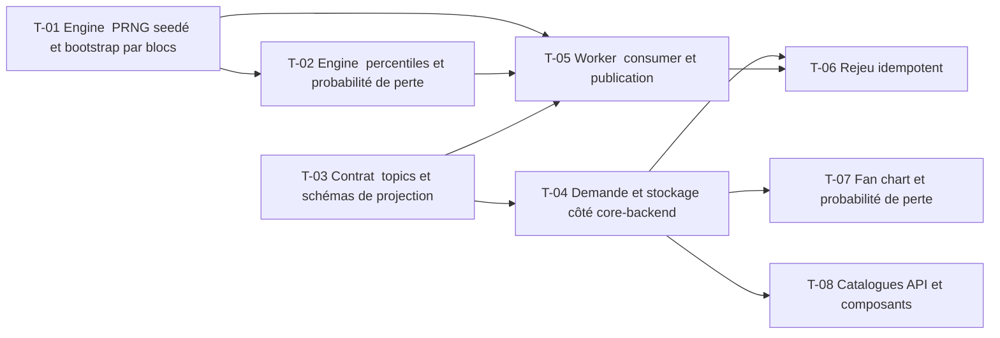

# 14 · Projection Monte Carlo — Tâches

> Décisions : `US.md`. Échelle de points, statuts et définition de terminé commune : [`roadmap/README.md`](../README.md). Points prévus.

## Synthèse

| Tâche | Titre | US | Couche | Priorité | Points | Dépend de | Commits |
| --- | --- | --- | --- | --- | --- | --- | --- |
| T-01 | Engine : PRNG seedé et bootstrap par blocs | US-01, US-03 | backtest-engine | MUST | 5 | — | — |
| T-02 | Engine : percentiles et probabilité de perte | US-01, US-02 | backtest-engine | MUST | 3 | T-01 | — |
| T-03 | Contrat : topics et schémas de projection | US-03 | contracts | MUST | 2 | — | — |
| T-04 | Demande et stockage côté core-backend | US-01 | core-backend | MUST | 5 | T-03 | — |
| T-05 | Worker : consumer et publication | US-01 | backtest-engine | MUST | 3 | T-01, T-02, T-03 | — |
| T-06 | Rejeu idempotent | US-03 | core-backend | MUST | 2 | T-04, T-05 | — |
| T-07 | Fan chart et probabilité de perte | US-01, US-02 | web | MUST | 5 | T-04 | — |
| T-08 | Catalogues API et composants | US-01 | docs | SHOULD | 1 | T-04 | — |

**Total** : 26 points — MUST 25, SHOULD 1.

| Lot | Tâches | Points |
| --- | --- | --- |
| 1. Moteur | T-01 → T-02 | 8 |
| 2. Contrat | T-03 | 2 |
| 3. Service | T-04 | 5 |
| 4. Worker | T-05 → T-06 | 5 |
| 5. Écrans | T-07 → T-08 | 6 |

**Chemin critique** (13 points) : T-01 → T-02 → T-05 → T-06. T-01 : la reproductibilité doit tenir sur toute la boucle (même seed, même ordre de tirage). Un test de non-régression sur une seed fixe le protège.

**Parallélisable** : T-01, T-03 dès le début ; T-01, T-03 dès le début ; T-07 après T-04.

## Graphe des dépendances

---

## Lot 1 — Moteur

### T-01 · Engine : PRNG seedé et bootstrap par blocs

- **US** : US-01, US-03 · **Priorité** : MUST · **Points** : 5 · **Dépend de** : — · **Commits** : —
- **Fichiers** : `apps/backtest-engine/engine/projection.ts`, `projection.test.ts`

Critères d’acceptation :
- [ ] Même seed et mêmes entrées : sortie identique (test de reproductibilité).
- [ ] Blocs de 21 jours ouvrés (D2) ; 10 000 trajectoires.

### T-02 · Engine : percentiles et probabilité de perte

- **US** : US-01, US-02 · **Priorité** : MUST · **Points** : 3 · **Dépend de** : T-01 · **Commits** : —
- **Fichiers** : `apps/backtest-engine/engine/projection.ts`

Critères d’acceptation :
- [ ] Percentiles 10, 50, 90 par date ; probabilité que la valeur finale soit < capital investi.
- [ ] Test sur une série constante (résultat connu).

## Lot 2 — Contrat

### T-03 · Contrat : topics et schémas de projection

- **US** : US-03 · **Priorité** : MUST · **Points** : 2 · **Dépend de** : — · **Commits** : —
- **Fichiers** : `packages/contracts/src/projection.ts`, `packages/contracts/src/index.ts`

Critères d’acceptation :
- [ ] `projection.requested` et `projection.completed` ; enveloppe `KafkaEvent`.
- [ ] Chaque champ numérique documente son unité.

## Lot 3 — Service

### T-04 · Demande et stockage côté core-backend

- **US** : US-01 · **Priorité** : MUST · **Points** : 5 · **Dépend de** : T-03 · **Commits** : —
- **Fichiers** : `apps/core-backend/services/projection.service.ts`, `prisma/schema.prisma`, `routes/projection/`

Critères d’acceptation :
- [ ] POST crée une projection `PENDING`, publie `projection.requested`.
- [ ] Seules les courbes de percentiles sont stockées, pas les trajectoires.

## Lot 4 — Worker

### T-05 · Worker : consumer et publication

- **US** : US-01 · **Priorité** : MUST · **Points** : 3 · **Dépend de** : T-01, T-02, T-03 · **Commits** : —
- **Fichiers** : `apps/backtest-engine/consumers/projection.consumer.ts`, `publishers/`

Critères d’acceptation :
- [ ] Consomme `projection.requested`, publie `projection.completed` ou un échec.
- [ ] Un message invalide est loggué et ignoré.

### T-06 · Rejeu idempotent

- **US** : US-03 · **Priorité** : MUST · **Points** : 2 · **Dépend de** : T-04, T-05 · **Commits** : —
- **Fichiers** : `apps/core-backend/consumers/projection.consumer.ts`

Critères d’acceptation :
- [ ] Un `projection.completed` rejoué ne crée pas de deuxième résultat.

## Lot 5 — Écrans

### T-07 · Fan chart et probabilité de perte

- **US** : US-01, US-02 · **Priorité** : MUST · **Points** : 5 · **Dépend de** : T-04 · **Commits** : —
- **Fichiers** : `apps/web/src/features/projection/` (nouveau)

Critères d’acceptation :
- [ ] Médiane et bandes P10-P90 dans le temps.
- [ ] La probabilité de perte est affichée telle que reçue, avec la mention « scénarios construits sur l'historique ».

### T-08 · Catalogues API et composants

- **US** : US-01 · **Priorité** : SHOULD · **Points** : 1 · **Dépend de** : T-04 · **Commits** : —
- **Fichiers** : `apps/core-backend/API.md`, `apps/web/COMPONENTS.md`

Critères d’acceptation :
- [ ] Routes et composants documentés.
