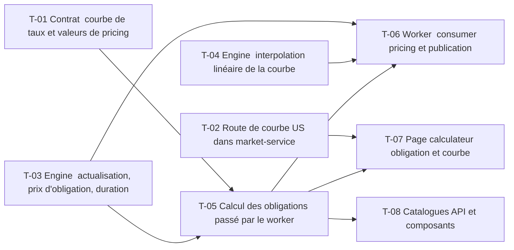

# 15 · Taux et obligations — Tâches

> Décisions : `US.md`. Échelle de points, statuts et définition de terminé commune : [`roadmap/README.md`](../README.md). Points prévus.

## Synthèse

| Tâche | Titre | US | Couche | Priorité | Points | Dépend de | Commits |
| --- | --- | --- | --- | --- | --- | --- | --- |
| T-01 | Contrat : courbe de taux et valeurs de pricing | US-01, US-02 | contracts | MUST | 2 | — | — |
| T-02 | Route de courbe US dans market-service | US-01 | market-service | MUST | 3 | — | — |
| T-03 | Engine : actualisation, prix d'obligation, duration | US-02 | backtest-engine | MUST | 5 | — | — |
| T-04 | Engine : interpolation linéaire de la courbe | US-01 | backtest-engine | MUST | 3 | — | — |
| T-05 | Calcul des obligations passé par le worker | US-02 | core-backend | MUST | 5 | T-01, T-03 | — |
| T-06 | Worker : consumer pricing et publication | US-02 | backtest-engine | MUST | 3 | T-03, T-04, T-05 | — |
| T-07 | Page calculateur obligation et courbe | US-01, US-02, US-03 | web | SHOULD | 5 | T-02, T-05 | — |
| T-08 | Catalogues API et composants | US-02 | docs | SHOULD | 1 | T-05 | — |

**Total** : 27 points — MUST 21, SHOULD 6.

| Lot | Tâches | Points |
| --- | --- | --- |
| 1. Contrat | T-01 | 2 |
| 2. Données | T-02 | 3 |
| 3. Moteur | T-03 → T-04 | 8 |
| 4. Service | T-05 | 5 |
| 5. Worker | T-06 | 3 |
| 6. Écrans | T-07 → T-08 | 6 |

**Chemin critique** (15 points) : T-03 → T-05 → T-07. T-05/T-06 : premier usage du pipeline pricing ; le contrat doit être figé ici, les options (16) l'étendent sans le casser.

**Parallélisable** : T-01, T-02, T-03, T-04 dès le début ; T-01, T-03, T-04 dès le début ; T-07 après T-02 et T-05.

## Graphe des dépendances

---

## Lot 1 — Contrat

### T-01 · Contrat : courbe de taux et valeurs de pricing

- **US** : US-01, US-02 · **Priorité** : MUST · **Points** : 2 · **Dépend de** : — · **Commits** : —
- **Fichiers** : `packages/contracts/src/pricing.ts`

Critères d’acceptation :
- [ ] Point de courbe : maturité en années (nombre), taux en ratio annuel (0,045 = 4,5 %), devise.
- [ ] Ajout de `pricing.requested` et `pricing.completed` (enveloppe `KafkaEvent`).

## Lot 2 — Données

### T-02 · Route de courbe US dans market-service

- **US** : US-01 · **Priorité** : MUST · **Points** : 3 · **Dépend de** : — · **Commits** : —
- **Fichiers** : `apps/market-service/routes/market/`, `repositories/market.repository.ts`, `API.md`

Critères d’acceptation :
- [ ] `GET /api/market/rates` renvoie les points `^IRX` (0,25 an), `^FVX` (5 ans), `^TNX` (10 ans), `^TYX` (30 ans).
- [ ] Taux en pourcentage Yahoo converti en ratio une seule fois, ici (D1).
- [ ] Route cataloguée dans `API.md`.

## Lot 3 — Moteur

### T-03 · Engine : actualisation, prix d'obligation, duration

- **US** : US-02 · **Priorité** : MUST · **Points** : 5 · **Dépend de** : — · **Commits** : —
- **Fichiers** : `apps/backtest-engine/engine/bonds.ts`, `bonds.test.ts`

Critères d’acceptation :
- [ ] Actualisation composée annuelle (D3) : PV = flux / (1 + r)^t.
- [ ] Prix d'un zéro-coupon à 3 % sur 5 ans = 86,26 pour 100.
- [ ] Duration de Macaulay et modifiée ; une hausse de 1 % des taux change le prix d'environ duration × 1 %.

### T-04 · Engine : interpolation linéaire de la courbe

- **US** : US-01 · **Priorité** : MUST · **Points** : 3 · **Dépend de** : — · **Commits** : —
- **Fichiers** : `apps/backtest-engine/engine/bonds.ts`

Critères d’acceptation :
- [ ] Taux à une maturité quelconque, interpolé entre deux points (D2).
- [ ] Hors de la courbe : erreur explicite, jamais d'extrapolation silencieuse.

## Lot 4 — Service

### T-05 · Calcul des obligations passé par le worker

- **US** : US-02 · **Priorité** : MUST · **Points** : 5 · **Dépend de** : T-01, T-03 · **Commits** : —
- **Fichiers** : `apps/core-backend/services/pricing.service.ts`, `routes/pricing/`, `prisma/schema.prisma`

Critères d’acceptation :
- [ ] POST crée une demande `PENDING`, publie `pricing.requested`.
- [ ] Résultat stocké (prix, duration) ; rejeu sans doublon.

## Lot 5 — Worker

### T-06 · Worker : consumer pricing et publication

- **US** : US-02 · **Priorité** : MUST · **Points** : 3 · **Dépend de** : T-03, T-04, T-05 · **Commits** : —
- **Fichiers** : `apps/backtest-engine/consumers/pricing.consumer.ts`, `publishers/`

Critères d’acceptation :
- [ ] Consomme `pricing.requested`, publie `pricing.completed` ou un échec.
- [ ] Message invalide loggué et ignoré.

## Lot 6 — Écrans

### T-07 · Page calculateur obligation et courbe

- **US** : US-01, US-02, US-03 · **Priorité** : SHOULD · **Points** : 5 · **Dépend de** : T-02, T-05 · **Commits** : —
- **Fichiers** : `apps/web/src/features/pricing/` (nouveau)

Critères d’acceptation :
- [ ] Courbe affichée telle que reçue.
- [ ] Prix et duration affichés telle que reçus du backend.

### T-08 · Catalogues API et composants

- **US** : US-02 · **Priorité** : SHOULD · **Points** : 1 · **Dépend de** : T-05 · **Commits** : —
- **Fichiers** : `apps/core-backend/API.md`, `apps/web/COMPONENTS.md`

Critères d’acceptation :
- [ ] Routes et composants documentés.
