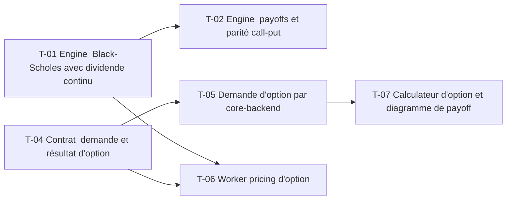

# 16 · Options vanilles : payoffs et Black-Scholes — Tâches

> Décisions : `US.md`. Échelle de points, statuts et définition de terminé commune : [`roadmap/README.md`](../README.md). Points prévus.

## Synthèse

| Tâche | Titre | US | Couche | Priorité | Points | Dépend de | Commits |
| --- | --- | --- | --- | --- | --- | --- | --- |
| T-01 | Engine : Black-Scholes avec dividende continu | US-01, US-03 | backtest-engine | MUST | 5 | — | — |
| T-02 | Engine : payoffs et parité call-put | US-01, US-02 | backtest-engine | MUST | 3 | T-01 | — |
| T-04 | Contrat : demande et résultat d'option | US-01, US-02 | contracts | MUST | 3 | — | — |
| T-05 | Demande d'option par core-backend | US-01 | core-backend | MUST | 3 | T-04 | — |
| T-06 | Worker : pricing d'option | US-01 | backtest-engine | MUST | 2 | T-01, T-04 | — |
| T-07 | Calculateur d'option et diagramme de payoff | US-01, US-02 | web | SHOULD | 5 | T-05 | — |

**Total** : 21 points — MUST 16, SHOULD 5. T-03 (chaîne d'options) est déplacée en 17 (T-08), décision D5.

| Lot | Tâches | Points |
| --- | --- | --- |
| 1. Moteur | T-01 → T-02 | 8 |
| 3. Contrat | T-04 | 3 |
| 4. Service | T-05 | 3 |
| 5. Worker | T-06 | 2 |
| 6. Écrans | T-07 | 5 |

**Chemin critique** (11 points) : T-04 → T-05 → T-07. T-01 : les formules doivent passer le test de référence avant toute intégration ; la parité est le filet de sécurité.

**Parallélisable** : T-01 et T-04 dès le début ; T-07 après T-05.

## Graphe des dépendances

---

## Lot 1 — Moteur

### T-01 · Engine : Black-Scholes avec dividende continu

- **US** : US-01, US-03 · **Priorité** : MUST · **Points** : 5 · **Dépend de** : — · **Commits** : —
- **Fichiers** : `apps/backtest-engine/engine/options.ts`, `options.test.ts`

Critères d’acceptation :
- [ ] Prix call et put avec taux r, dividende q, volatilité σ, maturité T.
- [ ] Test de référence : spot 100, strike 100, r 5 %, σ 20 %, T 1 an → call ≈ 10,45.

### T-02 · Engine : payoffs et parité call-put

- **US** : US-01, US-02 · **Priorité** : MUST · **Points** : 3 · **Dépend de** : T-01 · **Commits** : —
- **Fichiers** : `apps/backtest-engine/engine/options.ts`

Critères d’acceptation :
- [ ] Payoff à l'échéance : call = max(S − K, 0), put = max(K − S, 0), sur une grille de cours.
- [ ] Parité : C − P = S e^(−qT) − K e^(−rT), à 1e-6 près (test).

## Lot 3 — Contrat

### T-04 · Contrat : demande et résultat d'option

- **US** : US-01, US-02 · **Priorité** : MUST · **Points** : 3 · **Dépend de** : — · **Commits** : —
- **Fichiers** : `packages/contracts/src/pricing.ts`

Critères d’acceptation :
- [ ] Union sur `instrument` (`BOND`, `OPTION`) ; chaque champ numérique documente son unité (ratio, devise, années).

## Lot 4 — Service

### T-05 · Demande d'option par core-backend

- **US** : US-01 · **Priorité** : MUST · **Points** : 3 · **Dépend de** : T-04 · **Commits** : —
- **Fichiers** : `apps/core-backend/services/pricing.service.ts`, `interfaces/pricing.interface.ts`

Critères d’acceptation :
- [ ] Validation zod des paramètres ; mapping entrée → DTO dans le service.
- [ ] Réutilise le pipeline et la table de la feature 15 (T-05).

## Lot 5 — Worker

### T-06 · Worker : pricing d'option

- **US** : US-01 · **Priorité** : MUST · **Points** : 2 · **Dépend de** : T-01, T-04 · **Commits** : —
- **Fichiers** : `apps/backtest-engine/consumers/pricing.consumer.ts`

Critères d’acceptation :
- [ ] Le consumer 15 route l'instrument `OPTION` vers `options.ts`.

## Lot 6 — Écrans

### T-07 · Calculateur d'option et diagramme de payoff

- **US** : US-01, US-02 · **Priorité** : SHOULD · **Points** : 5 · **Dépend de** : T-05 · **Commits** : —
- **Fichiers** : `apps/web/src/features/pricing/` (calculateur)

Critères d’acceptation :
- [ ] Pré-remplissage du spot et du dividende depuis la fiche ; volatilité historique 1 an et taux US 3 mois modifiables (D2, D4).
- [ ] Diagramme de payoff tel que reçu du backend.
