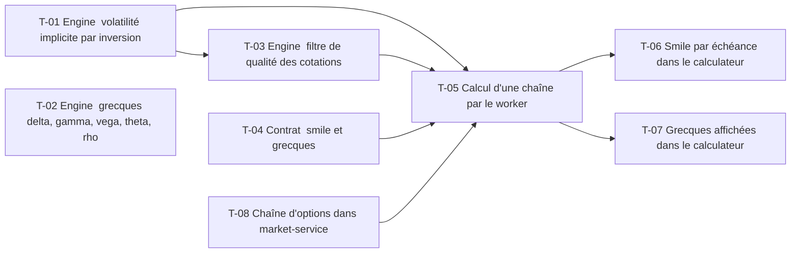

# 17 · Grecques, volatilité implicite et smile — Tâches

> Décisions : `US.md`. Échelle de points, statuts et définition de terminé commune : [`roadmap/README.md`](../README.md). Points prévus.

## Synthèse

| Tâche | Titre | US | Couche | Priorité | Points | Dépend de | Commits |
| --- | --- | --- | --- | --- | --- | --- | --- |
| T-01 | Engine : volatilité implicite par inversion | US-01 | backtest-engine | MUST | 5 | — | — |
| T-02 | Engine : grecques delta, gamma, vega, theta, rho | US-02 | backtest-engine | MUST | 3 | — | — |
| T-03 | Engine : filtre de qualité des cotations | US-01 | backtest-engine | MUST | 2 | T-01 | — |
| T-04 | Contrat : smile et grecques | US-02, US-03 | contracts | MUST | 2 | — | — |
| T-05 | Calcul d'une chaîne par le worker | US-01, US-03 | core-backend | MUST | 5 | T-01, T-03, T-04, T-08 | — |
| T-06 | Smile par échéance dans le calculateur | US-03 | web | SHOULD | 5 | T-05 | — |
| T-07 | Grecques affichées dans le calculateur | US-02 | web | MUST | 2 | T-05 | — |
| T-08 | Chaîne d'options dans market-service | US-01 | market-service | MUST | 3 | — | — |

**Total** : 27 points — MUST 22, SHOULD 5.

| Lot | Tâches | Points |
| --- | --- | --- |
| 1. Moteur | T-01 → T-03 | 10 |
| Données | T-08 | 3 |
| 2. Contrat | T-04 | 2 |
| 3. Service | T-05 | 5 |
| 4. Écrans | T-06 → T-07 | 7 |

**Chemin critique** (17 points) : T-01 → T-03 → T-05 → T-06. T-01 : l'inversion peut diverger sur des prix proches des bornes ; les cas limites doivent être testés avant la chaîne complète.

**Parallélisable** : T-01, T-02, T-04, T-08 dès le début ; T-03 après T-01 ; T-06 et T-07 après T-05.

## Graphe des dépendances

---

## Lot 1 — Moteur

### T-01 · Engine : volatilité implicite par inversion

- **US** : US-01 · **Priorité** : MUST · **Points** : 5 · **Dépend de** : — · **Commits** : —
- **Fichiers** : `apps/backtest-engine/engine/options.ts` (`impliedVolatility`), tests

Critères d’acceptation :
- [ ] Bisection entre 1 % et 300 %, tolérance 1e-6 sur le prix.
- [ ] Aller-retour : IV(prix(σ)) = σ à 1e-6 près (test).
- [ ] Prix hors bornes d'arbitrage : erreur explicite, pas de valeur inventée.

### T-02 · Engine : grecques delta, gamma, vega, theta, rho

- **US** : US-02 · **Priorité** : MUST · **Points** : 3 · **Dépend de** : — · **Commits** : —
- **Fichiers** : `apps/backtest-engine/engine/options.ts`

Critères d’acceptation :
- [ ] Formules fermées ; unités documentées (vega pour 1 point de volatilité, theta par jour).
- [ ] Test contre différences finies (écart < 1e-4).

### T-03 · Engine : filtre de qualité des cotations

- **US** : US-01 · **Priorité** : MUST · **Points** : 2 · **Dépend de** : T-01 · **Commits** : —
- **Fichiers** : `apps/backtest-engine/engine/options.ts`

Critères d’acceptation :
- [ ] Écarte : prix nul, bid et ask nuls, IV hors [1 %, 300 %].
- [ ] Le nombre de contrats écartés est renvoyé avec le résultat (D2).

## Lot 2 — Contrat

### T-04 · Contrat : smile et grecques

- **US** : US-02, US-03 · **Priorité** : MUST · **Points** : 2 · **Dépend de** : — · **Commits** : —
- **Fichiers** : `packages/contracts/src/pricing.ts`

Critères d’acceptation :
- [ ] Un point de smile : strike, IV, nombre de contrats retenus.
- [ ] Grecques documentées en unité.

## Lot 3 — Service

### T-05 · Calcul d'une chaîne par le worker

- **US** : US-01, US-03 · **Priorité** : MUST · **Points** : 5 · **Dépend de** : T-01, T-03, T-04 · **Commits** : —
- **Fichiers** : `apps/core-backend/services/pricing.service.ts`, `prisma/schema.prisma`

Critères d’acceptation :
- [ ] Une demande calcule IV, grecques et smile pour une échéance.
- [ ] Résultat stocké avec le nombre de contrats écartés.

## Lot 4 — Écrans

### T-08 · Chaîne d'options dans market-service

- **US** : US-01 · **Priorité** : MUST · **Points** : 3 · **Dépend de** : — · **Commits** : —
- **Fichiers** : `apps/market-service/routes/market/`, `repositories/market.repository.ts`, `API.md`

Critères d’acceptation :
- [ ] `GET /api/market/options/:symbol?expiration=` renvoie strikes, bid, ask, dernier prix, volume et volatilité Yahoo, à titre indicatif (le filtre de qualité est en T-03).
- [ ] Dates d'échéance à la forme `YYYY-MM-DD`.

### T-06 · Smile par échéance dans le calculateur

- **US** : US-03 · **Priorité** : SHOULD · **Points** : 5 · **Dépend de** : T-05 · **Commits** : —
- **Fichiers** : `apps/web/src/features/pricing/`

Critères d’acceptation :
- [ ] Courbe IV par strike, une par échéance, telle que reçue.

### T-07 · Grecques affichées dans le calculateur

- **US** : US-02 · **Priorité** : MUST · **Points** : 2 · **Dépend de** : T-05 · **Commits** : —
- **Fichiers** : `apps/web/src/features/pricing/`

Critères d’acceptation :
- [ ] Delta, gamma, vega, theta, rho affichés avec leur unité.
