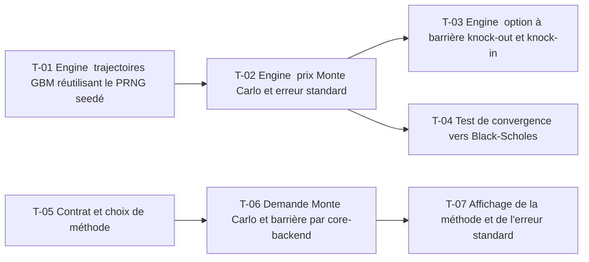

# 18 · Pricing Monte Carlo et option à barrière — Tâches

> Décisions : `US.md`. Échelle de points, statuts et définition de terminé commune : [`roadmap/README.md`](../README.md). Points prévus.

## Synthèse

| Tâche | Titre | US | Couche | Priorité | Points | Dépend de | Commits |
| --- | --- | --- | --- | --- | --- | --- | --- |
| T-01 | Engine : trajectoires GBM réutilisant le PRNG seedé | US-01 | backtest-engine | MUST | 5 | — | — |
| T-02 | Engine : prix Monte Carlo et erreur standard | US-01 | backtest-engine | MUST | 3 | T-01 | — |
| T-03 | Engine : option à barrière (knock-out et knock-in) | US-02 | backtest-engine | MUST | 5 | T-02 | — |
| T-04 | Test de convergence vers Black-Scholes | US-01 | backtest-engine | MUST | 2 | T-02 | — |
| T-05 | Contrat et choix de méthode | US-01, US-02 | contracts | MUST | 2 | — | — |
| T-06 | Demande Monte Carlo et barrière par core-backend | US-01, US-02 | core-backend | MUST | 2 | T-05 | — |
| T-07 | Affichage de la méthode et de l'erreur standard | US-01 | web | SHOULD | 3 | T-06 | — |

**Total** : 22 points — MUST 19, SHOULD 3.

| Lot | Tâches | Points |
| --- | --- | --- |
| 1. Moteur | T-01 → T-04 | 15 |
| 2. Contrat | T-05 | 2 |
| 3. Service | T-06 | 2 |
| 4. Écrans | T-07 | 3 |

**Chemin critique** (13 points) : T-01 → T-02 → T-03. T-03 : la barrière surveillée jour par jour doit être testée par la parité knock-out + knock-in avant tout affichage.

**Parallélisable** : T-01, T-05 dès le début ; T-01, T-05 dès le début ; T-07 après T-06.

## Graphe des dépendances

---

## Lot 1 — Moteur

### T-01 · Engine : trajectoires GBM réutilisant le PRNG seedé

- **US** : US-01 · **Priorité** : MUST · **Points** : 5 · **Dépend de** : — · **Commits** : —
- **Fichiers** : `apps/backtest-engine/engine/pricing-mc.ts`, tests

Critères d’acceptation :
- [ ] Trajectoires géométriques browniennes sous la mesure neutre au risque (dérive r − q).
- [ ] Même seed : mêmes trajectoires (réutilise le PRNG de 14 T-01).

### T-02 · Engine : prix Monte Carlo et erreur standard

- **US** : US-01 · **Priorité** : MUST · **Points** : 3 · **Dépend de** : T-01 · **Commits** : —
- **Fichiers** : `apps/backtest-engine/engine/pricing-mc.ts`

Critères d’acceptation :
- [ ] Prix = moyenne actualisée des payoffs ; erreur standard renvoyée avec le prix.

### T-03 · Engine : option à barrière (knock-out et knock-in)

- **US** : US-02 · **Priorité** : MUST · **Points** : 5 · **Dépend de** : T-02 · **Commits** : —
- **Fichiers** : `apps/backtest-engine/engine/pricing-mc.ts`

Critères d’acceptation :
- [ ] Surveillance quotidienne de la barrière (D2).
- [ ] Knock-out : payoff nul si la barrière est touchée ; knock-in : l'inverse.
- [ ] Test : knock-out + knock-in = option vanille.

### T-04 · Test de convergence vers Black-Scholes

- **US** : US-01 · **Priorité** : MUST · **Points** : 2 · **Dépend de** : T-02 · **Commits** : —
- **Fichiers** : `apps/backtest-engine/engine/pricing-mc.test.ts`

Critères d’acceptation :
- [ ] Sur une option européenne, |prix MC − BS| < 3 erreurs standard (D3).

## Lot 2 — Contrat

### T-05 · Contrat et choix de méthode

- **US** : US-01, US-02 · **Priorité** : MUST · **Points** : 2 · **Dépend de** : — · **Commits** : —
- **Fichiers** : `packages/contracts/src/pricing.ts`

Critères d’acceptation :
- [ ] Champ `method` : `BLACK_SCHOLES` ou `MONTE_CARLO`, ajout sans rupture.

## Lot 3 — Service

### T-06 · Demande Monte Carlo et barrière par core-backend

- **US** : US-01, US-02 · **Priorité** : MUST · **Points** : 2 · **Dépend de** : T-05 · **Commits** : —
- **Fichiers** : `apps/core-backend/services/pricing.service.ts`

Critères d’acceptation :
- [ ] Validation zod ; seed et nombre de trajectoires absents de l'API (valeurs fixes).

## Lot 4 — Écrans

### T-07 · Affichage de la méthode et de l'erreur standard

- **US** : US-01 · **Priorité** : SHOULD · **Points** : 3 · **Dépend de** : T-06 · **Commits** : —
- **Fichiers** : `apps/web/src/features/pricing/`

Critères d’acceptation :
- [ ] Méthode et erreur standard affichées telles que reçues.
