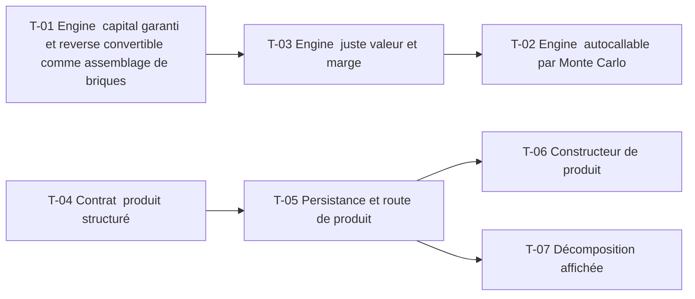

# 19 · Produits structurés : décomposition, juste valeur, marge — Tâches

> Décisions : `US.md`. Échelle de points, statuts et définition de terminé commune : [`roadmap/README.md`](../README.md). Points prévus.

## Synthèse

| Tâche | Titre | US | Couche | Priorité | Points | Dépend de | Commits |
| --- | --- | --- | --- | --- | --- | --- | --- |
| T-01 | Engine : capital garanti et reverse convertible comme assemblage de briques | US-01, US-02 | backtest-engine | MUST | 5 | — | — |
| T-02 | Engine : autocallable par Monte Carlo | US-03 | backtest-engine | MUST | 5 | T-03 | — |
| T-03 | Engine : juste valeur et marge | US-02, US-03 | backtest-engine | MUST | 3 | T-01 | — |
| T-04 | Contrat : produit structuré | US-01, US-02, US-03 | contracts | MUST | 3 | — | — |
| T-05 | Persistance et route de produit | US-01, US-02, US-03 | core-backend | MUST | 5 | T-04 | — |
| T-06 | Constructeur de produit | US-01, US-02 | web | MUST | 5 | T-05 | — |
| T-07 | Décomposition affichée | US-01 | web | MUST | 3 | T-05 | — |

**Total** : 29 points — MUST 29, SHOULD 0.

| Lot | Tâches | Points |
| --- | --- | --- |
| 1. Moteur | T-01 → T-03 | 13 |
| 2. Contrat | T-04 | 3 |
| 3. Service | T-05 | 5 |
| 4. Écrans | T-06 → T-07 | 8 |

**Chemin critique** (13 points) : T-01 → T-03 → T-02. T-02 : l'autocallable est la tâche la plus lourde en tests ; elle doit reproduire un cas à remboursement certain (test de bord).

**Parallélisable** : T-01, T-04 dès le début ; T-01, T-04 dès le début ; T-06 et T-07 après T-05.

## Graphe des dépendances

---

## Lot 1 — Moteur

### T-01 · Engine : capital garanti et reverse convertible comme assemblage de briques

- **US** : US-01, US-02 · **Priorité** : MUST · **Points** : 5 · **Dépend de** : — · **Commits** : —
- **Fichiers** : `apps/backtest-engine/engine/structured.ts`, tests

Critères d’acceptation :
- [ ] Capital garanti = zéro-coupon (15) + call (16) ; participation = (100 − zéro-coupon) / prix du call.
- [ ] Reverse convertible = obligation + vente de put : le coupon couvre la prime.
- [ ] Test : la somme des briques égale le prix du produit.

### T-02 · Engine : autocallable par Monte Carlo

- **US** : US-03 · **Priorité** : MUST · **Points** : 5 · **Dépend de** : T-03 · **Commits** : —
- **Fichiers** : `apps/backtest-engine/engine/structured-mc.ts`

Critères d’acceptation :
- [ ] Dates d'observation, barrière de remboursement anticipé, coupon et barrière de capital.
- [ ] Chaque trajectoire donne le flux ; prix = moyenne actualisée.

### T-03 · Engine : juste valeur et marge

- **US** : US-02, US-03 · **Priorité** : MUST · **Points** : 3 · **Dépend de** : T-01 · **Commits** : —
- **Fichiers** : `apps/backtest-engine/engine/structured.ts`

Critères d’acceptation :
- [ ] Marge = prix client − juste valeur, en devise et en pourcentage du prix client (D4).
- [ ] Le calcul vit ici, pas dans le web.

## Lot 2 — Contrat

### T-04 · Contrat : produit structuré

- **US** : US-01, US-02, US-03 · **Priorité** : MUST · **Points** : 3 · **Dépend de** : — · **Commits** : —
- **Fichiers** : `packages/contracts/src/structured.ts`

Critères d’acceptation :
- [ ] Type de produit (`CAPITAL_GUARANTEED`, `REVERSE_CONVERTIBLE`, `AUTOCALLABLE`), paramètres, sortie décomposée.

## Lot 3 — Service

### T-05 · Persistance et route de produit

- **US** : US-01, US-02, US-03 · **Priorité** : MUST · **Points** : 5 · **Dépend de** : T-04 · **Commits** : —
- **Fichiers** : `apps/core-backend/services/structured.service.ts`, `prisma/schema.prisma`, `routes/structured/`

Critères d’acceptation :
- [ ] Création et lecture d'un produit ; résultat décomposé stocké.
- [ ] Migration additive.

## Lot 4 — Écrans

### T-06 · Constructeur de produit

- **US** : US-01, US-02 · **Priorité** : MUST · **Points** : 5 · **Dépend de** : T-05 · **Commits** : —
- **Fichiers** : `apps/web/src/features/structured/` (nouveau)

Critères d’acceptation :
- [ ] Formulaire : type, maturité, sous-jacent, prix client.
- [ ] La participation et la marge sont celles reçues du backend, jamais calculées ici.

### T-07 · Décomposition affichée

- **US** : US-01 · **Priorité** : MUST · **Points** : 3 · **Dépend de** : T-05 · **Commits** : —
- **Fichiers** : `apps/web/src/features/structured/`

Critères d’acceptation :
- [ ] Deux lignes : obligation et option, avec leur valeur reçue et une phrase d'explication (glossaire).
