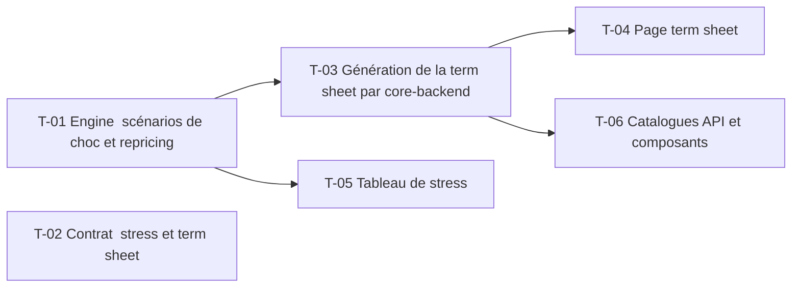

# 20 · Stress de produit et term sheet — Tâches

> Décisions : `US.md`. Échelle de points, statuts et définition de terminé commune : [`roadmap/README.md`](../README.md). Points prévus.

## Synthèse

| Tâche | Titre | US | Couche | Priorité | Points | Dépend de | Commits |
| --- | --- | --- | --- | --- | --- | --- | --- |
| T-01 | Engine : scénarios de choc et repricing | US-01 | backtest-engine | MUST | 5 | — | — |
| T-02 | Contrat : stress et term sheet | US-01, US-02 | contracts | MUST | 2 | — | — |
| T-03 | Génération de la term sheet par core-backend | US-02 | core-backend | MUST | 5 | T-01 | — |
| T-04 | Page term sheet | US-02 | web | MUST | 3 | T-03 | — |
| T-05 | Tableau de stress | US-01 | web | SHOULD | 3 | T-01 | — |
| T-06 | Catalogues API et composants | US-01 | docs | SHOULD | 1 | T-03 | — |

**Total** : 19 points — MUST 15, SHOULD 4.

| Lot | Tâches | Points |
| --- | --- | --- |
| 1. Moteur | T-01 | 5 |
| 2. Contrat | T-02 | 2 |
| 3. Service | T-03 | 5 |
| 4. Écrans | T-04 → T-06 | 7 |

**Chemin critique** (13 points) : T-01 → T-03 → T-04. T-03 : la fiche agrège plusieurs sources ; le contrat (T-02) doit être figé avant.

**Parallélisable** : T-01, T-02 dès le début ; T-01, T-02 dès le début ; T-04 et T-05 après T-03 et T-01.

## Graphe des dépendances

---

## Lot 1 — Moteur

### T-01 · Engine : scénarios de choc et repricing

- **US** : US-01 · **Priorité** : MUST · **Points** : 5 · **Dépend de** : — · **Commits** : —
- **Fichiers** : `apps/backtest-engine/engine/stress.ts`, tests

Critères d’acceptation :
- [ ] Quatre scénarios fixes (D1, D4) : sous-jacent −20 %, volatilité +10 points, taux −1 point, taux +1 point.
- [ ] Le produit est repricé dans chaque scénario ; la variation est renvoyée.

## Lot 2 — Contrat

### T-02 · Contrat : stress et term sheet

- **US** : US-01, US-02 · **Priorité** : MUST · **Points** : 2 · **Dépend de** : — · **Commits** : —
- **Fichiers** : `packages/contracts/src/structured.ts`

Critères d’acceptation :
- [ ] Scénarios, prix par scénario, fiche (paramètres, scénarios favorable / neutre / défavorable, risques).

## Lot 3 — Service

### T-03 · Génération de la term sheet par core-backend

- **US** : US-02 · **Priorité** : MUST · **Points** : 5 · **Dépend de** : T-01 · **Commits** : —
- **Fichiers** : `apps/core-backend/services/structured.service.ts`

Critères d’acceptation :
- [ ] La fiche est assemblée à partir des données du produit et des scénarios.
- [ ] Les trois scénarios de performance sont renvoyés (D5) : cours final +20 %, inchangé, −30 % à l'échéance, payoff en % du nominal.

## Lot 4 — Écrans

### T-04 · Page term sheet

- **US** : US-02 · **Priorité** : MUST · **Points** : 3 · **Dépend de** : T-03 · **Commits** : —
- **Fichiers** : `apps/web/src/features/structured/`

Critères d’acceptation :
- [ ] Fiche lisible, avec titres et unités telles que reçues.

### T-05 · Tableau de stress

- **US** : US-01 · **Priorité** : SHOULD · **Points** : 3 · **Dépend de** : T-01 · **Commits** : —
- **Fichiers** : `apps/web/src/features/structured/`

Critères d’acceptation :
- [ ] Une ligne par scénario : prix, variation en devise et en %.

### T-06 · Catalogues API et composants

- **US** : US-01 · **Priorité** : SHOULD · **Points** : 1 · **Dépend de** : T-03 · **Commits** : —
- **Fichiers** : `apps/core-backend/API.md`, `apps/web/COMPONENTS.md`

Critères d’acceptation :
- [ ] Routes et composants documentés.
