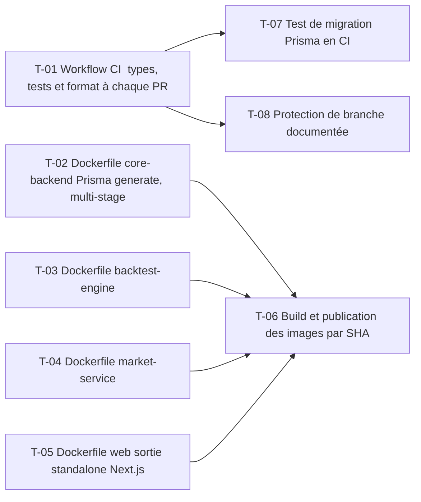

# 21 · Pipeline CI/CD et images — Tâches

> Décisions : `US.md`. Échelle de points, statuts et définition de terminé commune : [`roadmap/README.md`](../README.md). Points prévus.

## Synthèse

| Tâche | Titre | US | Couche | Priorité | Points | Dépend de | Commits |
| --- | --- | --- | --- | --- | --- | --- | --- |
| T-01 | Workflow CI : types, tests et format à chaque PR | US-01 | infra | MUST | 3 | — | — |
| T-02 | Dockerfile core-backend (Prisma generate, multi-stage) | US-02 | infra | MUST | 5 | — | — |
| T-03 | Dockerfile backtest-engine | US-02 | infra | MUST | 3 | — | — |
| T-04 | Dockerfile market-service | US-02 | infra | MUST | 3 | — | — |
| T-05 | Dockerfile web (sortie standalone Next.js) | US-02 | infra | MUST | 5 | — | — |
| T-06 | Build et publication des images par SHA | US-02 | infra | MUST | 3 | T-02, T-03, T-04, T-05 | — |
| T-07 | Test de migration Prisma en CI | US-01 | infra | SHOULD | 3 | T-01 | — |
| T-08 | Protection de branche documentée | US-03 | docs | SHOULD | 1 | T-01 | — |

**Total** : 26 points — MUST 22, SHOULD 4.

| Lot | Tâches | Points |
| --- | --- | --- |
| 1. CI | T-01 → T-08 | 7 |
| 2. Images | T-02 → T-06 | 19 |

**Chemin critique** (8 points) : T-05 → T-06. T-06 : le build de l'image web est le plus long et casse souvent à cause de Prisma ; il faut le tester sur une branche avant la fusion.

**Parallélisable** : T-01, T-02, T-03, T-04, T-05 dès le début ; T-01 à T-05 dès le début ; T-06 après les quatre Dockerfiles ; T-07 et T-08 après T-01.

## Graphe des dépendances

---

## Lot 1 — CI

### T-01 · Workflow CI : types, tests et format à chaque PR

- **US** : US-01 · **Priorité** : MUST · **Points** : 3 · **Dépend de** : — · **Commits** : —
- **Fichiers** : `.github/workflows/ci.yml`

Critères d’acceptation :
- [ ] `bunx tsc --noEmit` dans chaque app et package touché.
- [ ] `bun test` dans `apps/backtest-engine`, `bun run lint` et `format:check` dans `apps/web`.
- [ ] Un échec bloque la PR.

### T-07 · Test de migration Prisma en CI

- **US** : US-01 · **Priorité** : SHOULD · **Points** : 3 · **Dépend de** : T-01 · **Commits** : —
- **Fichiers** : `.github/workflows/ci.yml`

Critères d’acceptation :
- [ ] Une base PostgreSQL éphémère reçoit `prisma migrate deploy` à chaque PR.
- [ ] Une migration cassée fait échouer la CI.

### T-08 · Protection de branche documentée

- **US** : US-03 · **Priorité** : SHOULD · **Points** : 1 · **Dépend de** : T-01 · **Commits** : —
- **Fichiers** : `roadmap/21-cicd-et-images/README.md`

Critères d’acceptation :
- [ ] Les checks requis sont listés ; le réglage GitHub est fait par l'utilisateur.

## Lot 2 — Images

### T-02 · Dockerfile core-backend (Prisma generate, multi-stage)

- **US** : US-02 · **Priorité** : MUST · **Points** : 5 · **Dépend de** : — · **Commits** : —
- **Fichiers** : `apps/core-backend/Dockerfile`, `.dockerignore`

Critères d’acceptation :
- [ ] L'image démarre et répond sur le port 8000.
- [ ] Aucun `.env` ni secret dans l'image (vérifié par test).

### T-03 · Dockerfile backtest-engine

- **US** : US-02 · **Priorité** : MUST · **Points** : 3 · **Dépend de** : — · **Commits** : —
- **Fichiers** : `apps/backtest-engine/Dockerfile`

Critères d’acceptation :
- [ ] Le worker démarre et se connecte à Kafka via variables d'environnement.

### T-04 · Dockerfile market-service

- **US** : US-02 · **Priorité** : MUST · **Points** : 3 · **Dépend de** : — · **Commits** : —
- **Fichiers** : `apps/market-service/Dockerfile`

Critères d’acceptation :
- [ ] Le service répond sur le port 8001.

### T-05 · Dockerfile web (sortie standalone Next.js)

- **US** : US-02 · **Priorité** : MUST · **Points** : 5 · **Dépend de** : — · **Commits** : —
- **Fichiers** : `apps/web/Dockerfile`, `apps/web/next.config.ts`

Critères d’acceptation :
- [ ] `output: 'standalone'` activé ; l'image démarre sans `node_modules` complet.

### T-06 · Build et publication des images par SHA

- **US** : US-02 · **Priorité** : MUST · **Points** : 3 · **Dépend de** : T-02, T-03, T-04, T-05 · **Commits** : —
- **Fichiers** : `.github/workflows/images.yml`

Critères d’acceptation :
- [ ] Chaque commit sur `main` publie les 4 images taggées par SHA sur le registre de conteneurs.
- [ ] Aucun secret dans le dépôt : identifiants via secrets GitHub.
