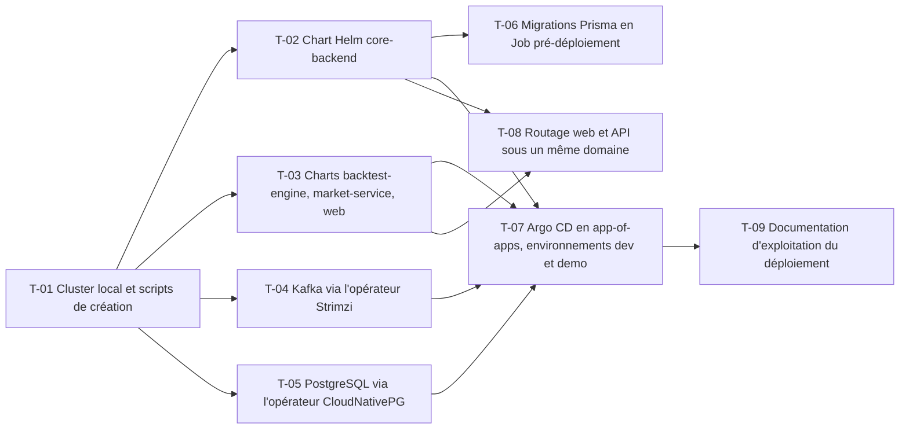

# 22 · Kubernetes, Helm et Argo CD — Tâches

> Décisions : `US.md`. Échelle de points, statuts et définition de terminé commune : [`roadmap/README.md`](../README.md). Points prévus.

## Synthèse

| Tâche | Titre | US | Couche | Priorité | Points | Dépend de | Commits |
| --- | --- | --- | --- | --- | --- | --- | --- |
| T-01 | Cluster local et scripts de création | US-01 | infra | MUST | 3 | — | — |
| T-02 | Chart Helm core-backend | US-01 | infra | MUST | 5 | T-01 | — |
| T-03 | Charts backtest-engine, market-service, web | US-01 | infra | MUST | 5 | T-01 | — |
| T-04 | Kafka via l'opérateur Strimzi | US-01 | infra | MUST | 5 | T-01 | — |
| T-05 | PostgreSQL via l'opérateur CloudNativePG | US-01 | infra | MUST | 3 | T-01 | — |
| T-06 | Migrations Prisma en Job pré-déploiement | US-01 | infra | MUST | 3 | T-02 | — |
| T-07 | Argo CD en app-of-apps, environnements dev et demo | US-02, US-03 | infra | MUST | 5 | T-02, T-03, T-04, T-05 | — |
| T-08 | Routage web et API sous un même domaine | US-01 | infra | SHOULD | 3 | T-02, T-03 | — |
| T-09 | Documentation d'exploitation du déploiement | US-01 | docs | SHOULD | 2 | T-07 | — |

**Total** : 34 points — MUST 29, SHOULD 5.

| Lot | Tâches | Points |
| --- | --- | --- |
| 1. Cluster | T-01 | 3 |
| 2. Chart | T-02 → T-09 | 18 |
| 3. Données | T-04 → T-05 | 8 |
| 4. GitOps | T-07 | 5 |

**Chemin critique** (15 points) : T-01 → T-04 → T-07 → T-09. T-04 et T-05 : les opérateurs ont leurs propres versions de CRD ; épingler les versions dans le dépôt.

**Parallélisable** : T-01 dès le début ; T-01 d'abord ; T-02 à T-05 ensuite en parallèle ; T-07 après les charts.

## Graphe des dépendances

---

## Lot 1 — Cluster

### T-01 · Cluster local et scripts de création

- **US** : US-01 · **Priorité** : MUST · **Points** : 3 · **Dépend de** : — · **Commits** : —
- **Fichiers** : `deploy/scripts/cluster-up.sh`, `deploy/README.md`

Critères d’acceptation :
- [ ] Un cluster kind se crée et se détruit par une commande documentée.

## Lot 2 — Chart

### T-02 · Chart Helm core-backend

- **US** : US-01 · **Priorité** : MUST · **Points** : 5 · **Dépend de** : T-01 · **Commits** : —
- **Fichiers** : `deploy/charts/core-backend/`

Critères d’acceptation :
- [ ] Deployment, Service, ConfigMap ; secrets référencés, jamais en clair.
- [ ] `helm lint` passe.

### T-03 · Charts backtest-engine, market-service, web

- **US** : US-01 · **Priorité** : MUST · **Points** : 5 · **Dépend de** : T-01 · **Commits** : —
- **Fichiers** : `deploy/charts/backtest-engine/`, `market-service/`, `web/`

Critères d’acceptation :
- [ ] Un chart par service, même structure que T-02.
- [ ] Probes readiness et liveness sur chaque service.

### T-06 · Migrations Prisma en Job pré-déploiement

- **US** : US-01 · **Priorité** : MUST · **Points** : 3 · **Dépend de** : T-02 · **Commits** : —
- **Fichiers** : `deploy/charts/core-backend/templates/migrate-job.yaml`

Critères d’acceptation :
- [ ] La migration s'exécute avant le démarrage de l'API ; un échec bloque le déploiement.

### T-08 · Routage web et API sous un même domaine

- **US** : US-01 · **Priorité** : SHOULD · **Points** : 3 · **Dépend de** : T-02, T-03 · **Commits** : —
- **Fichiers** : `deploy/charts/web/templates/ingress.yaml`

Critères d’acceptation :
- [ ] `/api/*` vers core-backend, le reste vers web.

### T-09 · Documentation d'exploitation du déploiement

- **US** : US-01 · **Priorité** : SHOULD · **Points** : 2 · **Dépend de** : T-07 · **Commits** : —
- **Fichiers** : `deploy/README.md`

Critères d’acceptation :
- [ ] Installer, mettre à jour, revenir en arrière : une page chacun.

## Lot 3 — Données

### T-04 · Kafka via l'opérateur Strimzi

- **US** : US-01 · **Priorité** : MUST · **Points** : 5 · **Dépend de** : T-01 · **Commits** : —
- **Fichiers** : `deploy/charts/kafka/`

Critères d’acceptation :
- [ ] Un broker KRaft, topics `backtest.*` créés par manifeste.
- [ ] Le worker consomme depuis le cluster.

### T-05 · PostgreSQL via l'opérateur CloudNativePG

- **US** : US-01 · **Priorité** : MUST · **Points** : 3 · **Dépend de** : T-01 · **Commits** : —
- **Fichiers** : `deploy/charts/postgres/`

Critères d’acceptation :
- [ ] Une instance par base, identifiants générés par l'opérateur.

## Lot 4 — GitOps

### T-07 · Argo CD en app-of-apps, environnements dev et demo

- **US** : US-02, US-03 · **Priorité** : MUST · **Points** : 5 · **Dépend de** : T-02, T-03, T-04, T-05 · **Commits** : —
- **Fichiers** : `deploy/argocd/`

Critères d’acceptation :
- [ ] Une modification de `deploy/` sur `main` se déploie sans commande manuelle.
- [ ] Les environnements `dev` et `demo` ont des valeurs séparées.
