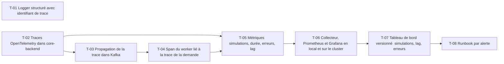

# 23 · Observabilité : OpenTelemetry, traces, runbooks — Tâches

> Décisions : `US.md`. Échelle de points, statuts et définition de terminé commune : [`roadmap/README.md`](../README.md). Points prévus.

## Synthèse

| Tâche | Titre | US | Couche | Priorité | Points | Dépend de | Commits |
| --- | --- | --- | --- | --- | --- | --- | --- |
| T-01 | Logger structuré avec identifiant de trace | US-01 | packages/utils | MUST | 3 | — | — |
| T-02 | Traces OpenTelemetry dans core-backend | US-01 | core-backend | MUST | 5 | — | — |
| T-03 | Propagation de la trace dans Kafka | US-01 | packages/kafka | MUST | 5 | T-02 | — |
| T-04 | Span du worker lié à la trace de la demande | US-01 | backtest-engine | MUST | 3 | T-03 | — |
| T-05 | Métriques : simulations, durée, erreurs, lag | US-02 | core-backend | MUST | 5 | T-02, T-04 | — |
| T-06 | Collecteur, Prometheus et Grafana en local et sur le cluster | US-02 | infra | MUST | 3 | T-05 | — |
| T-07 | Tableau de bord versionné : simulations, lag, erreurs | US-02 | infra | MUST | 3 | T-06 | — |
| T-08 | Runbook par alerte | US-03 | docs | SHOULD | 2 | T-07 | — |

**Total** : 29 points — MUST 27, SHOULD 2.

| Lot | Tâches | Points |
| --- | --- | --- |
| 1. Logs | T-01 | 3 |
| 2. Traces | T-02 → T-04 | 13 |
| 3. Métriques | T-05 → T-08 | 13 |

**Chemin critique** (26 points) : T-02 → T-03 → T-04 → T-05 → T-06 → T-07 → T-08. T-03 : modifier les headers Kafka touche tous les consumers ; le test de non-régression sur l'enveloppe doit passer avant.

**Parallélisable** : T-01, T-02 dès le début ; T-01 et T-02 dès le début ; T-03 après T-02 ; T-06 et T-07 après T-05.

## Graphe des dépendances

---

## Lot 1 — Logs

### T-01 · Logger structuré avec identifiant de trace

- **US** : US-01 · **Priorité** : MUST · **Points** : 3 · **Dépend de** : — · **Commits** : —
- **Fichiers** : `packages/utils/src/logger.ts`

Critères d’acceptation :
- [ ] Chaque ligne de log porte `traceId` et, si présent, `executionId`.
- [ ] Format JSON en production, lisible en développement.

## Lot 2 — Traces

### T-02 · Traces OpenTelemetry dans core-backend

- **US** : US-01 · **Priorité** : MUST · **Points** : 5 · **Dépend de** : — · **Commits** : —
- **Fichiers** : `apps/core-backend/lib/telemetry.ts`, `index.ts`

Critères d’acceptation :
- [ ] Chaque requête HTTP produit un span ; export OTLP vers un collecteur.

### T-03 · Propagation de la trace dans Kafka

- **US** : US-01 · **Priorité** : MUST · **Points** : 5 · **Dépend de** : T-02 · **Commits** : —
- **Fichiers** : `packages/kafka/src/*`

Critères d’acceptation :
- [ ] Le contexte de trace part dans les headers du message.
- [ ] `createKafkaEvent` ne change pas de forme (enveloppe inchangée).

### T-04 · Span du worker lié à la trace de la demande

- **US** : US-01 · **Priorité** : MUST · **Points** : 3 · **Dépend de** : T-03 · **Commits** : —
- **Fichiers** : `apps/backtest-engine/consumers/backtest.consumer.ts`

Critères d’acceptation :
- [ ] Le traitement d'un `backtest.requested` apparaît dans la même trace que la requête HTTP.

## Lot 3 — Métriques

### T-05 · Métriques : simulations, durée, erreurs, lag

- **US** : US-02 · **Priorité** : MUST · **Points** : 5 · **Dépend de** : T-02, T-04 · **Commits** : —
- **Fichiers** : `apps/core-backend/lib/metrics.ts`, `apps/backtest-engine/`

Critères d’acceptation :
- [ ] Compteurs par statut, histogramme de durée, lag de consumer exposés en Prometheus.

### T-06 · Collecteur, Prometheus et Grafana en local et sur le cluster

- **US** : US-02 · **Priorité** : MUST · **Points** : 3 · **Dépend de** : T-05 · **Commits** : —
- **Fichiers** : `docker-compose.yml`, `deploy/charts/observability/`

Critères d’acceptation :
- [ ] Les métriques et traces arrivent dans Grafana en local et sur kind.

### T-07 · Tableau de bord versionné : simulations, lag, erreurs

- **US** : US-02 · **Priorité** : MUST · **Points** : 3 · **Dépend de** : T-06 · **Commits** : —
- **Fichiers** : `deploy/dashboards/azimut.json`

Critères d’acceptation :
- [ ] Trois panneaux : simulations par statut, lag, erreurs ; le JSON est dans le dépôt.

### T-08 · Runbook par alerte

- **US** : US-03 · **Priorité** : SHOULD · **Points** : 2 · **Dépend de** : T-07 · **Commits** : —
- **Fichiers** : `deploy/runbooks/`

Critères d’acceptation :
- [ ] Une page par alerte : symptôme, cause probable, action.
