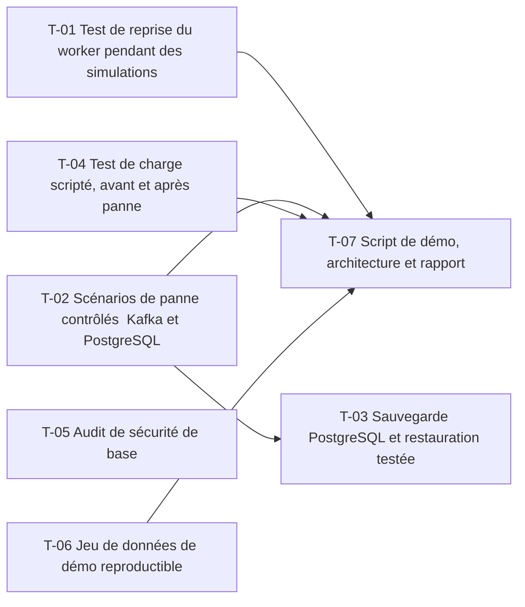

# 24 · Résilience et soutenance — Tâches

> Décisions : `US.md`. Échelle de points, statuts et définition de terminé commune : [`roadmap/README.md`](../README.md). Points prévus.

## Synthèse

| Tâche | Titre | US | Couche | Priorité | Points | Dépend de | Commits |
| --- | --- | --- | --- | --- | --- | --- | --- |
| T-01 | Test de reprise du worker pendant des simulations | US-01 | backtest-engine | MUST | 5 | — | — |
| T-02 | Scénarios de panne contrôlés : Kafka et PostgreSQL | US-01 | infra | MUST | 5 | — | — |
| T-03 | Sauvegarde PostgreSQL et restauration testée | US-02 | infra | MUST | 5 | T-02 | — |
| T-04 | Test de charge scripté, avant et après panne | US-01 | infra | MUST | 3 | — | — |
| T-05 | Audit de sécurité de base | US-04 | docs | SHOULD | 3 | — | — |
| T-06 | Jeu de données de démo reproductible | US-03 | core-backend | MUST | 3 | — | — |
| T-07 | Script de démo, architecture et rapport | US-03 | docs | MUST | 3 | T-01, T-02, T-04, T-06 | — |

**Total** : 27 points — MUST 24, SHOULD 3.

| Lot | Tâches | Points |
| --- | --- | --- |
| 1. Résilience | T-01 → T-02 | 10 |
| 2. Données | T-03 | 5 |
| 3. Charge | T-04 | 3 |
| 4. Sécurité | T-05 | 3 |
| 5. Démo | T-06 → T-07 | 6 |

**Chemin critique** (10 points) : T-02 → T-03. T-02 : les pannes sur le cluster sont longues à répéter ; les noter dès le premier passage, pas à la répétition finale.

**Parallélisable** : T-01, T-02, T-04, T-05, T-06 dès le début ; T-01, T-02, T-04, T-06 dès le début ; T-03 après T-02 ; T-07 en dernier.

## Graphe des dépendances

---

## Lot 1 — Résilience

### T-01 · Test de reprise du worker pendant des simulations

- **US** : US-01 · **Priorité** : MUST · **Points** : 5 · **Dépend de** : — · **Commits** : —
- **Fichiers** : `apps/backtest-engine/tests/resilience/worker-restart.test.ts`

Critères d’acceptation :
- [ ] Worker arrêté pendant N backtests, redémarré : tous les résultats arrivent.
- [ ] Aucun double résultat (comptage en base).

### T-02 · Scénarios de panne contrôlés : Kafka et PostgreSQL

- **US** : US-01 · **Priorité** : MUST · **Points** : 5 · **Dépend de** : — · **Commits** : —
- **Fichiers** : `deploy/scripts/chaos/`

Critères d’acceptation :
- [ ] Arrêt de Kafka puis de PostgreSQL pendant une charge : comportement et délai de reprise mesurés et notés.

## Lot 2 — Données

### T-03 · Sauvegarde PostgreSQL et restauration testée

- **US** : US-02 · **Priorité** : MUST · **Points** : 5 · **Dépend de** : T-02 · **Commits** : —
- **Fichiers** : `deploy/charts/postgres/backup.yaml`, `deploy/scripts/restore.sh`

Critères d’acceptation :
- [ ] Sauvegarde quotidienne ; une restauration dans une base vide reproduit les données (test manuel documenté).

## Lot 3 — Charge

### T-04 · Test de charge scripté, avant et après panne

- **US** : US-01 · **Priorité** : MUST · **Points** : 3 · **Dépend de** : — · **Commits** : —
- **Fichiers** : `deploy/load/simulations.js` (k6)

Critères d’acceptation :
- [ ] Le même script s'exécute avant et après les pannes ; les écarts de latence sont rapportés.

## Lot 4 — Sécurité

### T-05 · Audit de sécurité de base

- **US** : US-04 · **Priorité** : SHOULD · **Points** : 3 · **Dépend de** : — · **Commits** : —
- **Fichiers** : `audit/` (fichier de résultats)

Critères d’acceptation :
- [ ] `bun audit` et un scan de secrets sans résultat bloquant non traité.
- [ ] Liste des points OWASP vérifiés, avec leur statut.

## Lot 5 — Démo

### T-06 · Jeu de données de démo reproductible

- **US** : US-03 · **Priorité** : MUST · **Points** : 3 · **Dépend de** : — · **Commits** : —
- **Fichiers** : `apps/core-backend/prisma/seed.ts`

Critères d’acceptation :
- [ ] Une commande crée le même jeu de données (seed fixe).

### T-07 · Script de démo, architecture et rapport

- **US** : US-03 · **Priorité** : MUST · **Points** : 3 · **Dépend de** : T-01, T-02, T-04, T-06 · **Commits** : —
- **Fichiers** : `docs/demo.md`, `docs/architecture.md`

Critères d’acceptation :
- [ ] Le script suit les 7 étapes du README ; un schéma d'architecture d'une page ; rapport rédigé.
